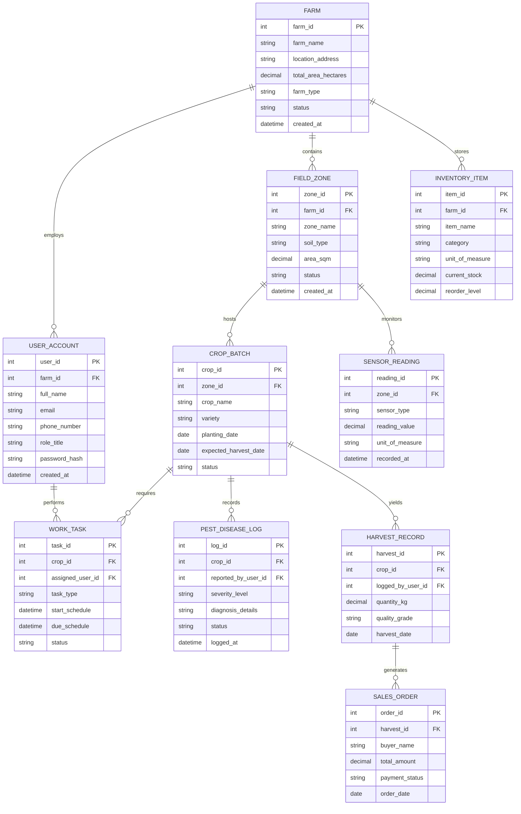

# Conceptual ERD — Farm Management System

## Mermaid Code

## Entity Description Table | Bang mo ta Entity

| # | Entity Name | Vietnamese Name | Description | Key Attributes | Main Relationships |
|---|-------------|-----------------|-------------|----------------|-------------------|
| 1 | FARM | Trang Trại | Represents the core agricultural enterprise entity including location and total land area | farm_id, farm_name, total_area_hectares, status | Has many USER_ACCOUNT, FIELD_ZONE, INVENTORY_ITEM |
| 2 | USER_ACCOUNT | Tài Khoản Nguời Dùng | Stores system credentials, contact info, and security role permissions for farm staff | user_id, farm_id, full_name, email, role_title | Belongs to FARM, performs WORK_TASK |
| 3 | FIELD_ZONE | Phân Khu Canh Tác | Geographical parcel of land within a farm designated for crop cultivation | zone_id, farm_id, zone_name, soil_type, area_sqm | Belongs to FARM, hosts CROP_BATCH, monitored by SENSOR_READING |
| 4 | CROP_BATCH | Lô Cây Trồng | Specific planted crop batch during a cultivation cycle with growth schedules | crop_id, zone_id, crop_name, variety, planting_date | Belongs to FIELD_ZONE, has WORK_TASK, PEST_DISEASE_LOG, HARVEST_RECORD |
| 5 | WORK_TASK | Công Việc Đồng Ruộng | Scheduled operational duty assigned to field staff for crop management | task_id, crop_id, assigned_user_id, task_type, status | Belongs to CROP_BATCH, assigned to USER_ACCOUNT |
| 6 | SENSOR_READING | Dữ Liệu Cảm Biến | Automated telemetry measurement recorded by IoT hardware in field zones | reading_id, zone_id, sensor_type, reading_value, recorded_at | Belongs to FIELD_ZONE |
| 7 | PEST_DISEASE_LOG | Nhật Ký Sâu Bệnh | Incident log tracking identified crop health issues, severity, and treatments | log_id, crop_id, reported_by_user_id, severity_level, logged_at | Belongs to CROP_BATCH, reported by USER_ACCOUNT |
| 8 | INVENTORY_ITEM | Vật Tư Trang Trại | Physical input stock stored in farm warehouses including seeds, fertilizer, and fuel | item_id, farm_id, item_name, category, current_stock | Belongs to FARM |
| 9 | HARVEST_RECORD | Nhật Ký Thu Hoạch | Log of harvested produce volume, batch codes, and initial quality grading | harvest_id, crop_id, logged_by_user_id, quantity_kg, quality_grade | Belongs to CROP_BATCH, logged by USER_ACCOUNT, generates SALES_ORDER |
| 10 | SALES_ORDER | Đơn Hàng Bán Nông Sản | Commercial contract and sales invoice generated for selling harvested produce | order_id, harvest_id, buyer_name, total_amount, payment_status | Belongs to HARVEST_RECORD |

## Relationship Description | Mo ta Quan he

| # | From Entity | Cardinality | To Entity | Relationship Label | Business Explanation |
|---|-------------|-------------|-----------|-------------------|----------------------|
| 1 | FARM | one-to-many | USER_ACCOUNT | employs | Một trang trại có thể có nhiều người dùng (Farm Manager, Field Worker, Agronomist). |
| 2 | FARM | one-to-many | FIELD_ZONE | contains | Một trang trại được chia thành nhiều khu vực/lô đất canh tác khác nhau. |
| 3 | FARM | one-to-many | INVENTORY_ITEM | stores | Một trang trại quản lý kho gồm nhiều mặt hàng vật tư nông nghiệp. |
| 4 | FIELD_ZONE | one-to-many | CROP_BATCH | hosts | Một lô đất canh tác có thể trải qua nhiều mùa vụ / lô cây trồng theo thời gian. |
| 5 | FIELD_ZONE | one-to-many | SENSOR_READING | monitors | Một lô đất được lắp đặt cảm biến và lưu trữ nhiều bản ghi dữ liệu môi trường. |
| 6 | CROP_BATCH | one-to-many | WORK_TASK | requires | Một mùa vụ cây trồng phát sinh nhiều công việc đồng ruộng cần thực hiện. |
| 7 | CROP_BATCH | one-to-many | PEST_DISEASE_LOG | records | Một mùa vụ cây trồng có thể ghi nhận nhiều nhật ký theo dõi sâu bệnh hại. |
| 8 | CROP_BATCH | one-to-many | HARVEST_RECORD | yields | Một mùa vụ cây trồng cho ra một hoặc nhiều đợt thu hoạch sản lượng. |
| 9 | USER_ACCOUNT | one-to-many | WORK_TASK | performs | Một nhân viên nông trại có thể được phân công và thực hiện nhiều công việc. |
| 10 | HARVEST_RECORD | one-to-many | SALES_ORDER | generates | Một đợt sản lượng thu hoạch có thể được phân chia bán cho nhiều đơn hàng khác nhau. |
