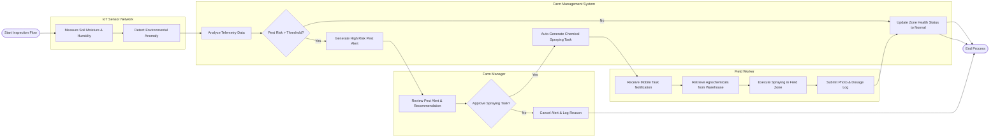

# Swimlane Diagram — Farm Management System

## Mermaid Code

## Flow Description | Mo ta luong

| Lane | Actor / Subsystem | Role in Flow |
|------|-------------------|--------------|
| IoT Sensor Network | Sensor Hardware | Continuously collects field soil moisture, ambient humidity, and temperature data; detects microclimatic anomalies conducive to fungal/pest outbreaks. |
| Farm Management System | Core Platform | Ingests telemetry metrics, executes threat detection algorithms against pre-set threshold rules, generates automated task dispatches, and updates zone health records upon task completion. |
| Farm Manager | Primary Supervisor | Evaluates system-generated pest risk alerts, reviews recommended pesticide dosages, approves or rejects chemical spraying tasks, or logs justification for manual dismissal. |
| Field Worker | Operational Staff | Receives push notifications on mobile devices, checks out required agrochemicals from inventory, performs spraying in target field zones, and logs dosage and photo confirmation to resolve the alert. |
