# Action Tree — Farm Management System

## Mermaid Code

```mermaid
graph TD
    Root["Farm Management System"]

    Root --> M1["Farm & Zone Administration"]
    Root --> M2["Crop & Cultivation Lifecycle"]
    Root --> M3["IoT Environment Monitoring"]
    Root --> M4["Task & Field Workforce Operations"]
    Root --> M5["Inventory & Supply Logistics"]
    Root --> M6["Harvest Sales & Financial Analytics"]

    M1 --> A11["Register Farm Spatial Boundaries"]
    M1 --> A12["Define Field Zones & Soil Types"]
    M1 --> A13["Manage User Roles & Access Rights"]

    M2 --> A21["Create Seasonal Cultivation Plans"]
    M2 --> A22["Schedule Planting & Harvest Dates"]
    M2 --> A23["Log Agronomic Growth Milestones"]
    M2 --> A24["Track Crop Variety Performance"]

    M3 --> A31["Configure IoT Hardware Sensors"]
    M3 --> A32["Ingest Microclimate Telemetry"]
    M3 --> A33["Trigger Automated Disease Alerts"]
    M3 --> A34["View Weather Forecast Integration"]

    M4 --> A41["Dispatch Daily Field Worker Tasks"]
    M4 --> A42["Log Chemical Spraying & Dosage"]
    M4 --> A43["Record Machinery & Equipment Repairs"]
    M4 --> A44["Track Worker Attendance & GPS Logs"]

    M5 --> A51["Track Seed & Chemical Stock Levels"]
    M5 --> A52["Set Auto-Reorder Stock Thresholds"]
    M5 --> A53["Process Input Procurement Orders"]

    M6 --> A61["Record Harvest Batch Weights & Grades"]
    M6 --> A62["Generate Produce Sales Contracts"]
    M6 --> A63["Process Buyer Invoices & Payments"]
    M6 --> A64["Export Yield & Financial P&L Reports"]
    M6 --> A65["Generate Agriculture Compliance Audit"]
```

## Module Description | Mo ta Module

| # | Module | Description | Actions |
|---|--------|-------------|---------|
| 1 | Farm & Zone Administration | Manages overall farm profile configuration, land mapping into parcel zones, and user permission control | Register Farm Spatial Boundaries, Define Field Zones & Soil Types, Manage User Roles & Access Rights |
| 2 | Crop & Cultivation Lifecycle | Handles seasonal crop scheduling, planting calendar templates, growth milestone tracking, and variety comparisons | Create Seasonal Cultivation Plans, Schedule Planting & Harvest Dates, Log Agronomic Growth Milestones, Track Crop Variety Performance |
| 3 | IoT Environment Monitoring | Integrates sensor telemetry, microclimate data collection, weather forecasts, and predictive disease threat alerts | Configure IoT Hardware Sensors, Ingest Microclimate Telemetry, Trigger Automated Disease Alerts, View Weather Forecast Integration |
| 4 | Task & Field Workforce Operations | Coordinates day-to-day farm labor, chemical application compliance, equipment maintenance, and worker field logs | Dispatch Daily Field Worker Tasks, Log Chemical Spraying & Dosage, Record Machinery & Equipment Repairs, Track Worker Attendance & GPS Logs |
| 5 | Inventory & Supply Logistics | Controls warehouse stock for agricultural inputs (seeds, fertilizers, fuel), reorder alerts, and supplier procurement | Track Seed & Chemical Stock Levels, Set Auto-Reorder Stock Thresholds, Process Input Procurement Orders |
| 6 | Harvest Sales & Financial Analytics | Oversees harvest yield logging, batch traceability, sales contract generation, billing, and regulatory compliance export | Record Harvest Batch Weights & Grades, Generate Produce Sales Contracts, Process Buyer Invoices & Payments, Export Yield & Financial P&L Reports, Generate Agriculture Compliance Audit |
