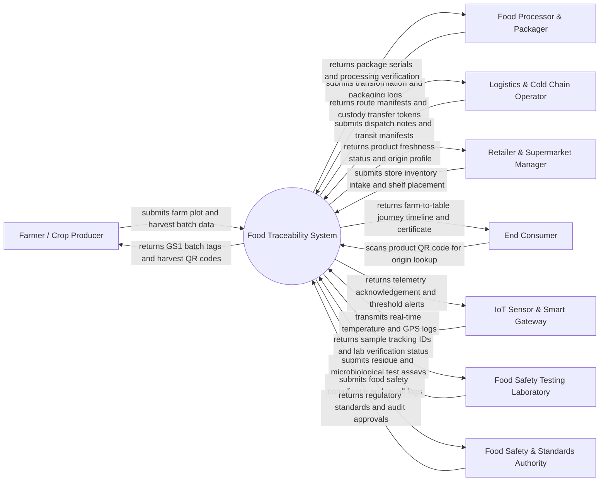

# Context Diagram — Food Traceability from Farm to Table System

## Mermaid Code

## Actor & Interaction Table | Bang Actor & Tuong tac

| # | Actor | Actor Type | Data Sent TO System | Data Received FROM System | Notes |
|---|-------|------------|---------------------|---------------------------|-------|
| 1 | Farmer / Crop Producer | Primary | Farm location GPS, soil treatment logs, crop variety, harvest timestamps, harvest batch quantities | Registered batch IDs, printable GS1 batch QR codes, harvest confirmation tokens | Primary agricultural producer recording crop planting, treatment, and harvesting data |
| 2 | Food Processor & Packager | Primary | Raw produce intake batches, washing/sorting records, processing timestamps, final consumer unit serials | Processing batch clearance, packaging barcode labels, raw-to-processed mapping | Industrial facility transforming raw agricultural produce into packaged food products |
| 3 | Logistics & Cold Chain Operator | Primary | Pickup timestamps, vehicle IDs, driver credentials, handover digital signatures, location route checkpoints | Waybill manifests, chain-of-custody transfer tokens, destination warehouse alerts | Third-party logistics (3PL) firm managing refrigerated transport and distribution |
| 4 | Retailer & Supermarket Manager | Primary | Receiving inspection logs, retail store shelf placement, sell-by date validation, damaged lot flags | Inventory freshness indexes, batch provenance validation, store receiving clearances | Retail outlet receiving packaged food products and offering them to retail buyers |
| 5 | End Consumer | Primary | Product GS1 Digital Link QR scans, location queries, quality ratings, feedback reports | Complete farm-to-table timeline, farm location map, lab test certificates, recall alerts | Shopper scanning retail product packages using smartphone browsers or mobile app |
| 6 | IoT Sensor & Smart Gateway | Supporting System | Telemetry data: ambient temperature, relative humidity, shock/vibration, real-time GPS coordinates | Data ingest receipts, sampling frequency commands, excursion/breach alarm triggers | Telematics devices mounted inside reefer trucks, cold storage rooms, and transit pallets |
| 7 | Food Safety Testing Laboratory | Supporting System | Chemical residue assay results, microbiological pathogen test reports, heavy metal analysis | Lab sample barcode bindings, test order status, digital certificate signing keys | Accredited third-party analytical lab conducting safety and compliance testing |
| 8 | Food Safety & Standards Authority | Regulatory System | National food safety regulations, maximum residue limits (MRL), mandatory recall decrees | Monthly food safety compliance reports, high-risk batch audit logs, recall executions | Government regulator enforcing national food hygiene and traceability mandates |

## System Boundary Description | Mo ta Pham vi He thong

The **Food Traceability from Farm to Table System** is an enterprise supply chain transparency platform that tracks food products from raw agricultural harvest to final retail consumption. The system boundary encompasses farm plot registration, crop harvest logging, transformation/processing mapping, GS1 Digital Link barcode generation, IoT cold chain temperature telemetry monitoring, laboratory safety certificate binding, retail receiving verification, and public consumer provenance scanning. Excluded from the system boundary are physical agricultural machinery operation, chemical synthesis of lab reagents, internal financial accounting/payroll engines, and mechanical maintenance of reefer refrigeration units. The platform interfaces seamlessly via RESTful APIs, MQTT telemetry streams, and standard GS1 barcodes to ensure complete end-to-end chain of custody.
