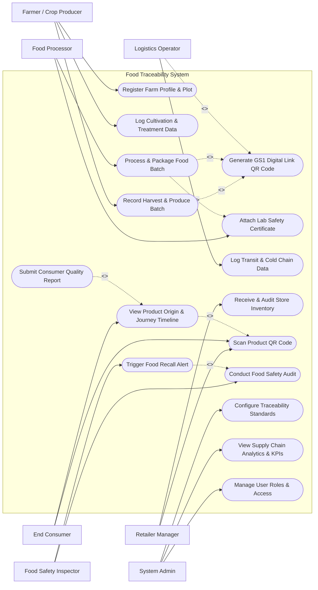

# Use Case Diagram — Food Traceability from Farm to Table System

## Mermaid Code

## Actor Table | Bang Actor

| # | Actor | Actor Type | Role Description | Related Use Cases |
|---|-------|------------|------------------|-------------------|
| 1 | Farmer / Crop Producer | Primary | Registers farm plots, inputs crop planting dates, logs pesticide/fertilizer usage, records harvest batches | UC01, UC02, UC03, UC04 |
| 2 | Food Processor | Primary | Logs raw produce receiving, manages sorting/cleaning/transformation, generates final consumer package units | UC04, UC05, UC06 |
| 3 | Logistics Operator | Primary | Manages pickup/delivery handovers, verifies cold storage integrity, logs transit route checkpoints | UC04, UC07 |
| 4 | Retailer Manager | Primary | Scans incoming shipments at store backend, audits inventory freshness, places items on display racks | UC08, UC09 |
| 5 | End Consumer | Primary | Scans product QR codes in store or at home, inspects origin details, verifies certificates, reports issues | UC09, UC10, UC11 |
| 6 | Food Safety Inspector | Secondary / Regulatory | Conducts surprise compliance audits, checks residue lab reports, issues emergency food recall alerts | UC12, UC13 |
| 7 | System Admin | System Administrator | Manages system standards, configures GS1 schemas, monitors system telemetry feeds, manages access control | UC14, UC15, UC16 |

## Use Case Table | Bang Use Case

| # | UC ID | Use Case Name | Primary Actor | Secondary Actor | Description | Priority |
|---|-------|---------------|---------------|-----------------|-------------|----------|
| 1 | UC01 | Register Farm Profile & Plot | Farmer / Crop Producer | System Admin | Registers farm geographical boundaries, soil types, and organic certification badges | High |
| 2 | UC02 | Log Cultivation & Treatment Data | Farmer / Crop Producer | None | Records seed varieties, irrigation logs, fertilizer types, and pre-harvest interval (PHI) dates | Medium |
| 3 | UC03 | Record Harvest & Produce Batch | Farmer / Crop Producer | None | Creates unique raw harvest batch IDs, quantity metrics, harvest date, and harvest crew details | High |
| 4 | UC04 | Generate GS1 Digital Link QR Code | System (Automated) | Farmer, Processor, Logistics | Generates compliant GS1 Digital Link QR codes encoding GTIN, Batch/Lot, and Serial numbers | High |
| 5 | UC05 | Process & Package Food Batch | Food Processor | None | Maps incoming raw harvest batches into processed packaged units with transformation ratios | High |
| 6 | UC06 | Attach Lab Safety Certificate | Food Processor | Food Safety Testing Lab | Binds pesticide residue and microbiological lab assay test reports to specific batches | High |
| 7 | UC07 | Log Transit & Cold Chain Data | Logistics Operator | IoT Sensor Gateway | Records location GPS checkpoints, ambient temperature logs, and humidity excursions in transit | High |
| 8 | UC08 | Receive & Audit Store Inventory | Retailer Manager | None | Verifies shipment integrity upon supermarket arrival, validates freshness, and updates stock | Medium |
| 9 | UC09 | Scan Product QR Code | End Consumer | Retailer Manager | Resolves 2D QR barcode scan into structured digital passport landing page via smartphone | High |
| 10 | UC10 | View Product Origin & Journey Timeline | End Consumer | None | Renders interactive farm-to-table map, cultivation history, processing date, and transit history | High |
| 11 | UC11 | Submit Consumer Quality Report | End Consumer | System Admin | Allows consumers to report spoiled produce, physical defects, or false labeling complaints | Low |
| 12 | UC12 | Conduct Food Safety Audit | Food Safety Inspector | System Admin | Reviews compliance logs, verifies MRL thresholds, and approves or flags supply chain batches | High |
| 13 | UC13 | Trigger Food Recall Alert | Food Safety Inspector | Retailer, Processor | Broadcasts emergency recall notifications to lock affected batches across stores and warehouses | Critical |
| 14 | UC14 | Configure Traceability Standards | System Admin | None | Defines GS1 syntax rules, threshold parameters for temperature breaches, and mandatory fields | Medium |
| 15 | UC15 | View Supply Chain Analytics & KPIs | System Admin | Food Processor, Retailer | Displays shelf-life loss metrics, transit lead times, cold-chain compliance rates, and scan counts | Medium |
| 16 | UC16 | Manage User Roles & Access | System Admin | None | Provisions user accounts, assigns cryptographic signing keys, and controls role-based permissions | High |

## Use Case Specification | Dac ta Use Case

---

### UC03 — Record Harvest & Produce Batch

| Field | Detail |
|-------|--------|
| **UC ID** | UC03 |
| **Use Case Name** | Record Harvest & Produce Batch |
| **Actor(s)** | Primary: Farmer / Crop Producer   Secondary: None |
| **Description** | Allows the farmer to record a new raw agricultural harvest event, capturing harvest yield, plot ID, harvest method, and generating an initial GS1-compliant raw produce batch code. |
| **Precondition** | 1. Farmer is authenticated in the system.   2. The target farm plot is registered and active in UC01. |
| **Main Flow** | 1. Farmer selects the registered farm plot from the dashboard.   2. System displays plot details and active crop planting record.   3. Farmer inputs harvest date, total yield quantity (kg/tons), harvest supervisor name, and storage bin IDs.   4. System verifies that crop pre-harvest interval (PHI) conditions have elapsed since last chemical treatment.   5. System generates a unique raw harvest batch code (e.g., `BATCH-FARM99-20260727-001`).   6. System invokes UC04 to render printable GS1 raw batch QR codes for bin tagging.   7. System saves harvest batch record with immutable timestamp and notifies farmer of successful registration. |
| **Alternative Flow** | **AF1** — Bulk Harvest Recording: If harvesting across multiple adjacent plots, farmer selects multi-plot option and system generates linked sub-batch identifiers.   **AF2** — Offline Field Recording: If network connection is unavailable in the field, app stores batch data locally and syncs to central server upon network restoration. |
| **Exception Flow** | **EX1** — Pre-Harvest Interval (PHI) Violation: If harvest date is within forbidden PHI window following chemical application, System blocks batch creation, displays safety warning, and requires agronomist override.   **EX2** — Invalid Quantity Input: If entered yield exceeds plot theoretical max capacity by >50%, System prompts confirmation and flags lot for yield audit. |
| **Postcondition** | Raw harvest batch is created, locked with an immutable state, tagged with GS1 QR labels, and ready for transit to food processor. |
| **Business Rule** | **BR1**: All harvest batches must have a non-reoperable PHI safety clearance check.   **BR2**: Batch codes must strictly adhere to GS1 Global Individual Asset Identifier (GIAI) or Global Returnable Asset Identifier (GRAI) standard format. |

---

### UC05 — Process & Package Food Batch

| Field | Detail |
|-------|--------|
| **UC ID** | UC05 |
| **Use Case Name** | Process & Package Food Batch |
| **Actor(s)** | Primary: Food Processor   Secondary: None |
| **Description** | Captures the transformation of raw agricultural harvest batches into finished consumer-packaged food units, establishing parent-child lot lineage and package GTIN serial numbers. |
| **Precondition** | 1. Food Processor is authenticated.   2. Incoming raw harvest batch has been received and verified in the processor intake module. |
| **Main Flow** | 1. Food Processor opens the Processing Batch Creation portal.   2. Processor scans or selects one or multiple raw harvest batch QR codes.   3. System verifies raw batch validity and displays available input quantities.   4. Processor enters processing parameters: line ID, washing/sanitizing agent logs, sorting yield ratio, packaging format, and target GTIN product code.   5. System computes mass balance and maps raw batch lineage to new finished product lot.   6. System invokes UC04 to generate unique consumer-level GS1 Digital Link QR codes for each package unit.   7. System binds required lab certificates (UC06) and outputs final packaging manifest. |
| **Alternative Flow** | **AF1** — Multi-Farm Blending: If raw produce is combined from 3 different farms, System logs all 3 raw parent batches as joint inputs to ensure downstream traceability.   **AF2** — Repackaging / Sorting: If produce is only sorted without chemical processing, System creates direct 1:1 repack lot relationships. |
| **Exception Flow** | **EX1** — Uncertified Raw Input: If one selected raw harvest batch is marked as quarantined or unverified, System halts batch processing and displays safety hold notice.   **EX2** — Mass Balance Discrepancy: If output quantity exceeds input quantity by >10%, System flags potential unauthorized produce insertion error. |
| **Postcondition** | Processing batch record is committed, parent-child lot relationships are established, consumer unit QR serials are registered. |
| **Business Rule** | **BR1**: Mass balance input-to-output tolerance must not exceed 105%.   **BR2**: Full multi-parent genealogy must be preserved for any blended food product. |

---

### UC07 — Log Transit & Cold Chain Data

| Field | Detail |
|-------|--------|
| **UC ID** | UC07 |
| **Use Case Name** | Log Transit & Cold Chain Data |
| **Actor(s)** | Primary: Logistics Operator   Secondary: IoT Sensor Gateway |
| **Description** | Tracks food shipment dispatch, real-time GPS route checkpoints, and continuous temperature/humidity telemetry to ensure cold-chain compliance during transit. |
| **Precondition** | 1. Packaged food units have been dispatched with valid waybill IDs.   2. IoT environmental sensors are paired with vehicle/container ID. |
| **Main Flow** | 1. Logistics Operator logs shipment pickup, scanning master carton QR codes.   2. System records chain-of-custody transfer from processor to carrier with electronic signature.   3. IoT Sensor Gateway transmits periodic temperature, humidity, and GPS coordinates (e.g., every 5 minutes) via MQTT to System.   4. System evaluates received telemetry against product-specific thermal limits (e.g., 2°C to 4°C for fresh produce).   5. System updates real-time transit map and estimated arrival time.   6. Upon arrival, Logistics Operator submits final delivery handover token.   7. System generates Cold Chain Compliance Summary Report for receiving retailer. |
| **Alternative Flow** | **AF1** — Manual Temperature Override Logging: In case of IoT gateway hardware failure, Logistics Operator manually records analog temperature readings at mandatory stop checkpoints. |
| **Exception Flow** | **EX1** — Temperature Excursion Alert: If recorded temperature exceeds 8°C for over 30 consecutive minutes, System immediately triggers real-time SMS/email alerts to driver and quality manager, flagging lot as "Thermal Excursion Warning".   **EX2** — Route Deviation: If truck strays off assigned corridor, System logs security exception notice. |
| **Postcondition** | Complete thermal history and GPS breadcrumbs are attached to shipment batch record; cold chain compliance score is computed. |
| **Business Rule** | **BR1**: Cold chain continuity must maintain product temperature within specified bounds (e.g., 2°C-4°C) with zero unflagged excursions over 45 minutes. |

---

### UC10 — View Product Origin & Journey Timeline

| Field | Detail |
|-------|--------|
| **UC ID** | UC10 |
| **Use Case Name** | View Product Origin & Journey Timeline |
| **Actor(s)** | Primary: End Consumer   Secondary: None |
| **Description** | Displays an interactive, consumer-friendly web page rendering the complete lifecycle history of a scanned food product, including farm origin, harvest date, lab test certificates, and transport route. |
| **Precondition** | 1. Consumer scans product GS1 Digital Link QR code using smartphone camera (UC09). |
| **Main Flow** | 1. System receives QR code HTTP request containing URL parameters (GTIN, Lot, Serial).   2. System resolves parameters and queries traceability database for batch lineage.   3. System renders web application landing page displaying: product name, farm photo, farmer profile, and interactive map of farm location.   4. Consumer scrolls through visual timeline showing: Planting Date -> Harvest Date -> Quality Control Lab Pass Badge -> Packaged Date -> Transport Journey -> Retail Store Arrival.   5. Consumer clicks to view downloadable Lab Safety Assay Certificate (pesticide residue pass status).   6. System logs anonymous scan event metric for market analytics. |
| **Alternative Flow** | **AF1** — Multi-Ingredient Product View: If product has multiple ingredients, page displays interactive ingredient tree allowing consumer to tap each raw component origin.   **AF2** — Language Localization: Page detects browser locale and renders timeline in Vietnamese or English. |
| **Exception Flow** | **EX1** — Invalid / Counterfeit Serial: If scanned QR code serial does not exist in registry, System displays red "Unverified / Unknown Origin" warning.   **EX2** — Recalled Batch Scanned: If scanned product lot is under active recall (UC13), System displays prominent red banner "CRITICAL SAFETY RECALL: DO NOT CONSUME" with store return instructions. |
| **Postcondition** | Consumer receives verified product origin transparency data; system logs scan interaction. |
| **Business Rule** | **BR1**: Public consumer view must hide sensitive commercial pricing/cost data while displaying 100% of food safety certification data. |

---

### UC13 — Trigger Food Recall Alert

| Field | Detail |
|-------|--------|
| **UC ID** | UC13 |
| **Use Case Name** | Trigger Food Recall Alert |
| **Actor(s)** | Primary: Food Safety Inspector   Secondary: Retailer Manager, Food Processor |
| **Description** | Initiates an immediate targeted emergency recall for contaminated or non-compliant food batches, locking inventory across distribution centers, supermarket shelves, and public consumer scan portals. |
| **Precondition** | 1. Food Safety Inspector is authenticated with emergency admin credentials.   2. Lab analysis or consumer health incident confirms pathogen/chemical contamination in specific lot. |
| **Main Flow** | 1. Inspector inputs target product GTIN, contaminated Lot/Batch ID, and recall justification reason.   2. System performs automated backward-and-forward batch trace, identifying all parent farm batches, processing sub-lots, packaging serials, shipping containers, and destination retail store locations.   3. Inspector reviews affected inventory distribution summary table and confirms recall initiation.   4. System instantly updates batch status to `RECALLED_LOCKED` across all modules.   5. System sends automated priority broadcast push alerts/emails to affected food processors, logistics carriers, and supermarket managers.   6. System updates public QR scan page (UC10) to display immediate safety recall warning for any consumer scanning the lot.   7. System generates official Regulatory Emergency Recall Audit Report. |
| **Alternative Flow** | **AF1** — Precautionary Hold (Quarantine): Inspector selects temporary "Quarantine Hold" status pending laboratory re-test result rather than full public recall. |
| **Exception Flow** | **EX1** — Unauthorized Execution Attempt: If user lacks inspector cryptographic security clearance, System aborts operation and alerts security auditor. |
| **Postcondition** | Target food batch is globally locked; inventory alerts dispatched; public consumer scan endpoint displays recall warning. |
| **Business Rule** | **BR1**: Traceability graph traversal must identify 100% of forward-distributed sub-lots within 5 seconds of recall execution. |
