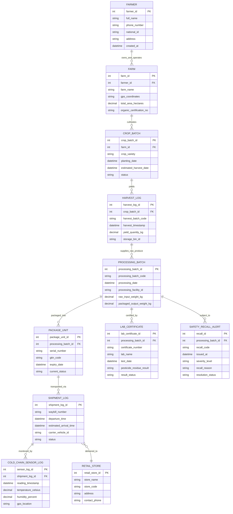

# Conceptual ERD — Food Traceability from Farm to Table System

## Mermaid Code

## Entity Description Table | Bang mo ta Entity

| # | Entity Name | Vietnamese Name | Description | Key Attributes | Main Relationships |
|---|-------------|-----------------|-------------|----------------|-------------------|
| 1 | FARMER | Nong Dan / Nguoi San Xuat | Represents the registered crop producer or farm owner | farmer_id, full_name, phone_number, national_id | Has many FARM records |
| 2 | FARM | Trang Trai / Co So Cultivate | Represents physical agricultural plot land with GPS mapping | farm_id, farmer_id, farm_name, gps_coordinates | Belongs to FARMER, has many CROP_BATCH records |
| 3 | CROP_BATCH | Lo Lay Vu Trong | Tracks a specific crop planting event from seeding to maturity | crop_batch_id, farm_id, crop_variety, planting_date | Belongs to FARM, has many HARVEST_LOG records |
| 4 | HARVEST_LOG | Nhat Ky Thu Hoach | Captures a raw harvest yield event and raw batch ID | harvest_log_id, crop_batch_id, harvest_batch_code, yield_quantity_kg | Belongs to CROP_BATCH, supplies PROCESSING_BATCH |
| 5 | PROCESSING_BATCH | Lo Che Bien Dong Goi | Tracks industrial processing, sorting, and transformation of raw produce | processing_batch_id, processing_batch_code, facility_id, input_weight, output_weight | Receives raw produce, has many PACKAGE_UNIT records, LAB_CERTIFICATE, SAFETY_RECALL_ALERT |
| 6 | PACKAGE_UNIT | Don Vi Goi San Pham | Individual consumer package or master carton with unique serial barcode | package_unit_id, processing_batch_id, serial_number, gtin_code, expiry_date | Belongs to PROCESSING_BATCH, transported via SHIPMENT_LOG |
| 7 | SHIPMENT_LOG | Lịch Trinh Van Chuyen | Details of refrigerated transit shipment from processor to supermarket | shipment_log_id, waybill_number, departure_time, vehicle_id, status | Contains PACKAGE_UNIT, monitored by COLD_CHAIN_SENSOR_LOG, delivered to RETAIL_STORE |
| 8 | COLD_CHAIN_SENSOR_LOG | Nhat Ky Cam Bien Lanh | Real-time IoT environmental readings (temperature, humidity, GPS) | sensor_log_id, shipment_log_id, reading_timestamp, temperature_celsius, humidity_percent | Belongs to SHIPMENT_LOG |
| 9 | RETAIL_STORE | Cua Hang Ban Le / Sieu Thi | Target physical supermarket outlet receiving and selling food packages | retail_store_id, store_name, store_code, address | Receives SHIPMENT_LOG deliveries |
| 10 | LAB_CERTIFICATE | Chung Nhan Kiem Nghiem | Official food safety laboratory residue and pathogen test clearance | lab_certificate_id, processing_batch_id, certificate_number, lab_name, result_status | Belongs to PROCESSING_BATCH |
| 11 | SAFETY_RECALL_ALERT | Canh Bao Thu Hoi San Pham | Emergency recall alert notice issued against non-compliant food lots | recall_id, processing_batch_id, recall_code, severity_level, recall_reason | Belongs to PROCESSING_BATCH |

## Relationship Description | Mo ta Quan he

| # | From Entity | Cardinality | To Entity | Relationship Label | Business Explanation |
|---|-------------|-------------|-----------|-------------------|----------------------|
| 1 | FARMER | one-to-many | FARM | owns_and_operates | Mot nong dan co the so huu va quan ly nhieu trang trai hoac thuat dat |
| 2 | FARM | one-to-many | CROP_BATCH | cultivates | Mot trang trai thuc hien nhieu lo canh tac qua cac vu mua khac nhau |
| 3 | CROP_BATCH | one-to-many | HARVEST_LOG | yields | Mot lo canh tac co the duoc thu hoach thanh nhieu dot thu hoach khac nhau |
| 4 | HARVEST_LOG | one-to-many | PROCESSING_BATCH | supplies_raw_produce | Mot hoac nhieu dot thu hoach tho cung cap nguyen lieu cho lo che bien |
| 5 | PROCESSING_BATCH | one-to-many | PACKAGE_UNIT | packaged_into | Mot lo che bien duoc chia va dong goi thanh nhieu hop/don vi san pham |
| 6 | PROCESSING_BATCH | one-to-many | LAB_CERTIFICATE | certified_by | Mot lo che bien co the co mot hoac nhieu phieu kiem nghiem an toan |
| 7 | PROCESSING_BATCH | one-to-many | SAFETY_RECALL_ALERT | subject_to | Mot lo che bien co me xay ra canh bao thu hoi neu bi phat hien vi phạm an toan |
| 8 | PACKAGE_UNIT | one-to-many | SHIPMENT_LOG | transported_via | Nhieu don vi san pham duoc gom vao cac chuyen van chuyen hop nhat |
| 9 | SHIPMENT_LOG | one-to-many | COLD_CHAIN_SENSOR_LOG | monitored_by | Mot chuyen hang van chuyen duoc ghi nhan lien tuc bang nhieu luot cam bien IoT |
| 10 | SHIPMENT_LOG | many-to-one | RETAIL_STORE | delivered_to | Nhieu chuyen hang duoc giao den mot sieu thi hoac cua hang ban le cu the |
