# Swimlane Diagram — Food Traceability from Farm to Table System

## Mermaid Code

```mermaid
flowchart LR
    Start(["Start Food Lifecycle"])

    subgraph Lane1["Farmer / Crop Producer"]
        A1["Register Farm Plot & Soil Data"]
        A2["Log Cultivation & Pre-Harvest Checks"]
        A3["Harvest Crop & Input Batch Yield"]
        A4["Affix GS1 Raw Batch Tag to Bins"]
    end

    subgraph Lane2["Food Processor"]
        B1["Receive Raw Produce & Scan Batch Tag"]
        B2["Process & Package into Consumer Units"]
        B3["Bind Laboratory Test Certificate"]
        B4["Generate Consumer GS1 Digital Link QR"]
    end

    subgraph Lane3["Logistics & Cold Chain"]
        C1["Pickup Shipment & Sign Handover"]
        C2["Transport Produce with IoT Telemetry"]
        C3{"Cold Chain Temp Within Bounds?"}
        C4["Flag Thermal Excursion Exception"]
    end

    subgraph Lane4["Food Traceability Platform"]
        D1["Ingest IoT Readings & Check Thresholds"]
        D2["Update Master Provenance Ledger"]
        D3["Trigger Automated Quarantine Alert"]
    end

    subgraph Lane5["Retailer & Consumer"]
        E1["Receive & Scan Inventory at Supermarket"]
        E2["Place Package on Display Shelf"]
        E3["Scan QR Code via Smartphone"]
        E4["View Complete Farm-to-Table Timeline"]
    end

    Finish(["End Traceability Journey"])

    Start --> A1 --> A2 --> A3 --> A4
    A4 --> B1 --> B2 --> B3 --> B4
    B4 --> C1 --> C2 --> C3
    C3 -->|"Yes (2°C - 4°C)"| D2
    C3 -->|"No (Temp > 8°C)"| C4 --> D1 --> D3 --> Finish
    D2 --> E1 --> E2 --> E3 --> E4 --> Finish
```

## Flow Description | Mo ta luong

| Lane | Actor | Role in Flow |
|------|-------|-------------|
| 1 | Farmer / Crop Producer | Initiates food traceability by logging plot GPS, crop treatment, harvest yield, and tagging storage bins with GS1 raw batch identifiers. |
| 2 | Food Processor | Receives raw produce, verifies batch codes, executes processing/packaging, attaches lab safety certificates, and prints final consumer unit QR codes. |
| 3 | Logistics & Cold Chain | Manages refrigerated transit, records chain-of-custody signatures, and evaluates continuous IoT sensor telemetry for thermal excursions. |
| 4 | Food Traceability Platform | Core cloud engine that ingests real-time IoT readings, evaluates compliance rules, updates master digital ledger, and fires quarantine alerts on breach. |
| 5 | Retailer & Consumer | Supermarket audits incoming stock for shelf placement; end consumer scans package 2D QR code to inspect complete farm-to-table origin transparency. |
