# Action Tree — Food Traceability from Farm to Table System

## Mermaid Code

```mermaid
graph TD
    Root["Food Traceability System"]

    Root --> M1["Farm & Harvest Traceability"]
    Root --> M2["Processing & Packaging Module"]
    Root --> M3["Logistics & Cold Chain Monitoring"]
    Root --> M4["Retail & Consumer Scan Portal"]
    Root --> M5["Quality & Recall Management"]
    Root --> M6["Admin & Compliance Analytics"]

    M1 --> A1["Register Farm Plot & Soil Data"]
    M1 --> A2["Log Chemical Treatment & PHI"]
    M1 --> A3["Record Harvest Yield & Bin IDs"]
    M1 --> A4["Generate Raw Batch GS1 Tag"]

    M2 --> B1["Log Raw Produce Intake & Inspection"]
    M2 --> B2["Record Sorting & Transformation Ratio"]
    M2 --> B3["Bind Packaging GTIN & Serial Serials"]
    M2 --> B4["Attach Lab Safety Assay Certificate"]

    M3 --> C1["Log Carrier Dispatch & Custody Transfer"]
    M3 --> C2["Stream IoT Sensor Telemetry Data"]
    M3 --> C3["Verify Thermal Excursions & GPS Route"]
    M3 --> C4["Submit Receiving Delivery Handover"]

    M4 --> D1["Resolve GS1 Digital Link QR Scan"]
    M4 --> D2["Render Farm-to-Table Interactive Map"]
    M4 --> D3["Display Lab Assay Clearance Badges"]
    M4 --> D4["Submit Consumer Quality Feedback"]

    M5 --> E1["Conduct Food Safety Compliance Audit"]
    M5 --> E2["Execute Targeted Batch Recall Alert"]
    M5 --> E3["Lock Contaminated Inventory Lots"]
    M5 --> E4["Generate Regulatory Incident Report"]

    M6 --> F1["Configure GS1 Code Syntax Standards"]
    M6 --> F2["Monitor System Telemetry & Scan Stats"]
    M6 --> F3["Manage Role Permissions & Key Vault"]
    M6 --> F4["Export Supply Chain KPI Dashboard"]
```

## Module Description | Mo ta Module

| # | Module | Description | Actions |
|---|--------|-------------|---------|
| 1 | Farm & Harvest Traceability | Manages agricultural producer onboarding, farm plot registration, chemical input tracking, and raw harvest batch tagging. | Register Farm Plot, Log Chemical Treatment, Record Harvest Yield, Generate Raw Batch Tag |
| 2 | Processing & Packaging Module | Handles raw produce intake, transformation mass balance, consumer package unit serialization, and lab certificate binding. | Log Raw Produce Intake, Record Sorting Ratio, Bind GTIN & Serials, Attach Lab Certificate |
| 3 | Logistics & Cold Chain Monitoring | Tracks refrigerated transport dispatch, ingests real-time IoT environmental readings, monitors thermal excursions, and logs handovers. | Log Carrier Dispatch, Stream IoT Telemetry, Verify Thermal Excursions, Submit Delivery Handover |
| 4 | Retail & Consumer Scan Portal | Public-facing digital product passport rendering origin timeline, interactive farm map, lab safety badges, and consumer feedback. | Resolve QR Scan, Render Origin Map, Display Lab Badges, Submit Consumer Feedback |
| 5 | Quality & Recall Management | Enables regulatory inspectors to conduct safety audits, trigger targeted emergency recalls, and lock contaminated inventory globally. | Conduct Safety Audit, Execute Recall Alert, Lock Contaminated Lots, Generate Incident Report |
| 6 | Admin & Compliance Analytics | System administration suite for setting GS1 standards, monitoring scan volume metrics, user security, and supply chain KPI reporting. | Configure GS1 Standards, Monitor System Stats, Manage Role Permissions, Export KPI Dashboard |
