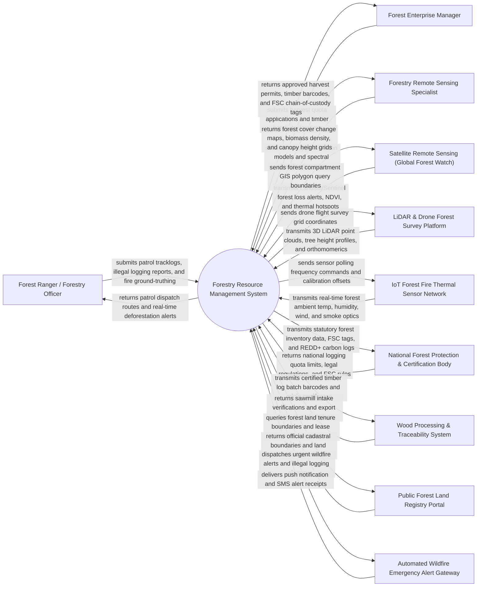

# Context Diagram — Forestry Resource Management System

## Mermaid Code

## Actor & Interaction Table | Bang Actor & Tuong tac

| # | Actor | Actor Type | Data Sent TO System | Data Received FROM System | Notes |
|---|-------|------------|---------------------|---------------------------|-------|
| 1 | Forest Ranger / Forestry Officer | Primary | Field patrol GPS tracks, illegal logging evidence, tree damage reports, wildfire ground-truthing | Anti-poaching/logging patrol routes, real-time satellite deforestation alerts, fire maps | Field officer patrolling forest reserves, inspecting logging concessions, and fighting forest fires |
| 2 | Forest Enterprise Manager | Primary | Annual harvest quota requests, timber batch volume declarations, reforestation plans | Approved timber harvest permits, log barcodes, FSC/PEFC chain-of-custody tags, royalty invoices | Manager operating commercial timber plantations or natural forest logging concessions |
| 3 | Forestry Remote Sensing Specialist | Primary | Spectral classification algorithms, LiDAR calibration models, canopy height formulas | Multi-temporal forest cover loss heatmaps, carbon biomass maps, canopy density models | Technical specialist analyzing satellite rasters, drone orthomosaics, and spatial forest dynamics |
| 4 | Satellite Remote Sensing (Global Forest Watch) | Supporting System | Sentinel-2 / Landsat forest loss alerts (GLAD/RADD), MODIS/VIIRS thermal hotspots, NDVI rasters | Forest compartment GIS polygon boundaries, spatial query timestamps | Global satellite feeds providing automated continuous deforestation and wildfire hotspot detection |
| 5 | LiDAR & Drone Forest Survey Platform | Supporting System | 3D airborne LiDAR point clouds, Digital Canopy Height Models (DCHM), high-res aerial orthomosaics | Drone survey flight grids, compartment target coordinates, elevation references | Airborne laser scanning platform capturing precise individual tree height, DBH, and volume metrics |
| 6 | IoT Forest Fire Thermal Sensor Network | Supporting System | Real-time ambient air temperature, relative humidity, wind speed, solar radiation, smoke optical density | Sensor sampling rates, zero-span calibration commands, battery status queries | Weather and infrared thermal sensor stations deployed in high-risk forest fire danger zones |
| 7 | National Forest Protection & Certification Body | Regulatory System | National annual logging quota caps, forestry protection laws, FSC/PEFC certification standards | Statutory national forest inventory reports, illegal logging crime statistics, REDD+ carbon logs | Government forestry ministry (e.g., Vietnam Administration of Forestry - VNFOREST / FSC Board) |
| 8 | Wood Processing & Traceability System | Supporting System | Sawmill timber intake verifications, log barcode scans, wood product export manifests | Certified timber log origin certificates, harvest permit verifications, chain-of-custody codes | Sawmill and timber exporter tracking software verifying legal timber origin from forest to market |
| 9 | Public Forest Land Registry Portal | Supporting System | Forest land tenure queries, lease contract details, indigenous community land boundaries | Official land parcel GIS boundaries, protection forest vs production forest classifications | Government cadastre portal managing forest land ownership, leasing contracts, and land classification |
| 10 | Automated Wildfire Emergency Alert | Supporting System | SMS delivery logs, alert dispatch status receipts | High-priority Fire Weather Index (FWI) warnings, thermal hotspot alerts, emergency evacuation orders | Communication gateway dispatching urgent alerts to fire departments, rangers, and nearby communities |

## System Boundary Description | Mo ta Pham vi He thong

The **Forestry Resource Management System** is an enterprise geospatial environmental software platform designed to manage national forest inventories, monitor satellite/drone deforestation, detect wildfires in real time, plan sustainable timber harvesting, issue FSC/PEFC timber traceability barcodes, track reforestation projects, and calculate REDD+ forest carbon stocks.

The **system boundary** encompasses forest stand GIS compartment mapping, multi-temporal satellite deforestation detection (GLAD/RADD), Fire Weather Index (FWI) calculation, LiDAR tree canopy height and timber volume modeling, sustainable harvest quota management, chain-of-custody timber barcoding, illegal logging patrol dispatching (SMART standards), and forest carbon accounting.

**External to the system boundary** are physical tree photosynthesis and wood growth, physical chainsaw combustion during harvesting, physical wildfire combustion dynamics, legal court prosecution of timber smugglers, and satellite orbital operations. System interfaces connect via HTTPS REST APIs, WFS/WMS geospatial GIS protocols, MAVLink/CoAP IoT streams, and barcode/RFID scanner data payloads.
