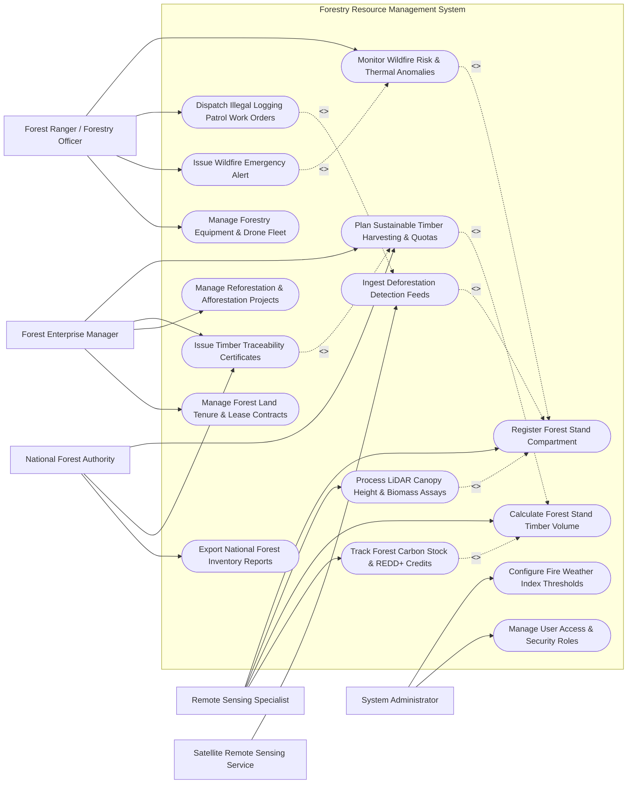

# Use Case Diagram — Forestry Resource Management System

## Mermaid Code

## Actor Table | Bang Actor

| # | Actor | Actor Type | Role Description | Related Use Cases |
|---|-------|------------|------------------|-------------------|
| 1 | Forest Ranger / Forestry Officer | Primary | Field officer patrolling compartments, dismantling illegal logging operations, and ground-truthing fires | UC03, UC07, UC10, UC15 |
| 2 | Forest Enterprise Manager | Primary | Commercial forestry operator applying for logging quotas, managing timber sales, and planting projects | UC05, UC06, UC09, UC11 |
| 3 | Remote Sensing Specialist | Primary | Technical expert analyzing satellite deforestation rasters, LiDAR point clouds, and forest carbon stocks | UC01, UC04, UC08, UC12 |
| 4 | National Forest Authority | Primary / Regulatory | Government ministry setting annual harvest quota caps, verifying FSC certificates, and auditing forests | UC05, UC06, UC13 |
| 5 | System Administrator | Primary | Technical administrator managing Fire Weather Index (FWI) rules, system parameters, and security roles | UC14, UC16 |
| 6 | Satellite Remote Sensing Service | Secondary / System | External satellite feed (Global Forest Watch / Sentinel-2) providing automated deforestation & fire hotspots | UC02 |

## Use Case Table | Bang Use Case

| # | UC ID | Use Case Name | Primary Actor | Secondary Actor | Description | Priority |
|---|-------|---------------|---------------|-----------------|-------------|----------|
| 1 | UC01 | Register Forest Stand Compartment | Remote Sensing | None | Defines forest land compartment GIS polygon, forest classification type, species, and elevation | High |
| 2 | UC02 | Ingest Deforestation Detection Feeds | System | Satellite Service | Ingests GLAD/RADD satellite alerts detecting canopy loss, tree felling, and road opening | High |
| 3 | UC03 | Monitor Wildfire Risk & Thermal Anomalies | Forest Ranger | System | Calculates Canadian Fire Weather Index (FWI) and ingests MODIS/VIIRS satellite thermal hotspots | High |
| 4 | UC04 | Process LiDAR Canopy Height & Biomass Assays | Remote Sensing | System | Processes 3D airborne LiDAR point clouds to measure individual tree heights, DBH, and biomass | High |
| 5 | UC05 | Plan Sustainable Timber Harvesting & Quotas | Enterprise Manager | Forest Authority | Calculates Annual Allowable Cut (AAC), designates harvest blocks, and submits quota requests | High |
| 6 | UC06 | Issue Timber Traceability Certificates | Enterprise Manager | Forest Authority | Generates FSC/PEFC chain-of-custody log barcodes, origin certificates, and transport passes | High |
| 7 | UC07 | Dispatch Illegal Logging Patrol Work Orders | Forest Ranger | System | Creates emergency ranger patrol missions (SMART standards) to investigate satellite deforestation alerts | High |
| 8 | UC08 | Calculate Forest Stand Timber Volume | Remote Sensing | System | Computes standing timber volume ($m^3/ha$) using species-specific allometric growth equations | High |
| 9 | UC09 | Manage Reforestation & Afforestation Projects | Enterprise Manager | None | Tracks tree planting campaigns, sapling species selection, nursery inventory, and survival rates | Medium |
| 10 | UC10 | Issue Wildfire Emergency Alert | Forest Ranger | Notification Gateway | Dispatches emergency warnings to local communities and fire brigades when FWI reaches Extreme | High |
| 11 | UC11 | Manage Forest Land Tenure & Lease Contracts | Enterprise Manager | Public Land Registry | Manages forest land leasing agreements, concession boundaries, annual fees, and renewal dates | Medium |
| 12 | UC12 | Track Forest Carbon Stock & REDD+ Credits | Remote Sensing | System | Quantifies forest carbon stocks ($tC/ha$) and calculates REDD+ avoided deforestation carbon credits | High |
| 13 | UC13 | Export National Forest Inventory Reports | Forest Authority | System | Generates national forest cover statistics, timber inventory balance sheets, and FAO FRA disclosures | High |
| 14 | UC14 | Configure Fire Weather Index Thresholds | System Admin | System | Adjusts FWI danger rating thresholds (Low, Moderate, High, Extreme) based on regional climate | Medium |
| 15 | UC15 | Manage Forestry Equipment & Drone Fleet | Forest Ranger | System Admin | Manages field gear, radios, handheld GPS units, fire trucks, and drone surveillance aircraft | Low |
| 16 | UC16 | Manage User Access & Security Roles | System Admin | None | Configures user accounts, corporate roles (Ranger, Operator, Specialist, Admin), and API permissions | Low |

## Use Case Specification | Dac ta Use Case

---

### UC01 — Register Forest Stand Compartment

| Field | Detail |
|-------|--------|
| **UC ID** | UC01 |
| **Use Case Name** | Register Forest Stand Compartment |
| **Actor(s)** | Primary: Forestry Remote Sensing Specialist   Secondary: None |
| **Description** | Creates a master forest compartment record in the GIS database, specifying administrative boundaries, legal land classification (Protection Forest, Special-Use Forest, Production Forest), dominant tree species, soil type, and elevation profile. |
| **Precondition** | 1. Specialist is authenticated with GIS administrator privileges.   2. Official forest land survey boundary shapefile or satellite land-use map is available. |
| **Main Flow** | 1. Specialist opens "Forest Compartment Registration" in the GIS workspace.   2. Specialist uploads compartment polygon shapefile or draws boundaries on interactive satellite basemap.   3. Specialist inputs compartment code (e.g., `COMP-TN-204`), forest district name, and total acreage ($hectares$).   4. Specialist selects statutory Land Classification Type:   &nbsp;&nbsp;&nbsp;&nbsp;a. **Protection Forest**: Watershed protection, soil erosion prevention.   &nbsp;&nbsp;&nbsp;&nbsp;b. **Special-Use Forest**: National parks, nature reserves, historical sites.   &nbsp;&nbsp;&nbsp;&nbsp;c. **Production Forest**: Commercial timber production plantations.   5. Specialist inputs primary tree species (e.g., *Acacia mangium*, *Pinus kesiya*, *Tectona grandis*), planting/establishment year, and average slope ($degrees$).   6. System checks for boundary overlap with existing registered compartments or national park zones.   7. System extracts DEM elevation parameters, catchment basin IDs, and baseline forest canopy cover percentage.   8. System saves compartment profile and sets status to `REGISTERED_ACTIVE`. |
| **Alternative Flow** | **AF1** — Multi-Subcompartment Partitioning: Specialist divides a major compartment into smaller management sub-compartments based on age class or species variations. |
| **Exception Flow** | **EX1** — Boundary Overlap Conflict: System detects proposed compartment polygon overlaps with an existing registered protected area by $>1.0\text{ ha}$, blocking registration and highlighting conflict zone. |
| **Postcondition** | Forest compartment master record created in GIS database, establishing baseline for timber inventory, satellite monitoring, and harvest planning. |
| **Business Rule** | **BR1**: Commercial timber harvesting must be strictly forbidden in compartments designated as Protection Forest or Special-Use Forest. |

---

### UC03 — Monitor Real-Time Wildfire Risk & Thermal Anomalies

| Field | Detail |
|-------|--------|
| **UC ID** | UC03 |
| **Use Case Name** | Monitor Real-Time Wildfire Risk & Thermal Anomalies |
| **Actor(s)** | Primary: Forest Ranger / Forestry Officer   Secondary: System |
| **Description** | Computes the Canadian Fire Weather Index (FWI) using IoT weather telemetry, ingests real-time satellite thermal anomaly hotspots (MODIS/VIIRS), and generates spatial wildfire risk maps to trigger automated emergency warnings. |
| **Precondition** | 1. IoT weather stations in forest compartments are active and streaming temperature, humidity, wind, and rain data.   2. MODIS/VIIRS satellite hotspot feeds are connected. |
| **Main Flow** | 1. System retrieves daily 12:00 PM meteorological data from forest weather stations: Air Temp ($^\circ C$), Relative Humidity ($\%$), 10m Wind Speed ($km/h$), and 24-hour Rainfall ($mm$).   2. System executes Canadian Forest Fire Weather Index (FWI) component equations:   &nbsp;&nbsp;&nbsp;&nbsp;a. **FFMC** (Fine Fuel Moisture Code): Moisture content of surface litter.   &nbsp;&nbsp;&nbsp;&nbsp;b. **DMC** (Duff Moisture Code): Moisture content of moderate organic layers.   &nbsp;&nbsp;&nbsp;&nbsp;c. **DC** (Drought Code): Deep organic layer moisture deficit.   &nbsp;&nbsp;&nbsp;&nbsp;d. **ISI** (Initial Spread Index) & **BUI** (Buildup Index).   &nbsp;&nbsp;&nbsp;&nbsp;e. **FWI** (Fire Weather Index): Numerical rating of fire intensity potential.   3. System ingests satellite MODIS/VIIRS thermal hotspot detections ($>350\text{ K}$ bright temp) updated every 3 hours.   4. System overlays thermal hotspots onto FWI risk maps to identify active wildfire ignitions.   5. System rates compartment fire danger: `LOW`, `MODERATE`, `HIGH`, `VERY HIGH`, or `EXTREME`.   6. If FWI reaches `EXTREME` or satellite detects active fire hotspot within forest boundary, System triggers automated wildfire alert (UC10).   7. System updates interactive wildfire monitoring dashboard and routes coordinates to nearest ranger station. |
| **Alternative Flow** | **AF1** — Forest Fire Smoke Plume Detection: System integrates optical camera tower smoke detection AI to pinpoint ground smoke columns prior to satellite pass. |
| **Exception Flow** | **EX1** — False Thermal Hotspot: Satellite detects thermal hotspot caused by industrial factory chimney near forest border; system matches location with known factory database and filters false alert. |
| **Postcondition** | Daily FWI ratings calculated, satellite thermal hotspots mapped, and wildfire warning alerts dispatched if thresholds are exceeded. |
| **Business Rule** | **BR1**: Controlled agricultural slash burning must be automatically prohibited whenever FWI danger rating reaches `VERY HIGH` or `EXTREME`. |

---

### UC05 — Plan Sustainable Timber Harvesting & Quotas

| Field | Detail |
|-------|--------|
| **UC ID** | UC05 |
| **Use Case Name** | Plan Sustainable Timber Harvesting & Quotas |
| **Actor(s)** | Primary: Forest Enterprise Manager   Secondary: National Forest Authority |
| **Description** | Calculates the Annual Allowable Cut (AAC) timber volume for production forest compartments based on inventory growth rates, selects harvest blocks, specifies harvesting method (selective vs clear-cut), and submits formal logging quota applications. |
| **Precondition** | 1. Target compartment is classified as `Production Forest` with completed timber inventory (UC08).   2. Minimum rotation age for tree species (e.g., 10 years for Acacia, 40 years for Teak) is reached. |
| **Main Flow** | 1. Enterprise Manager opens "Harvesting & Quota Planner" module and selects target production compartment.   2. System retrieves latest standing timber volume ($m^3/ha$), mean DBH ($cm$), age class, and annual growth increment ($m^3/ha/year$) from inventory database.   3. System calculates **Annual Allowable Cut (AAC)** volume limit to ensure harvesting rate does not exceed annual net volume growth:   &nbsp;&nbsp;&nbsp;&nbsp;$$\text{AAC } (m^3) = \frac{\text{Total Standing Commercial Volume}}{\text{Rotation Period (Years)}} \times \text{Safety Factor (0.85)}$$   4. Manager selects harvesting method:   &nbsp;&nbsp;&nbsp;&nbsp;a. **Selective Logging**: Designates individual mature trees above minimum cutting diameter (e.g., $\text{DBH} > 40\text{ cm}$) for removal.   &nbsp;&nbsp;&nbsp;&nbsp;b. **Clear-Cutting**: Applied to short-rotation plantation species (Acacia/Eucalyptus) with mandatory immediate reforestation plan.   5. Manager defines harvest block GIS boundaries, skid trail access routes, and stream buffer protection zones ($>30\text{m}$ no-cut zone).   6. System generates Harvest Plan Dossier including timber volume breakdown by species, logging map, and environmental impact mitigation steps.   7. Manager submits Harvest Permit Application to National Forest Authority.   8. National Forest Authority reviews quota application against regional logging cap and issues approved Timber Harvest Permit. |
| **Alternative Flow** | **AF1** — Salvage Logging Plan: Manager submits emergency salvage logging plan for timber damaged by typhoon or wildfire to recover commercial wood value before rot occurs. |
| **Exception Flow** | **EX1** — Slope / Soil Erosion Block: System checks slope steepness ($>25^\circ$) on proposed harvest block, blocking clear-cut approval and mandating selective cable logging to prevent landslides. |
| **Postcondition** | Timber Harvest Permit issued, harvesting block GIS map locked, and allowable logging volume quota allocated. |
| **Business Rule** | **BR1**: Harvest planning must strictly enforce a minimum 30-meter unharvested buffer zone along all permanent streams and rivers. |

---

### UC06 — Issue Timber Traceability Certificates (FSC/PEFC)

| Field | Detail |
|-------|--------|
| **UC ID** | UC06 |
| **Use Case Name** | Issue Timber Traceability Certificates |
| **Actor(s)** | Primary: Forest Enterprise Manager   Secondary: National Forest Authority |
| **Description** | Generates unique 2D barcodes, RFID log tags, and Chain-of-Custody (CoC) origin certificates for harvested timber logs, tracking individual logs from stump to sawmill to ensure compliance with FSC, PEFC, and EUDR (EU Deforestation Regulation) legal timber rules. |
| **Precondition** | 1. Timber Harvest Permit is active and approved (UC05).   2. Timber felling operation is underway at designated harvest block. |
| **Main Flow** | 1. Field logging supervisor measures felled tree log parameters at landing site: Species, Log Length ($m$), Top/Butt Diameter ($cm$), and calculates net volume ($m^3$).   2. Supervisor inputs log measurements into rugged mobile barcoding terminal linked to active Harvest Permit ID.   3. Mobile printer generates weather-proof barcode / RFID tag; supervisor hammers tag into the log butt end.   4. System records individual log record: Tag Barcode ID, Permit ID, Compartment Geo-coordinates, Species, Volume ($m^3$), Felling Date, and FSC/PEFC Chain-of-Custody Code.   5. When log truck is loaded, supervisor compiles Timber Transport Manifest selecting individual log barcode IDs.   6. System verifies total truck timber volume does not exceed remaining permit quota.   7. System generates digital Timber Origin Certificate (Transport Pass) with QR code.   8. Driver carries digital/printed transport certificate; sawmill intake scans barcodes to verify legal timber origin (UC00/Traceability). |
| **Alternative Flow** | **AF1** — EUDR Geolocation Export Package: System exports complete polygon coordinates of felling plot for all logs in batch to comply with EU Deforestation Regulation (EUDR) import rules. |
| **Exception Flow** | **EX1** — Unregistered Log Barcode at Checkpoint: Forestry checkpoint officer scans log without active barcode tag in system database; officer confiscates truck cargo under illegal timber trafficking laws. |
| **Postcondition** | Georeferenced timber log barcodes registered, transport pass generated, and quota balance updated. |
| **Business Rule** | **BR1**: Every commercial timber log $> 20\text{ cm}$ diameter must bear an active physical barcode/RFID tag linked to an approved harvest permit before leaving the forest depot. |

---

### UC07 — Dispatch Illegal Logging Patrol Work Orders

| Field | Detail |
|-------|--------|
| **UC ID** | UC07 |
| **Use Case Name** | Dispatch Illegal Logging Patrol Work Orders |
| **Actor(s)** | Primary: Forest Ranger / Forestry Officer   Secondary: System |
| **Description** | Automatically generates high-priority ranger patrol work orders upon detection of satellite deforestation alerts (GLAD/RADD) or acoustic chainsaw sounds, routing ranger enforcement teams to exact GIS coordinates to apprehend illegal loggers. |
| **Precondition** | 1. Satellite deforestation alert (UC02) or acoustic chainsaw detection (UC00) is logged in system.   2. Ranger patrol teams are active in the target forest district. |
| **Main Flow** | 1. System ingests satellite GLAD deforestation alert detecting $0.5\text{ ha}$ fresh canopy loss in a protected forest compartment.   2. System automatically generates pending "Illegal Logging Investigation Work Order" specifying target GPS coordinates, detected canopy loss area, and estimated felling date.   3. System identifies nearest active ranger station and available patrol team.   4. Forestry Officer reviews alert details and dispatches work order to ranger team mobile devices.   5. System pushes target GIS coordinates, offline satellite imagery, and optimal navigation route to rangers' handheld GPS units.   6. Ranger team navigates to target field coordinates, conducts physical inspection, and locates illegal tree stumps or active illegal logging operations.   7. Rangers capture geotagged photos of fresh stumps, measure stump diameters, search for abandoned chainsaws/vehicles, and apprehend suspects.   8. Rangers complete digital investigation report on mobile app, attaching photo evidence and seized equipment records.   9. System updates deforestation alert status to `INVESTIGATED_CONFIRMED_ILLEGAL` and logs crime evidence for prosecution. |
| **Alternative Flow** | **AF1** — False Positive Clearance: Rangers inspect site and confirm canopy loss was caused by natural windthrow (storm damage); ranger logs `NATURAL_TREE_FALL` and system closes alert. |
| **Exception Flow** | **EX1** — Armed Loggers Encounter: Rangers encounter hostile armed timber smugglers; rangers trigger emergency SOS panic alarm, system dispatches armed police reinforcement team. |
| **Postcondition** | Deforestation alert investigated, physical evidence logged, SMART patrol tracklog recorded, and legal case file initiated if illegal. |
| **Business Rule** | **BR1**: Satellite deforestation alerts in Protection Forests must be physically investigated by rangers within 48 hours of detection. |
