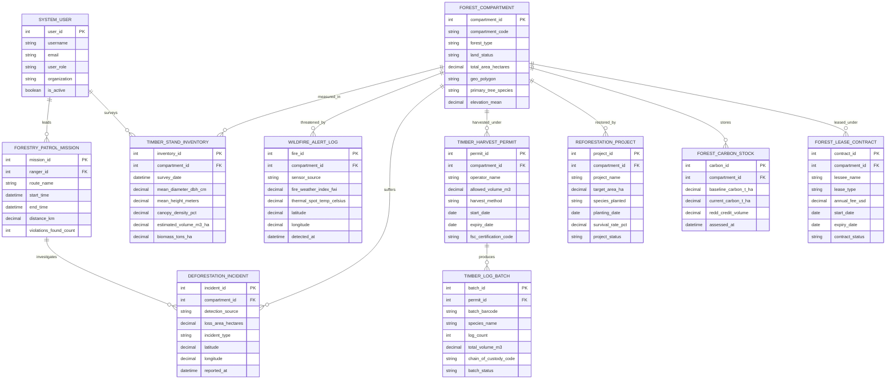

# Conceptual ERD — Forestry Resource Management System

## Mermaid Code

## Entity Description Table | Bang mo ta Entity

| # | Entity Name | Vietnamese Name | Description | Key Attributes | Main Relationships |
|---|-------------|-----------------|-------------|----------------|-------------------|
| 1 | FOREST_COMPARTMENT | Tiêu Khu Lâm Nghiệp | Stores master GIS boundaries, legal land status (Protection, Production, Special-Use), species, elevation, and area ($ha$) | compartment_id, compartment_code, forest_type, land_status, total_area_hectares, geo_polygon | Measured in INVENTORY, threatened by WILDFIRE, harvested under PERMIT |
| 2 | TIMBER_STAND_INVENTORY | Điều Tra Trữ Lượng Gỗ | Stores forest inventory survey results: mean tree height, mean DBH ($cm$), canopy density $\%$, and volume ($m^3/ha$) | inventory_id, compartment_id, survey_date, mean_diameter_dbh_cm, estimated_volume_m3_ha | Belongs to FOREST_COMPARTMENT, surveyed by SYSTEM_USER |
| 3 | WILDFIRE_ALERT_LOG | Nhật Ký Cảnh Báo Cháy Rừng | Logs MODIS/VIIRS satellite thermal hotspots, IoT sensor fire weather index (FWI) ratings, and hotspot temperatures | fire_id, compartment_id, sensor_source, fire_weather_index_fwi, thermal_spot_temp_celsius, detected_at | Threatens FOREST_COMPARTMENT |
| 4 | DEFORESTATION_INCIDENT | Biến Cố Mất Rừng & Chặt Phá | Captures satellite GLAD/RADD canopy loss alerts, detected illegal logging area ($ha$), incident location, and investigation status | incident_id, compartment_id, detection_source, loss_area_hectares, incident_type, reported_at | Suffered by FOREST_COMPARTMENT, investigated by PATROL_MISSION |
| 5 | TIMBER_HARVEST_PERMIT | Giấy Phép Khai Thác Gỗ | Stores legal logging permits, allowed volume quota ($m^3$), harvest blocks, FSC certification codes, and validity dates | permit_id, compartment_id, operator_name, allowed_volume_m3, harvest_method, fsc_certification_code | Issued for FOREST_COMPARTMENT, produces TIMBER_LOG_BATCH |
| 6 | TIMBER_LOG_BATCH | Lô Gỗ Khai Thác Barcode | Tracks harvested log batches, barcode IDs, species, log count, total volume ($m^3$), and FSC chain-of-custody codes | batch_id, permit_id, batch_barcode, species_name, total_volume_m3, chain_of_custody_code | Produced from TIMBER_HARVEST_PERMIT |
| 7 | REFORESTATION_PROJECT | Dự Án Trồng Lại Rừng | Manages tree planting campaigns, afforestation target areas ($ha$), species planted, survival rates ($\%$), and status | project_id, compartment_id, project_name, target_area_ha, species_planted, survival_rate_pct | Restores FOREST_COMPARTMENT |
| 8 | FOREST_CARBON_STOCK | Trữ Lượng Carbon Rừng | Tracks baseline and current forest carbon stocks ($tC/ha$), biomass density, and REDD+ avoided deforestation credits | carbon_id, compartment_id, baseline_carbon_t_ha, current_carbon_t_ha, redd_credit_volume | Stored in FOREST_COMPARTMENT |
| 9 | FORESTRY_PATROL_MISSION | Chuyến Tuần Tra Rừng | Tracks SMART-compliant forest ranger patrol routes, distance covered ($km$), illegal logging violations, and status | mission_id, ranger_id, route_name, start_time, distance_km, violations_found_count | Led by SYSTEM_USER, investigates DEFORESTATION_INCIDENT |
| 10 | FOREST_LEASE_CONTRACT | Hợp Đồng Cho Thuê Rừng | Manages commercial forest land lease contracts, lessee details, annual fees ($USD$), and concession lease dates | contract_id, compartment_id, lessee_name, lease_type, annual_fee_usd, start_date, expiry_date | Leases FOREST_COMPARTMENT |
| 11 | SYSTEM_USER | Người Dùng Hệ Thống | Stores user credentials, roles (Ranger, Enterprise Manager, Specialist, Admin), organizations, and security access | user_id, username, user_role, organization, is_active | Leads FORESTRY_PATROL_MISSION, surveys TIMBER_STAND_INVENTORY |

## Relationship Description | Mo ta Quan he

| # | From Entity | Cardinality | To Entity | Relationship Label | Business Explanation |
|---|-------------|-------------|-----------|-------------------|----------------------|
| 1 | FOREST_COMPARTMENT | one-to-many | TIMBER_STAND_INVENTORY | measured_in | A forest compartment undergoes periodic timber stand volume and biomass inventory surveys |
| 2 | FOREST_COMPARTMENT | one-to-many | WILDFIRE_ALERT_LOG | threatened_by | A forest compartment can be threatened by satellite or IoT detected thermal wildfire alerts |
| 3 | FOREST_COMPARTMENT | one-to-many | DEFORESTATION_INCIDENT | suffers | A forest compartment can suffer from satellite-detected canopy loss or illegal logging incidents |
| 4 | FOREST_COMPARTMENT | one-to-many | TIMBER_HARVEST_PERMIT | harvested_under | Production forest compartments are harvested under approved legal timber harvest permits |
| 5 | TIMBER_HARVEST_PERMIT | one-to-many | TIMBER_LOG_BATCH | produces | An approved harvest permit produces multiple barcoded timber log batches during logging |
| 6 | FOREST_COMPARTMENT | one-to-many | REFORESTATION_PROJECT | restored_by | A forest compartment is restored through planned tree planting and afforestation projects |
| 7 | FOREST_COMPARTMENT | one-to-many | FOREST_CARBON_STOCK | stores | A forest compartment stores measurable biomass carbon stocks eligible for REDD+ credits |
| 8 | FOREST_COMPARTMENT | one-to-many | FOREST_LEASE_CONTRACT | leased_under | A forest compartment can be leased to commercial operators under formal forest land contracts |
| 9 | SYSTEM_USER | one-to-many | FORESTRY_PATROL_MISSION | leads | A forest ranger system user leads and executes anti-deforestation patrol missions in the field |
| 10 | FORESTRY_PATROL_MISSION | one-to-many | DEFORESTATION_INCIDENT | investigates | A forestry patrol mission investigates satellite deforestation alerts and logs crime evidence |
| 11 | SYSTEM_USER | one-to-many | TIMBER_STAND_INVENTORY | surveys | A remote sensing specialist or forestry officer surveys timber stand inventories |
