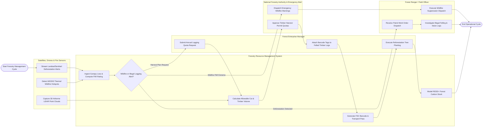

# Swimlane Diagram — Forestry Resource Management System

## Mermaid Code

## Flow Description | Mo ta luong

| Lane | Actor | Role in Flow |
|------|-------|-------------|
| 1 | Satellites, Drones & Fire Sensors | Sentinel-2 and Landsat satellites stream GLAD/RADD canopy loss alerts, MODIS sensors detect thermal wildfire hotspots, and 3D airborne LiDAR drones capture tree height and biomass profiles |
| 2 | Forestry Resource Management System | Ingests satellite canopy loss feeds, computes Fire Weather Index (FWI) ratings, evaluates alert conditions, calculates Annual Allowable Cut (AAC) timber volumes, generates FSC barcodes, and models REDD+ carbon stocks |
| 3 | Forest Ranger / Field Officer | Receives emergency SMART patrol work orders, navigates to target satellite alert coordinates, investigates illegal logging stumps, seizes contraband timber, and leads wildfire suppression teams |
| 4 | Forest Enterprise Manager | Submits annual commercial logging quota applications, attaches physical barcode/RFID tags to felled timber logs at landing sites, and executes post-harvest reforestation tree planting |
| 5 | National Forestry Authority & Emergency Alert | Approves legal timber harvest quotas and FSC permits, and dispatches high-priority emergency wildfire warnings to local communities and fire brigades when FWI reaches Extreme |
