# Action Tree — Forestry Resource Management System

## Mermaid Code

```mermaid
graph TD
    Root["Forestry Resource Management System"]

    Root --> M1["Forest Stand & Cadastral Land Management"]
    Root --> M2["Satellite Remote Sensing & Deforestation"]
    Root --> M3["Wildfire Risk & Thermal Anomaly Monitoring"]
    Root --> M4["Sustainable Timber Harvesting & FSC Traceability"]
    Root --> M5["Reforestation, Afforestation & REDD+ Carbon"]
    Root --> M6["Forest Protection Patrol & Illegal Logging"]
    Root --> M7["Forestry Standards & System Administration"]

    M1 --> A11["Register Forest Compartment GIS Polygons"]
    M1 --> A12["Set Statutory Land Classification Types"]
    M1 --> A13["Manage Forest Concession Lease Contracts"]
    M1 --> A14["Map Watershed & Stream Buffer Boundaries"]

    M2 --> A21["Ingest Landsat & Sentinel Deforestation Feeds"]
    M2 --> A22["Process Airborne LiDAR Point Cloud Models"]
    M2 --> A23["Classify Multi-Temporal Canopy Cover Changes"]
    M2 --> A24["Detect Unpermitted Forest Road Openings"]

    M3 --> A31["Calculate Canadian Fire Weather Index FWI"]
    M3 --> A32["Ingest MODIS & VIIRS Thermal Hotspot Feeds"]
    M3 --> A33["Monitor In-situ Forest Fire Station Telemetry"]
    M3 --> A34["Dispatch Emergency Wildfire Warning Alerts"]

    M4 --> A41["Calculate Annual Allowable Cut AAC Quotas"]
    M4 --> A42["Designate Timber Harvest Blocks & Buffer Zones"]
    M4 --> A43["Generate Log Barcode Tags & Transport Passes"]
    M4 --> A44["Verify FSC & PEFC Chain-of-Custody Integrity"]

    M5 --> A51["Track Reforestation Tree Planting Projects"]
    M5 --> A52["Monitor Nursery Seedling Inventory & Survival Rates"]
    M5 --> A53["Quantify Forest Biomass & Carbon Stocks"]
    M5 --> A54["Calculate REDD+ Avoided Deforestation Credits"]

    M6 --> A61["Plan SMART Standards Ranger Patrol Routes"]
    M6 --> A62["Dispatch Investigation Work Orders for Alerts"]
    M6 --> A63["Log Confiscated Timber & Seized Equipment"]
    M6 --> A64["Track Forest Crime Prosecutions & Fines"]

    M7 --> A71["Configure Fire Weather Index FWI Risk Breakpoints"]
    M7 --> A72["Manage FSC & PEFC Certification Standards Rules"]
    M7 --> A73["Export National Forest Inventory FRA Reports"]
    M7 --> A74["Manage User Roles & Security Access Credentials"]
```

## Module Description | Mo ta Module

| # | Module | Description | Actions |
|---|--------|-------------|---------|
| 1 | Forest Stand & Cadastral Land Management | Manages forest compartment GIS polygons, statutory land classification types (Protection, Production, Special-Use), forest lease contracts, and stream buffer zones | Register Forest Compartment GIS Polygons, Set Statutory Land Classification Types, Manage Forest Concession Lease Contracts, Map Watershed & Stream Buffer Boundaries |
| 2 | Satellite Remote Sensing & Deforestation | Ingests satellite canopy loss alerts (GLAD/RADD), processes 3D airborne LiDAR point clouds, classifies multi-temporal forest cover changes, and detects unpermitted roads | Ingest Landsat & Sentinel Deforestation Feeds, Process Airborne LiDAR Point Cloud Models, Classify Multi-Temporal Canopy Cover Changes, Detect Unpermitted Forest Road Openings |
| 3 | Wildfire Risk & Thermal Anomaly Monitoring | Computes the Canadian Fire Weather Index (FWI), ingests satellite MODIS/VIIRS thermal hotspots, monitors IoT weather stations, and dispatches emergency fire alerts | Calculate Canadian Fire Weather Index FWI, Ingest MODIS & VIIRS Thermal Hotspot Feeds, Monitor In-situ Forest Fire Station Telemetry, Dispatch Emergency Wildfire Warning Alerts |
| 4 | Sustainable Timber Harvesting & FSC Traceability | Calculates Annual Allowable Cut (AAC) logging quotas, designates harvest blocks, generates FSC/PEFC barcode tags, and verifies timber transport passes | Calculate Annual Allowable Cut AAC Quotas, Designate Timber Harvest Blocks & Buffer Zones, Generate Log Barcode Tags & Transport Passes, Verify FSC & PEFC Chain-of-Custody Integrity |
| 5 | Reforestation, Afforestation & REDD+ Carbon | Tracks tree planting projects, seedling nursery inventories, sapling survival rates, quantifies forest carbon stocks ($tC/ha$), and calculates REDD+ carbon credits | Track Reforestation Tree Planting Projects, Monitor Nursery Seedling Inventory & Survival Rates, Quantify Forest Biomass & Carbon Stocks, Calculate REDD+ Avoided Deforestation Credits |
| 6 | Forest Protection Patrol & Illegal Logging | Plans SMART-compliant ranger patrol routes, dispatches alert investigation work orders, logs confiscated illegal timber, and tracks environmental crime prosecutions | Plan SMART Standards Ranger Patrol Routes, Dispatch Investigation Work Orders for Alerts, Log Confiscated Timber & Seized Equipment, Track Forest Crime Prosecutions & Fines |
| 7 | Forestry Standards & System Administration | Configures FWI risk rating thresholds, manages FSC/PEFC compliance standards, exports national forest inventory reports (FAO FRA), and manages user roles | Configure Fire Weather Index FWI Risk Breakpoints, Manage FSC & PEFC Certification Standards Rules, Export National Forest Inventory FRA Reports, Manage User Roles & Security Access Credentials |
