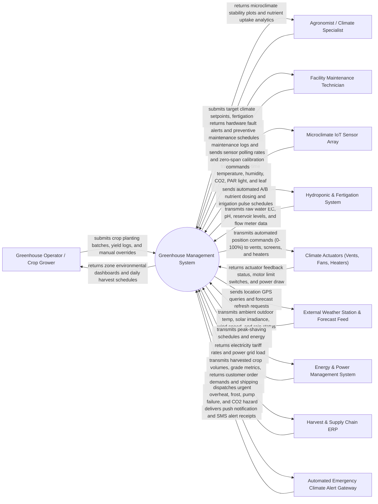

# Context Diagram — Greenhouse Management System

## Mermaid Code

## Actor & Interaction Table | Bang Actor & Tuong tac

| # | Actor | Actor Type | Data Sent TO System | Data Received FROM System | Notes |
|---|-------|------------|---------------------|---------------------------|-------|
| 1 | Greenhouse Operator / Crop Grower | Primary | Crop planting batch logs, manual actuator override commands, harvest yields | Real-time greenhouse climate dashboards, daily task lists, harvest schedules | Primary operator monitoring day-to-day greenhouse conditions and harvesting |
| 2 | Agronomist / Climate Specialist | Primary | Temperature/humidity setpoints, VPD target curves, fertigation NPK recipes, Daily Light Integral (DLI) goals | Microclimate stability plots, Vapor Pressure Deficit (VPD) heatmaps, EC/pH graphs | Specialist designing crop environment strategies, nutrient dosing, and lighting regimes |
| 3 | Facility Maintenance Technician | Primary | Actuator repair logs, motor maintenance completion notes, sensor calibration readings | Equipment failure alarms, motor overload warnings, preventive maintenance tickets | Technician maintaining mechanical vents, heating boilers, fertigation pumps, and sensors |
| 4 | Microclimate IoT Sensor Array | Supporting System | Real-time temperature ($^\circ C$), relative humidity ($\%$), $CO_2$ ($ppm$), PAR solar radiation ($\mu mol/m^2/s$), leaf wetness | Sensor sampling frequencies, zero-span calibration commands, optical sensor wipers | High-precision IoT sensors installed at crop canopy height across greenhouse bays |
| 5 | Hydroponic & Fertigation System | Supporting System | Raw water EC ($mS/cm$), pH, nutrient tank levels, drain water EC/pH, irrigation flow rates ($L/min$) | Automated A/B fertilizer dosing pulses, acid/base injection commands, irrigation schedules | Automated fertigation rig mixing concentrated NPK fertilizers and water for crop delivery |
| 6 | Automated Climate Actuators | Supporting System | Vent opening percentage ($0-100\%$), curtain shade position, heater burner status, exhaust fan speed, fogger status | Proportional PID position commands, step execution triggers, emergency safety closure signals | Mechanical actuators: ridge vents, side curtains, thermal screens, HAF fans, boilers, foggers |
| 7 | External Weather Station & Forecast Feed | Supporting System | Outdoor ambient temperature, relative humidity, solar irradiance ($W/m^2$), wind direction/speed, rain detection | Location GPS queries, 24-hour weather forecast refresh requests | Outdoor weather station providing meteorological context for anticipatory climate control |
| 8 | Energy & Power Management System | Supporting System | Electricity tariff structures (peak/off-peak rates), real-time power grid draw ($kW$), generator status | Peak-shaving load shedding commands, heat storage tank charging schedules | Facility energy management system optimizing electricity and heating fuel consumption |
| 9 | Harvest & Supply Chain ERP | Supporting System | Customer sales orders, packaging specifications, delivery shipping schedules | Harvested crop volume ($kg$), crop quality grade percentages, batch barcodes | Corporate ERP system integration coordinating greenhouse harvest with customer delivery |
| 10 | Automated Emergency Climate Alert Gateway | Supporting System | SMS delivery receipts, alert dispatch status logs | High-priority extreme climate alarms (Overheat $>38^\circ C$, Frost $<4^\circ C$, Boiler Failure, CO2 Leak) | Multi-channel communication service broadcasting urgent alarms to growers and technicians |

## System Boundary Description | Mo ta Pham vi He thong

The **Greenhouse Management System** is a closed-loop precision environmental control platform designed to monitor internal microclimate conditions, calculate Vapor Pressure Deficit (VPD) and Daily Light Integral (DLI), execute PID climate actuator control (roof vents, thermal screens, boilers, foggers), automate hydroponic fertigation dosing (EC/pH), manage LED grow lights, and optimize energy efficiency.

The **system boundary** encompasses IoT sensor telemetry ingestion, Vapor Pressure Deficit (VPD) computation, closed-loop PID and feedforward weather-predictive actuator control, hydroponic A/B nutrient recipe execution, supplemental LED lighting control, crop harvest batch tracking, and automated emergency alarm dispatching.

**External to the system boundary** are physical plant transpiration thermodynamics, physical chemical dissolution of solid fertilizers in mixing tanks, physical combustion in heating boilers, mechanical gear motor rotation, and public electricity grid infrastructure. System interfaces operate via Modbus RTU/TCP, BACnet MS/TP, MQTT IoT protocols, RESTful web APIs, and CAN-bus industrial automation feeds.
