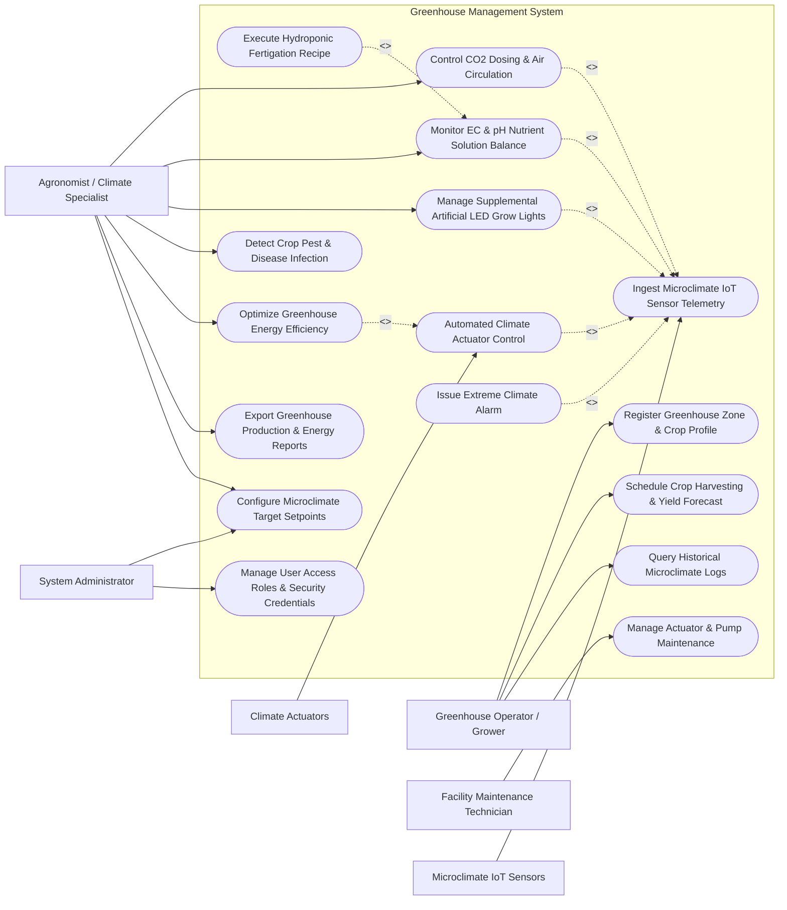

# Use Case Diagram — Greenhouse Management System

## Mermaid Code

## Actor Table | Bang Actor

| # | Actor | Actor Type | Role Description | Related Use Cases |
|---|-------|------------|------------------|-------------------|
| 1 | Greenhouse Operator / Grower | Primary | Field grower registering crop batches, monitoring real-time bay conditions, and harvesting | UC01, UC11, UC12 |
| 2 | Agronomist / Climate Specialist | Primary | Domain specialist configuring climate setpoints, fertigation recipes, LED grow lights, and energy rules | UC04, UC06, UC07, UC08, UC09, UC13, UC14 |
| 3 | Facility Maintenance Technician | Primary | Service technician maintaining mechanical ridge vents, boilers, fertigation pumps, and sensors | UC15 |
| 4 | System Administrator | Primary | Technical administrator managing PID control rules, system parameters, user roles, and security | UC14, UC16 |
| 5 | Microclimate IoT Sensors | Secondary / System | Multi-sensor array measuring temperature, humidity, $CO_2$, PAR solar radiation, and leaf wetness | UC02 |
| 6 | Climate Actuators | Secondary / System | Automated mechanical devices (ridge vents, thermal screens, exhaust fans, heating boilers, foggers) | UC03 |

## Use Case Table | Bang Use Case

| # | UC ID | Use Case Name | Primary Actor | Secondary Actor | Description | Priority |
|---|-------|---------------|---------------|-----------------|-------------|----------|
| 1 | UC01 | Register Greenhouse Zone & Crop Profile | Grower | None | Configures greenhouse bay zones, structure geometry, crop species, and planting batch dates | High |
| 2 | UC02 | Ingest Microclimate IoT Sensor Telemetry | System | Microclimate Sensors | Ingests real-time temperature, humidity, $CO_2$, PAR solar radiation, and VPD telemetry | High |
| 3 | UC03 | Automated Climate Actuator Control | System | Climate Actuators | Executes PID & feedforward control to adjust vents, shade screens, boilers, and fogger valves | High |
| 4 | UC04 | Control CO2 Dosing & Air Circulation | Agronomist | System | Manages liquid $CO_2$ injection to maintain target $800-1200\text{ ppm}$ levels and controls HAF circulation fans | High |
| 5 | UC05 | Execute Hydroponic Fertigation Recipe | Agronomist | System | Delivers precise A/B nutrient solution pulses, water volumes, and irrigation schedules to crop benches | High |
| 6 | UC06 | Monitor EC & pH Nutrient Solution Balance | Agronomist | System | Monitors raw/drain water Electrical Conductivity ($EC$) and pH, adjusting acid/fertilizer dosing pumps | High |
| 7 | UC07 | Manage Supplemental Artificial LED Grow Lights | Agronomist | System | Controls dimmable LED spectrum fixtures to achieve daily target Daily Light Integral (DLI $\text{mol/m}^2/\text{day}$) | High |
| 8 | UC08 | Detect Crop Pest & Disease Infection | Agronomist | System | Analyzes microclimate humidity/leaf wetness trends to predict Botrytis mold and powdery mildew risk | Medium |
| 9 | UC09 | Optimize Greenhouse Energy Efficiency | Agronomist | System | Coordinates thermal screen insulation and boiler heat storage tanks to minimize heating fuel costs | High |
| 10 | UC10 | Issue Extreme Climate Alarm | System | Notification Gateway | Dispatches emergency alerts when greenhouse temperature exceeds $38^\circ C$ or drops below $4^\circ C$ | High |
| 11 | UC11 | Schedule Crop Harvesting & Yield Forecast | Grower | None | Logs harvested fruit/flower weights ($kg$), crop quality grades, and projects weekly harvest volume | Medium |
| 12 | UC12 | Query Historical Microclimate Logs | Grower | None | Provides searchable historical database of 24-hour temperature, VPD curves, $CO_2$, and EC trends | Low |
| 13 | UC13 | Export Greenhouse Production & Energy Reports | Agronomist | System | Generates weekly production reports, energy consumption breakdowns ($kWh/kg$), and water use efficiency | Medium |
| 14 | UC14 | Configure Microclimate Target Setpoints | System Admin | Agronomist | Configures day/night temperature setpoints, humidity bands, VPD targets, and PID tuning gain parameters | High |
| 15 | UC15 | Manage Actuator & Pump Maintenance | Technician | System | Tracks motor operating hours, pump diaphragm maintenance, filter cleaning, and issues work orders | Medium |
| 16 | UC16 | Manage User Access & Security Roles | System Admin | None | Configures user accounts, operational roles (Grower, Agronomist, Technician, Admin), and security keys | Low |

## Use Case Specification | Dac ta Use Case

---

### UC02 — Ingest Microclimate IoT Sensor Telemetry

| Field | Detail |
|-------|--------|
| **UC ID** | UC02 |
| **Use Case Name** | Ingest Microclimate IoT Sensor Telemetry |
| **Actor(s)** | Primary: System   Secondary: Microclimate IoT Sensors |
| **Description** | Ingests high-frequency sensor telemetry (Air Temperature, Relative Humidity, $CO_2$ Concentration, PAR Solar Radiation, Leaf Wetness, Substrate Moisture) from greenhouse sensor nodes, computes Vapor Pressure Deficit (VPD), and validates data integrity. |
| **Precondition** | 1. Greenhouse zone and sensor nodes are registered in system with active API keys (UC01).   2. Sensor node Modbus/MQTT wireless network connection is active. |
| **Main Flow** | 1. Microclimate sensor nodes collect environmental metrics at canopy height every 30 seconds.   2. Sensor node packages telemetry payload: Zone ID, Node ID, Timestamp, Air Temperature ($^\circ C$), Relative Humidity ($\%$), $CO_2$ Concentration ($ppm$), PAR Solar Radiation ($\mu mol/m^2/s$), Substrate VWC ($\%$), and Leaf Wetness ($\%$).   3. Node transmits payload to System gateway via Modbus RTU/TCP or MQTT over TLS.   4. System ingests packet, parses sensor fields, and validates payload integrity.   5. System calculates **Vapor Pressure Deficit (VPD)** in kilopascals ($kPa$):   &nbsp;&nbsp;&nbsp;&nbsp;a. Calculate Saturated Vapor Pressure ($VP_{sat}$): $$VP_{sat} = 0.61078 \times e^{\left( \frac{17.27 \times T}{T + 237.3} \right)}$$   &nbsp;&nbsp;&nbsp;&nbsp;b. Calculate Actual Vapor Pressure ($VP_{act}$): $$VP_{act} = VP_{sat} \times \left( \frac{RH}{100} \right)$$   &nbsp;&nbsp;&nbsp;&nbsp;c. Calculate $\text{VPD} = VP_{sat} - VP_{act}$.   6. System checks VPD value against target crop growth stage band (e.g., $0.8 - 1.2\text{ kPa}$ for vegetative stage).   7. System stores validated 30-second telemetry record in time-series database.   8. System updates real-time greenhouse bay dashboard and triggers automated actuator control (UC03). |
| **Alternative Flow** | **AF1** — Aspirational Psychrometer Backup: If digital humidity sensor degrades due to high moisture, system switches to aspirated wet-bulb/dry-bulb psychrometer calculations. |
| **Exception Flow** | **EX1** — Extreme Sensor Outlier / Solar Radiation Bias: Sensor reads $60^\circ C$ due to direct sunlight hitting unshaded sensor box; system flags data as `SOLAR_RADIATION_BIAS` and switches to aspirated sensor reading. |
| **Postcondition** | Validated temperature, RH, $CO_2$, PAR, and calculated VPD metrics saved in time-series database and available for PID control. |
| **Business Rule** | **BR1**: Temperature sensors must be housed inside aspirated radiation shields with continuous airflow ($>2\text{ m/s}$) to ensure accurate air temperature readings. |

---

### UC03 — Automated Climate Actuator Control

| Field | Detail |
|-------|--------|
| **UC ID** | UC03 |
| **Use Case Name** | Automated Climate Actuator Control |
| **Actor(s)** | Primary: System   Secondary: Climate Actuators |
| **Description** | Executes closed-loop PID and feedforward weather-predictive control algorithms to proportionally adjust ridge vents, thermal shading screens, exhaust fans, heating boilers, and fogging systems to maintain target temperature, humidity, and VPD setpoints. |
| **Precondition** | 1. Ingested microclimate telemetry and calculated VPD (UC02) are updated.   2. Target climate setpoints (day/night temp, humidity, VPD bands) are configured (UC14). |
| **Main Flow** | 1. System compares current greenhouse zone temperature, RH, and VPD against target setpoints.   2. System evaluates outdoor weather forecast feed (outdoor temp, wind speed/direction, rain detection).   3. System executes Proportional-Integral-Derivative (PID) control loops:   &nbsp;&nbsp;&nbsp;&nbsp;a. **Cooling Mode**: If temperature exceeds target by $>1.5^\circ C$, system opens leeward ridge vents proportionally ($0-100\%$) and starts HAF air circulation fans.   &nbsp;&nbsp;&nbsp;&nbsp;b. **High Radiation Mode**: If outdoor solar irradiance exceeds $700\text{ W/m}^2$, system deploys thermal shade screens to $70\%$ coverage to prevent crop sunscald.   &nbsp;&nbsp;&nbsp;&nbsp;c. **High VPD / Humidification Mode**: If VPD exceeds $1.5\text{ kPa}$ (air too dry), system pulse-activates high-pressure fogging nozzles (10 seconds ON / 30 seconds OFF).   &nbsp;&nbsp;&nbsp;&nbsp;d. **Heating Mode**: If temperature drops below night setpoint ($16^\circ C$), system activates heating boiler mixing valves and deploys energy-saving thermal screens ($100\%$ closed).   4. System transmits position commands ($0-100\%$) to corresponding Climate Actuator motor controllers via BACnet/Modbus.   5. Actuators execute commands and return motor limit switch position feedback.   6. System logs actuator execution event and monitors climate response. |
| **Alternative Flow** | **AF1** — Rain / High Wind Storm Lockout: If external weather station detects rain or wind speed $>40\text{ km/h}$, system overrides cooling PID loop and forces 100% immediate closure of all roof ridge vents to prevent structural wind damage or water ingress. |
| **Exception Flow** | **EX1** — Actuator Motor Jammed: Roof vent motor fails to move following command; system detects feedback mismatch, logs `ACTUATOR_MOTOR_JAMMED` alarm, and triggers backup exhaust fans. |
| **Postcondition** | Climate actuators positioned, greenhouse microclimate stabilized within target setpoint bands, and execution logs recorded. |
| **Business Rule** | **BR1**: Vents on the windward side of the greenhouse must close first during high wind conditions to prevent roof uplift. |

---

### UC05 — Execute Hydroponic Fertigation Recipe

| Field | Detail |
|-------|--------|
| **UC ID** | UC05 |
| **Use Case Name** | Execute Hydroponic Fertigation Recipe |
| **Actor(s)** | Primary: Agronomist / Climate Specialist   Secondary: System |
| **Description** | Automates the mixing and delivery of concentrated A/B macro/micronutrient fertilizers and water according to growth-stage specific fertigation recipes, controlling irrigation pulse frequency, volume, and drain percentage. |
| **Precondition** | 1. Fertigation recipe (target EC, pH, N-P-K-Ca-Mg ratios) is selected for current crop growth stage.   2. Concentrate Stock Tank A (Calcium Nitrate, Iron), Stock Tank B (Potassium Phosphate, Magnesium Sulfate), and Acid Tank are filled. |
| **Main Flow** | 1. System checks scheduled irrigation trigger criteria (Timer-based, Solar Radiation Accumulation, or Substrate VWC depletion $<35\%$).   2. System retrieves target fertigation recipe parameters: Target $\text{EC} = 2.2\text{ mS/cm}$, Target $\text{pH} = 5.8$, Irrigation Volume $= 250\text{ mL/plant}$.   3. System opens raw water supply valve into mixing tank.   4. System modulates peristaltic dosing pumps for Stock Tank A and Stock Tank B to inject concentrated fertilizer until in-line EC probe reads $2.2\text{ mS/cm}$.   5. System modulates acid dosing pump ($HNO_3 / H_3PO_4$) to adjust solution pH to $5.8$.   6. System opens solenoid distribution valves for target greenhouse crop bench zone.   7. System runs main irrigation pump, delivering $250\text{ mL}$ nutrient solution per drip emitter.   8. System measures total delivered water volume via flow meter and monitors drainage tray volume ($mL$).   9. System calculates Drain Percentage ($\% \text{Drain} = \frac{\text{Drain Volume}}{\text{Delivered Volume}} \times 100$) and targets $15-20\%$ leaching fraction to prevent root zone salt accumulation.   10. System logs fertigation transaction and updates daily irrigation water budget. |
| **Alternative Flow** | **AF1** — High Solar Radiation Pulse Acceleration: System accelerates irrigation pulse frequency on sunny days when accumulated solar radiation reaches $250\text{ J/cm}^2$. |
| **Exception Flow** | **EX1** — Fertigation Dosing Lockout: In-line EC probe measures extreme spike ($\text{EC} > 4.5\text{ mS/cm}$) due to stuck dosing valve; system instantly shuts off main irrigation pump, flushes lines with fresh water, and triggers operator alarm. |
| **Postcondition** | Hydroponic nutrient solution delivered to crop roots, EC/pH balanced, drain percentage recorded, and fertigation log saved. |
| **Business Rule** | **BR1**: Direct raw un-mixed concentrated fertilizer injection into crop drip lines is strictly prohibited; all solution must be homogenized in a mixing tank/manifold before delivery. |

---

### UC06 — Monitor EC & pH Nutrient Solution Balance

| Field | Detail |
|-------|--------|
| **UC ID** | UC06 |
| **Use Case Name** | Monitor EC & pH Nutrient Solution Balance |
| **Actor(s)** | Primary: Agronomist / Climate Specialist   Secondary: System |
| **Description** | Continuously monitors raw water, mixed fertigation solution, and recycled drainage water Electrical Conductivity (EC) and pH levels, performing automated two-point calibration tracking and acid/fertilizer ratio adjustments. |
| **Precondition** | 1. In-line dual-redundant EC and pH sensor probes are installed in fertigation mixing manifold and drain return lines. |
| **Main Flow** | 1. System reads continuous EC ($mS/cm$) and pH sensor signals from fertigation mixing loop during irrigation cycles.   2. System applies temperature compensation formula to normalize EC to $25^\circ C$: $$\text{EC}_{25} = \frac{\text{EC}_T}{1 + 0.0191 \times (T - 25)}$$   3. System checks measured EC against recipe setpoint ($\text{EC}_{target} \pm 0.1\text{ mS/cm}$).   4. System checks measured pH against recipe setpoint ($\text{pH}_{target} \pm 0.2$).   5. If pH rises above $6.2$ (alkaline raw water), system increases acid pump pulse rate.   6. System measures recycled drainage water EC ($\text{EC}_{drain}$) from slab drain sensors.   7. If $\text{EC}_{drain}$ exceeds feed EC by $>1.0\text{ mS/cm}$ (indicates salt buildup in rockwool/coco substrate), system automatically reduces feed EC on next cycle and increases irrigation volume to flush root zone.   8. System logs EC/pH trends and displays real-time stability graphs on agronomist dashboard. |
| **Alternative Flow** | **AF1** — Closed-Loop Recirculating Hydroponics: System routes drain water through UV sterilizer, measures residual EC, and blends recycled water with fresh raw water to save $30\%$ fertilizer. |
| **Exception Flow** | **EX1** — pH Probe Glass Failure / Calibration Drift: Dual pH probes diverge by $>0.5\text{ pH}$ units; system flags `pH_PROBE_DIVERGENCE_FAULT`, freezes automated acid dosing, and alerts maintenance technician (UC15). |
| **Postcondition** | EC and pH nutrient solution balance maintained within safe agronomic limits and telemetry logged in time-series database. |
| **Business Rule** | **BR1**: Substrate drain water pH must be maintained between $5.5$ and $6.5$ to ensure optimal micronutrient (Iron, Manganese, Zinc) availability. |

---

### UC07 — Manage Supplemental Artificial LED Grow Lights

| Field | Detail |
|-------|--------|
| **UC ID** | UC07 |
| **Use Case Name** | Manage Supplemental Artificial LED Grow Lights |
| **Actor(s)** | Primary: Agronomist / Climate Specialist   Secondary: System |
| **Description** | Controls dimmable multi-spectrum LED grow light fixtures, calculating natural outdoor PAR solar radiation accumulation and dynamically adjusting artificial light intensity to achieve target Daily Light Integral (DLI $\text{mol/m}^2/\text{day}$). |
| **Precondition** | 1. Dimmable LED grow light fixtures (0-10V or DALI control) are installed in greenhouse bays.   2. PAR solar radiation sensors ($\mu mol/m^2/s$) are connected inside and outside greenhouse. |
| **Main Flow** | 1. Agronomist configures target Daily Light Integral (e.g., Target $\text{DLI} = 18\text{ mol/m}^2/\text{day}$ for vine tomatoes) and photoperiod window (04:00 AM to 10:00 PM).   2. System continuously integrates indoor PAR sensor readings ($\mu mol/m^2/s$) to calculate accumulated natural DLI:   &nbsp;&nbsp;&nbsp;&nbsp;$$\text{DLI}_{natural} = \sum \left( \text{PAR} \times 3600 \times 10^{-6} \right)$$   3. System checks remaining photoperiod hours and calculates required supplemental PAR intensity ($\mu mol/m^2/s$) to hit target DLI by end of day.   4. If natural sunlight drops (e.g., heavy cloud cover or afternoon sunset), system calculates required LED dimming level ($0-100\%$).   5. System transmits 0-10V or DALI dimming signals to LED driver power supplies.   6. LED fixtures illuminate greenhouse bay at calculated intensity level.   7. As natural sunlight increases, system automatically dims or turns off LED fixtures to conserve electricity.   8. System logs daily total DLI ($\text{DLI}_{natural} + \text{DLI}_{supplemental}$) and energy consumption ($kWh$). |
| **Alternative Flow** | **AF1** — Far-Red End-of-Day Spectrum Burst: System activates dedicated Far-Red ($730\text{ nm}$) LED channels for 15 minutes at dusk to trigger shade avoidance extension growth in young plants. |
| **Exception Flow** | **EX1** — Electricity Peak Tariff Curtailment: Power management system signals peak electricity tariff rate (UC09); system dims LED fixtures to maximum 30% power during peak 2-hour window to reduce utility costs. |
| **Postcondition** | Supplemental LED grow lights dynamically dimmed, target DLI achieved, and lighting energy consumption logged. |
| **Business Rule** | **BR1**: Artificial grow lights must not be operated during designated crop dark-period rest hours (minimum 6 continuous dark hours required for night respiration). |
