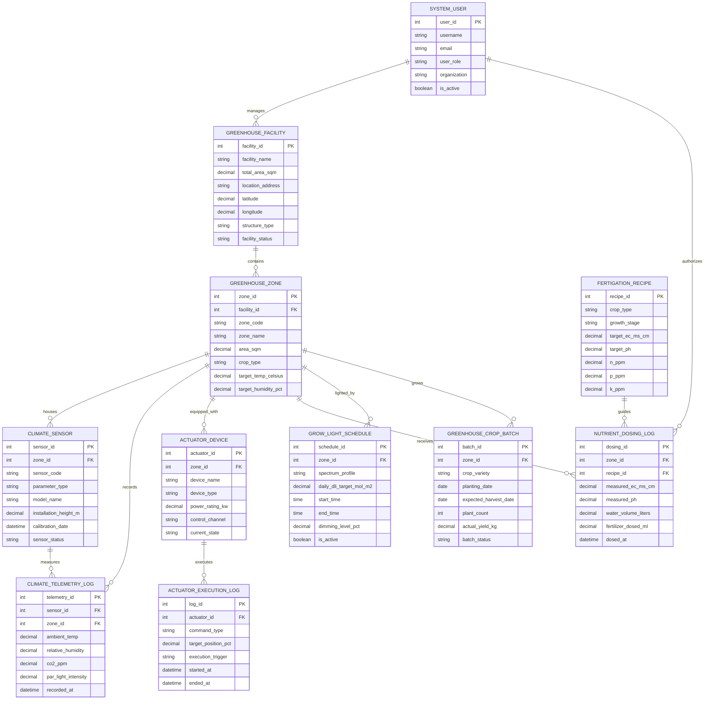

# Conceptual ERD — Greenhouse Management System

## Mermaid Code

## Entity Description Table | Bang mo ta Entity

| # | Entity Name | Vietnamese Name | Description | Key Attributes | Main Relationships |
|---|-------------|-----------------|-------------|----------------|-------------------|
| 1 | GREENHOUSE_FACILITY | Cơ Sở Nhà Kính Master | Stores greenhouse facility master profiles, total area ($m^2$), structure types (Venlo glass, Polyethylene film), location, and status | facility_id, facility_name, total_area_sqm, structure_type, latitude, longitude, facility_status | Contains GREENHOUSE_ZONE, managed by SYSTEM_USER |
| 2 | GREENHOUSE_ZONE | Phân Khu Nhà Kính (Bay) | Represents individual greenhouse bays, area ($m^2$), target crop species, temperature setpoints ($^\circ C$), and humidity targets | zone_id, facility_id, zone_code, zone_name, area_sqm, crop_type, target_temp_celsius | Belongs to FACILITY, houses SENSOR, equipped with ACTUATOR, grows BATCH |
| 3 | CLIMATE_SENSOR | Cảm Biến Vi Khí Hậu | Stores individual IoT sensor device hardware specs, measured parameter (Temp, RH, $CO_2$, PAR, Leaf Wetness), and calibration dates | sensor_id, zone_id, sensor_code, parameter_type, model_name, installation_height_m, sensor_status | Housed in GREENHOUSE_ZONE, measures CLIMATE_TELEMETRY_LOG |
| 4 | CLIMATE_TELEMETRY_LOG | Nhật Ký Vi Khí Hậu | High-frequency telemetry storing temperature, relative humidity, $CO_2$ ($ppm$), PAR solar radiation ($\mu mol/m^2/s$), and calculated VPD | telemetry_id, sensor_id, zone_id, ambient_temp, relative_humidity, co2_ppm, par_light_intensity, recorded_at | Measured by CLIMATE_SENSOR, recorded in GREENHOUSE_ZONE |
| 5 | ACTUATOR_DEVICE | Thiết Bị Chấp Hành | Stores mechanical climate control actuators (ridge vent motors, shade curtains, exhaust fans, heating boilers, foggers) | actuator_id, zone_id, device_name, device_type, power_rating_kw, control_channel, current_state | Equipped in GREENHOUSE_ZONE, executes ACTUATOR_EXECUTION_LOG |
| 6 | ACTUATOR_EXECUTION_LOG | Nhật Ký Vận Hành Chấp Hành | Records automated position command executions ($0-100\%$), execution triggers (PID, weather override, emergency), and timestamps | log_id, actuator_id, command_type, target_position_pct, execution_trigger, started_at, ended_at | Executed by ACTUATOR_DEVICE |
| 7 | FERTIGATION_RECIPE | Công Thức Phân Bón Dinh Dưỡng | Defines growth-stage specific N-P-K-Ca-Mg chemical recipes, target Electrical Conductivity ($\text{EC } mS/cm$), and target pH | recipe_id, crop_type, growth_stage, target_ec_ms_cm, target_ph, n_ppm, p_ppm, k_ppm | Guides NUTRIENT_DOSING_LOG |
| 8 | NUTRIENT_DOSING_LOG | Nhật Ký Châm Phân Dinh Dưỡng | Records hydroponic fertigation events, measured EC/pH, water volume ($L$), acid dosed ($mL$), and concentrated NPK stock volumes | dosing_id, zone_id, recipe_id, measured_ec_ms_cm, measured_ph, water_volume_liters, dosed_at | Receives dosing in GREENHOUSE_ZONE, guided by FERTIGATION_RECIPE |
| 9 | GROW_LIGHT_SCHEDULE | Lịch Chiếu Sáng Đèn LED | Configures supplemental LED grow light schedules, target Daily Light Integral (DLI $\text{mol/m}^2/\text{day}$), spectrum profile, and dimming levels | schedule_id, zone_id, spectrum_profile, daily_dli_target_mol_m2, start_time, end_time, dimming_level_pct | Lighted in GREENHOUSE_ZONE |
| 10 | GREENHOUSE_CROP_BATCH | Lô Cây Trồng Nhà Kính | Tracks active crop planting batches, crop varieties (tomato, pepper, cucumber, berries), plant counts, and harvested yield ($kg$) | batch_id, zone_id, crop_variety, planting_date, expected_harvest_date, plant_count, actual_yield_kg | Grows in GREENHOUSE_ZONE |
| 11 | SYSTEM_USER | Người Dùng Hệ Thống | Stores user credentials, roles (Grower, Agronomist, Technician, Admin), organizations, and operational access rights | user_id, username, user_role, organization, is_active | Manages GREENHOUSE_FACILITY, authorizes NUTRIENT_DOSING_LOG |

## Relationship Description | Mo ta Quan he

| # | From Entity | Cardinality | To Entity | Relationship Label | Business Explanation |
|---|-------------|-------------|-----------|-------------------|----------------------|
| 1 | GREENHOUSE_FACILITY | one-to-many | GREENHOUSE_ZONE | contains | A greenhouse facility contains multiple controlled climate bays or operational zones |
| 2 | GREENHOUSE_ZONE | one-to-many | CLIMATE_SENSOR | houses | A greenhouse zone houses multiple IoT microclimate sensors installed at canopy height |
| 3 | CLIMATE_SENSOR | one-to-many | CLIMATE_TELEMETRY_LOG | measures | A climate sensor device measures continuous time-series temperature, humidity, $CO_2$, and light logs |
| 4 | GREENHOUSE_ZONE | one-to-many | CLIMATE_TELEMETRY_LOG | records | A greenhouse zone records aggregate microclimate telemetry logs across its sensor network |
| 5 | GREENHOUSE_ZONE | one-to-many | ACTUATOR_DEVICE | equipped_with | A greenhouse zone is equipped with automated actuators (vents, curtains, fans, boilers, foggers) |
| 6 | ACTUATOR_DEVICE | one-to-many | ACTUATOR_EXECUTION_LOG | executes | An actuator device executes multiple automated position command logs over time |
| 7 | GREENHOUSE_ZONE | one-to-many | NUTRIENT_DOSING_LOG | receives_dosing | A greenhouse zone receives automated hydroponic fertigation and nutrient dosing events |
| 8 | FERTIGATION_RECIPE | one-to-many | NUTRIENT_DOSING_LOG | guides | A fertigation recipe guides target EC/pH and nutrient injection ratios during dosing events |
| 9 | GREENHOUSE_ZONE | one-to-many | GROW_LIGHT_SCHEDULE | lighted_by | A greenhouse zone is lighted by configured supplemental LED grow light schedules |
| 10 | GREENHOUSE_ZONE | one-to-many | GREENHOUSE_CROP_BATCH | grows | A greenhouse zone grows sequential or multi-cropped crop planting batches over seasons |
| 11 | SYSTEM_USER | one-to-many | GREENHOUSE_FACILITY | manages | An executive grower or agronomist user manages greenhouse facility operations |
| 12 | SYSTEM_USER | one-to-many | NUTRIENT_DOSING_LOG | authorizes | An agronomist user authorizes fertigation recipes and nutrient dosing adjustments |
