# Swimlane Diagram — Greenhouse Management System

## Mermaid Code

```mermaid
flowchart LR
    Start(["Start Greenhouse Climate Cycle"])

    subgraph SensorSondeLane["Microclimate IoT Sensors & Fertigation Sondes"]
        S1["Measure Temp, RH, CO2 & PAR Radiation"]
        S2["Measure Raw/Drain Water EC & pH"]
        S3["Stream 30-Sec Telemetry to Gateway"]
    end

    subgraph SystemLane["Greenhouse Management System"]
        M1["Calculate VPD & Accumulated DLI"]
        M2["Evaluate Climate Setpoints & Fertigation Triggers"]
        M3{"High Temp / Extreme VPD / High Wind?"}
        M4["Calculate PID Actuator & Fertigation Commands"]
        M5["Trigger Emergency Overheat or Storm Lockout"]
    end

    subgraph AgronomistLane["Agronomist / Climate Specialist"]
        A1["Review VPD Heatmaps & EC/pH Stability"]
        A2["Calibrate Fertigation NPK Recipes & Target DLI"]
    end

    subgraph GrowerLane["Greenhouse Operator / Grower"]
        G1["Inspect Crop Health & Leaf Transpiration"]
        G2["Log Harvested Batch Yield Weights"]
    end

    subgraph ActuatorPumpLane["Actuators, Fertigation Pumps & Grow Lights"]
        C1["Adjust Ridge Vents, Screens & Fogger Solenoids"]
        C2["Pulse Fertigation Dosing Pumps & Inject Acid"]
        C3["Dim DALI/0-10V Supplemental LED Grow Lights"]
    end

    Finish(["End Operational Cycle"])

    Start --> S1 --> S3 --> M1 --> M2 --> M3
    S2 --> S3
    M3 -->|"Normal Climate Variance"| M4 --> C1 --> C2 --> C3 --> A1 --> A2 --> G1 --> G2 --> Finish
    M3 -->|"Extreme Heat >38C or Storm Wind"| M5 --> C1 --> A1 --> Finish
```

## Flow Description | Mo ta luong

| Lane | Actor | Role in Flow |
|------|-------|-------------|
| 1 | Microclimate IoT Sensors & Fertigation Sondes | Microclimate sensors measure canopy temperature, relative humidity, $CO_2$, and PAR solar radiation, while fertigation sondes measure raw/drain water EC and pH, streaming 30-second telemetry over Modbus/MQTT |
| 2 | Greenhouse Management System | Computes Vapor Pressure Deficit (VPD) and Daily Light Integral (DLI), evaluates target setpoints, runs PID control loops, calculates A/B fertigation dosing pulses, dimming levels for LEDs, and handles storm safety lockouts |
| 3 | Agronomist / Climate Specialist | Monitors real-time VPD heatmaps and EC/pH nutrient stability plots, calibrates growth-stage specific NPK recipes, and updates target DLI photoperiod goals |
| 4 | Greenhouse Operator / Grower | Conducts physical crop health inspections in greenhouse bays, monitors plant transpiration, logs harvested crop batch weights, and oversees manual overriding if needed |
| 5 | Actuators, Fertigation Pumps & Grow Lights | Ridge vent motors, thermal shade curtains, and fogger solenoids adjust positions, fertigation pumps deliver precise A/B nutrient pulses, and DALI LED grow lights dynamically dim to target DLI |
