# Action Tree — Greenhouse Management System

## Mermaid Code

```mermaid
graph TD
    Root["Greenhouse Management System"]

    Root --> M1["Facility & Greenhouse Zone Registry"]
    Root --> M2["IoT Telemetry & Environmental Monitoring"]
    Root --> M3["Automated Climate Control & Actuators"]
    Root --> M4["Hydroponic Fertigation & EC/pH Dosing"]
    Root --> M5["Supplemental Lighting & Photoperiod DLI"]
    Root --> M6["Energy Optimization & Harvest Crop Batch"]
    Root --> M7["Actuator Calibration & System Admin"]

    M1 --> A11["Register Greenhouse Bays & Spatial Zones"]
    M1 --> A12["Set Structure Geometry & Glazing Types"]
    M1 --> A13["Configure Crop Species & Growth Stage Profiles"]
    M1 --> A14["Map Sensor & Actuator Hardware Channels"]

    M2 --> A21["Ingest 30-Second Microclimate Sensor Streams"]
    M2 --> A22["Calculate Vapor Pressure Deficit VPD Curves"]
    M2 --> A23["Ingest External Weather Station & Forecast Feeds"]
    M2 --> A24["Detect Microclimate Sensor Outliers & Radiative Biases"]

    M3 --> A31["Execute PID Closed-Loop Temperature Control"]
    M3 --> A32["Control Ridge Vents, Side Curtains & Shading Screens"]
    M3 --> A33["Manage CO2 Liquid Dosing & HAF Circulation Fans"]
    M3 --> A34["Trigger High-Wind & Heavy Rain Safety Lockouts"]

    M4 --> A41["Configure A/B Concentrated Stock NPK Recipes"]
    M4 --> A42["Control Automated Acid & Alkali Dosing Pumps"]
    M4 --> A43["Monitor Raw Water & Root Substrate Drain EC/pH"]
    M4 --> A44["Calculate Irrigation Leaching Fraction & Drain Percent"]

    M5 --> A51["Integrate Indoor PAR Solar Radiation Accumulation"]
    M5 --> A52["Calculate Dynamic Supplemental LED DLI Deficits"]
    M5 --> A53["Transmit DALI & 0-10V LED Driver Dimming Signals"]
    M5 --> A54["Configure Far-Red Dusk Spectrum End-of-Day Bursts"]

    M6 --> A61["Schedule Heating Boiler Thermal Storage Tank Charging"]
    M6 --> A62["Execute Electricity Peak Tariff Load Shedding"]
    M6 --> A63["Log Harvested Crop Batch Weights & Quality Grades"]
    M6 --> A64["Export Greenhouse Energy & Yield Audit Reports"]

    M7 --> A71["Record Sensor Zero-Span Calibration Offsets"]
    M7 --> A72["Track Actuator Motor Operating Hours & Maintenance"]
    M7 --> A73["Configure PID Gain & Weather Feedforward Parameters"]
    M7 --> A74["Manage User Roles & Security Access Credentials"]
```

## Module Description | Mo ta Module

| # | Module | Description | Actions |
|---|--------|-------------|---------|
| 1 | Facility & Greenhouse Zone Registry | Manages greenhouse facility master records, bay zone geometries, glazing types (glass/poly film), crop profiles, and hardware channel mappings | Register Greenhouse Bays & Spatial Zones, Set Structure Geometry & Glazing Types, Configure Crop Species & Growth Stage Profiles, Map Sensor & Actuator Hardware Channels |
| 2 | IoT Telemetry & Environmental Monitoring | Ingests 30-second microclimate telemetry (Temp, RH, $CO_2$, PAR light), computes Vapor Pressure Deficit (VPD), ingests weather feeds, and filters sensor biases | Ingest 30-Second Microclimate Sensor Streams, Calculate Vapor Pressure Deficit VPD Curves, Ingest External Weather Station & Forecast Feeds, Detect Microclimate Sensor Outliers & Radiative Biases |
| 3 | Automated Climate Control & Actuators | Executes PID and weather-predictive control loops for ridge vents, thermal shade screens, liquid $CO_2$ dosing, HAF fans, and storm safety lockouts | Execute PID Closed-Loop Temperature Control, Control Ridge Vents, Side Curtains & Shading Screens, Manage CO2 Liquid Dosing & HAF Circulation Fans, Trigger High-Wind & Heavy Rain Safety Lockouts |
| 4 | Hydroponic Fertigation & EC/pH Dosing | Formulates growth-stage NPK recipes, controls peristaltic acid/fertilizer pumps, monitors raw/drain EC and pH, and calculates leaching fractions | Configure A/B Concentrated Stock NPK Recipes, Control Automated Acid & Alkali Dosing Pumps, Monitor Raw Water & Root Substrate Drain EC/pH, Calculate Irrigation Leaching Fraction & Drain Percent |
| 5 | Supplemental Lighting & Photoperiod DLI | Integrates indoor PAR solar radiation, calculates DLI deficits ($\text{mol/m}^2/\text{day}$), sends DALI/0-10V LED dimming signals, and configures Far-Red dusk bursts | Integrate Indoor PAR Solar Radiation Accumulation, Calculate Dynamic Supplemental LED DLI Deficits, Transmit DALI & 0-10V LED Driver Dimming Signals, Configure Far-Red Dusk Spectrum End-of-Day Bursts |
| 6 | Energy Optimization & Harvest Crop Batch | Coordinates heating boiler storage tanks, executes peak electricity tariff load shedding, logs harvested crop batch weights, and exports energy/yield audit reports | Schedule Heating Boiler Thermal Storage Tank Charging, Execute Electricity Peak Tariff Load Shedding, Log Harvested Crop Batch Weights & Quality Grades, Export Greenhouse Energy & Yield Audit Reports |
| 7 | Actuator Calibration & System Admin | Records sensor zero-span calibration offsets, tracks actuator motor operating hours, tunes PID gain and weather feedforward rules, and manages user security roles | Record Sensor Zero-Span Calibration Offsets, Track Actuator Motor Operating Hours & Maintenance, Configure PID Gain & Weather Feedforward Parameters, Manage User Roles & Security Access Credentials |
