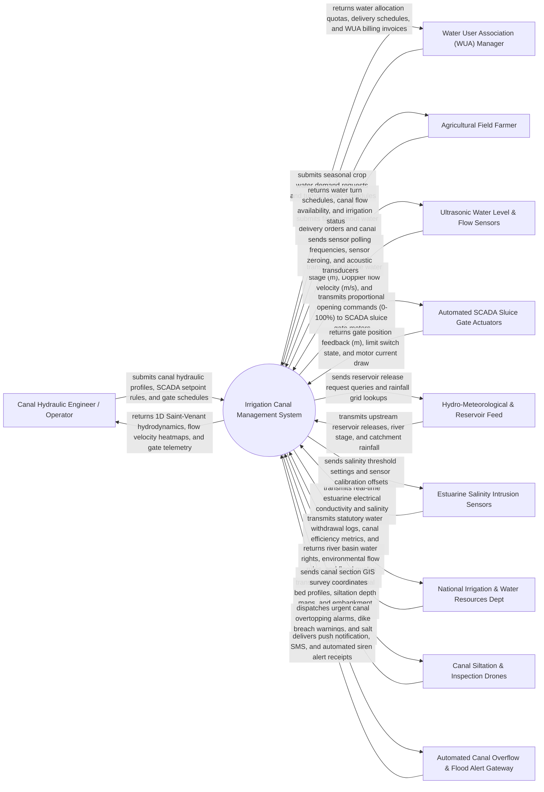

# Context Diagram — Irrigation Canal Management System

## Mermaid Code

## Actor & Interaction Table | Bang Actor & Tuong tac

| # | Actor | Actor Type | Data Sent TO System | Data Received FROM System | Notes |
|---|-------|------------|---------------------|---------------------------|-------|
| 1 | Canal Hydraulic Engineer / Operator | Primary | Canal cross-section geometry, Manning roughness $n$, SCADA PID parameters, gate schedules | Real-time 1D hydrodynamic flow models, sluice gate positions, hydraulic head loss curves | Professional hydraulic engineer operating primary/secondary canal networks and gates |
| 2 | Water User Association (WUA) Manager | Primary | Seasonal cropping pattern area ($ha$), crop water requirement schedules, turnout orders | Seasonal water allocation quotas, water delivery schedules, WUA volumetric billing invoices | Manager representing agricultural water user cooperatives distributing irrigation water |
| 3 | Agricultural Field Farmer | Primary | Farm turnout water delivery requests, canal bank erosion alerts, localized drought claims | Turnout water delivery schedules, canal flow availability status, water turn notifications | Individual farmer receiving canal irrigation water at farm-gate turnout structures |
| 4 | Ultrasonic Water Level & Flow Sensors | Supporting System | Real-time canal water depth ($m$), Acoustic Doppler Current Profiler (ADCP) velocity ($m/s$), discharge ($m^3/s$) | Sensor sampling frequency parameters, zero-stage calibration offsets, transducer clean signals | Ultrasonic radar level sensors and Doppler flow meters installed along canal sections |
| 5 | Automated SCADA Sluice Gate Actuators | Supporting System | Gate height position feedback ($m$), limit switch status (Open/Closed), motor current ($A$), battery state | Proportional opening position commands ($0 - 100\%$), emergency drop signals, motor start/stop | Motorized sluice gates, radial gates, and automated check gates regulating canal water level |
| 6 | Hydro-Meteorological & Reservoir Feed | Supporting System | Upstream dam reservoir discharge ($m^3/s$), river stage ($m$), radar rainfall forecasts ($mm$) | Reservoir release request payloads, downstream irrigation water demand metrics | National weather agency and upstream reservoir management system supplying hydrological inputs |
| 7 | Estuarine Salinity Intrusion Sensors | Supporting System | Real-time electrical conductivity ($EC$), Total Dissolved Solids ($TDS$), salinity concentration ($ppt$) | Salinity alert threshold setpoints ($>1.0\text{ ppt}$), sensor calibration commands | Submersible sensors located at estuarine sluice gates monitoring coastal salt wedge intrusion |
| 8 | National Irrigation & Water Resources Dept | Regulatory System | River basin water rights allocations, minimum environmental flow requirements, flood limits | Annual statutory water extraction logs, canal conveyance efficiency ratios ($E_c$), flood logs | Government ministry (MARD/DWR) regulating river basin water resources and infrastructure |
| 9 | Canal Siltation & Inspection Drones | Supporting System | Bathymetric sonar depth maps, 3D LiDAR canal bed profiles, siltation volume ($m^3$), bank erosion photos | Canal section survey coordinates, flight path grids, bed elevation reference baselines | Drone and bathymetric sonar platforms surveying canal bed silt accumulation and dike structural health |
| 10 | Automated Canal Overflow & Flood Alert Gateway | Supporting System | SMS delivery receipts, automated siren status logs | High-priority canal overtopping alarms, dike breach warnings, salinity emergency alerts | Multi-channel communication service broadcasting urgent alerts to operators and communities |

## System Boundary Description | Mo ta Pham vi He thong

The **Irrigation Canal Management System** is a closed-loop hydraulic and water resource management platform designed to automate primary, secondary, and tertiary irrigation canal networks. It monitors real-time canal water levels and flow velocities, executes 1D Saint-Venant unsteady flow hydrodynamics, controls SCADA motorized sluice gates, manages estuarine salinity intrusion protection, schedules crop water allocations for Water User Associations (WUAs), and dispatches canal desilting maintenance.

The **system boundary** encompasses canal section GIS geometry, ultrasonic level/flow telemetry ingestion, 1D hydrodynamic flow modeling, SCADA PID sluice gate actuation, salinity barrier gate automation, seasonal crop water demand allocation, turnout water order processing, volumetric WUA billing, and flood/dike breach alarm management.

**External to the system boundary** are physical fluid mechanics of turbulent water flow, physical siltation deposition in channels, physical dam reservoir spillway mechanics, civil concrete embankment construction, and rainfall meteorology. System interfaces operate via Modbus TCP, BACnet/IP, DNP3 industrial SCADA protocols, MQTT IoT telematics feeds, and WFS/WMS geospatial GIS services.
