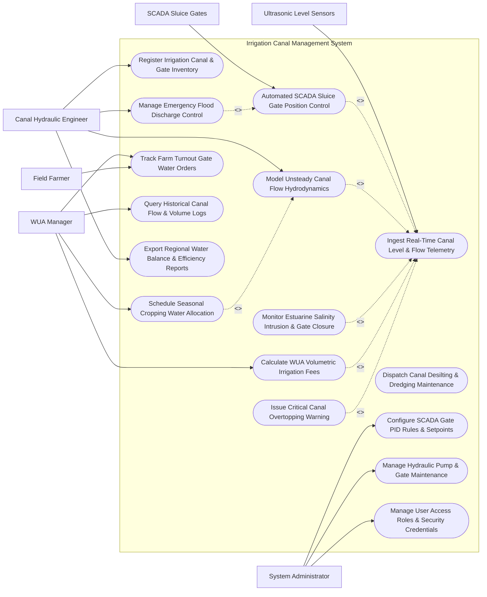

# Use Case Diagram — Irrigation Canal Management System

## Mermaid Code

## Actor Table | Bang Actor

| # | Actor | Actor Type | Role Description | Related Use Cases |
|---|-------|------------|------------------|-------------------|
| 1 | Canal Hydraulic Engineer | Primary | Hydraulic engineer configuring canal geometries, monitoring 1D hydrodynamics, and directing gate operations | UC01, UC04, UC09, UC13 |
| 2 | WUA Manager | Primary | Representative of Water User Association managing seasonal crop water allocations, turnout orders, and billing | UC05, UC08, UC11, UC12 |
| 3 | Field Farmer | Primary | Individual farmer placing water delivery orders for farm turnouts and reporting localized canal issues | UC11 |
| 4 | System Administrator | Primary | Technical admin managing SCADA PID control parameters, equipment maintenance, and security roles | UC14, UC15, UC16 |
| 5 | Ultrasonic Level Sensors | Secondary / System | Sensor hardware measuring real-time water levels, Doppler flow velocities, and discharge along canals | UC02 |
| 6 | SCADA Sluice Gates | Secondary / System | Motorized sluice gates and check structures adjusting opening heights based on automated system commands | UC03 |

## Use Case Table | Bang Use Case

| # | UC ID | Use Case Name | Primary Actor | Secondary Actor | Description | Priority |
|---|-------|---------------|---------------|-----------------|-------------|----------|
| 1 | UC01 | Register Irrigation Canal & Gate Inventory | Canal Engineer | None | Configures canal network GIS layout, cross-sections, bed slope, roughness $n$, and sluice gate specs | High |
| 2 | UC02 | Ingest Real-Time Canal Level & Flow Telemetry | System | Level Sensors | Ingests 1-minute water stage ($m$), ADCP flow velocity ($m/s$), discharge ($m^3/s$), and salinity ($ppt$) | High |
| 3 | UC03 | Automated SCADA Sluice Gate Position Control | System | SCADA Gates | Executes PID closed-loop control to adjust sluice gate heights ($0-100\%$) to maintain target water levels | High |
| 4 | UC04 | Model Unsteady Canal Flow Hydrodynamics | Canal Engineer | System | Runs 1D Saint-Venant hydraulic simulation to predict wave propagation, travel time, and seepage loss | High |
| 5 | UC05 | Schedule Seasonal Cropping Water Allocation | WUA Manager | System | Calculates seasonal crop water requirements ($m^3/ha$) and generates rotation schedules for canal branches | High |
| 6 | UC06 | Monitor Estuarine Salinity Intrusion & Gate Closure | System | Level Sensors | Monitors coastal salinity ($ppt$) and triggers automatic closure of estuarine tidal sluice gates when $EC > 1.0\text{ ppt}$ | High |
| 7 | UC07 | Dispatch Canal Desilting & Dredging Maintenance | Canal Engineer | System | Analyzes drone bathymetry to identify silted canal sections ($>30\text{cm}$ silt) and dispatches dredging | Medium |
| 8 | UC08 | Calculate WUA Volumetric Irrigation Fees | WUA Manager | System | Computes volumetric water charges ($USD/m^3$) based on turnout flow integration for water user associations | High |
| 9 | UC09 | Manage Emergency Flood Discharge Control | Canal Engineer | SCADA Gates | Operates spillways and headworks gates during extreme storms to discharge excess flood water safely | High |
| 10 | UC10 | Issue Critical Canal Overtopping Warning | System | Notification Gateway | Dispatches emergency alerts when canal stage reaches freeboard safety limit ($<0.3\text{m}$ below dike top) | High |
| 11 | UC11 | Track Farm Turnout Gate Water Orders | Field Farmer | WUA Manager | Manages farmer water delivery requests, turn schedules, and turnout gate open/close durations | High |
| 12 | UC12 | Query Historical Canal Flow & Volume Logs | WUA Manager | None | Provides searchable historical database of 24-hour canal discharge, water delivery volumes, and losses | Low |
| 13 | UC13 | Export Regional Water Balance & Efficiency Reports | Canal Engineer | System | Generates statutory water balance reports: conveyance efficiency ($E_c$), distribution losses, and water rights | High |
| 14 | UC14 | Configure SCADA Gate PID Rules & Setpoints | System Admin | Canal Engineer | Configures target water level setpoints, PID gain parameters ($K_p, K_i, K_d$), and motor travel limits | Medium |
| 15 | UC15 | Manage Hydraulic Pump & Gate Maintenance | System Admin | System | Tracks motor operating hours, gearbox lubrication, gate seal replacement, and issues work orders | Medium |
| 16 | UC16 | Manage User Access & Security Roles | System Admin | None | Configures user accounts, operational roles (Engineer, WUA Manager, Farmer, Admin), and security keys | Low |

## Use Case Specification | Dac ta Use Case

---

### UC02 — Ingest Real-Time Canal Level & Flow Telemetry

| Field | Detail |
|-------|--------|
| **UC ID** | UC02 |
| **Use Case Name** | Ingest Real-Time Canal Level & Flow Telemetry |
| **Actor(s)** | Primary: System   Secondary: Ultrasonic Level Sensors |
| **Description** | Ingests high-frequency sensor telemetry (Water Stage $h$, ADCP Velocity $v$, Discharge $Q$, Salinity $S$) from canal gauging stations, computes stage-discharge rating curves, and validates data integrity. |
| **Precondition** | 1. Canal gauging stations and ultrasonic sensors are registered in system with valid station IDs (UC01).   2. Sensor Modbus TCP / DNP3 telemetry network connection is active. |
| **Main Flow** | 1. Ultrasonic radar level sensors and Doppler velocity probes take readings every 1 minute.   2. Gauging station packages telemetry payload: Station ID, Canal Section Code, Timestamp, Water Stage ($m$), Mean Flow Velocity ($m/s$), Salinity ($ppt$), and Battery Voltage ($V$).   3. Station transmits payload to System gateway via Modbus TCP or DNP3 over cellular/radio link.   4. System ingests packet, parses sensor fields, and validates payload integrity.   5. System computes **Real-Time Discharge ($Q\text{ in } m^3/s$)**:   &nbsp;&nbsp;&nbsp;&nbsp;a. Calculate Wetted Cross-Sectional Area ($A$) from stage $h$ and trapezoidal canal geometry: $$A = (b + m \cdot h) \times h$$   &nbsp;&nbsp;&nbsp;&nbsp;b. Calculate Discharge: $$Q = A \times v$$   6. System checks water stage $h$ against canal design freeboard limit ($h_{max}$).   7. System stores validated 1-minute telemetry record in time-series database.   8. System updates real-time hydraulic GIS map and triggers automated SCADA sluice gate control (UC03). |
| **Alternative Flow** | **AF1** — Rating Curve Backup Calculation: If velocity probe fails, system computes estimated discharge using calibrated Stage-Discharge Rating Curve ($Q = a \cdot h^b$) or Manning Equation ($Q = \frac{1}{n} A R^{2/3} S_0^{1/2}$). |
| **Exception Flow** | **EX1** — Sensor Desiccation / Trash Obstruction Spike: Sensor depth spikes by $>2.0\text{ m}$ in 1 minute due to floating debris under sensor; system flags `DATA_OUTLIER_DEBRIS` and routes reading to validation queue. |
| **Postcondition** | Validated water stage, velocity, calculated discharge, and salinity stored in database and mapped on canal GIS. |
| **Business Rule** | **BR1**: Ultrasonic level sensors must be calibrated against physical staff gauges at least once per crop season to correct for bed siltation zero-shift. |

---

### UC03 — Automated SCADA Sluice Gate Position Control

| Field | Detail |
|-------|--------|
| **UC ID** | UC03 |
| **Use Case Name** | Automated SCADA Sluice Gate Position Control |
| **Actor(s)** | Primary: System   Secondary: SCADA Sluice Gates |
| **Description** | Executes closed-loop PID and feedforward hydraulic control to adjust motorized sluice gate opening heights ($0-100\%$) to maintain target water levels and flow rates along canal reaches. |
| **Precondition** | 1. Ingested canal water level and discharge telemetry (UC02) are updated.   2. Target water level setpoints ($h_{set}$) for canal sections are configured (UC14). |
| **Main Flow** | 1. System compares current upstream/downstream water stage ($h$) at a check structure against target setpoint ($h_{set}$).   2. System calculates error signal: $$e(t) = h_{set} - h(t)$$   3. System executes Proportional-Integral-Derivative (PID) control algorithm:   &nbsp;&nbsp;&nbsp;&nbsp;$$u(t) = K_p e(t) + K_i \int e(t) dt + K_d \frac{de(t)}{dt}$$   4. System converts calculated control signal $u(t)$ into target gate opening height ($y_{target}\text{ in meters}$).   5. System checks gate motor travel limits ($0.0\text{ m}$ Fully Closed to $y_{max}\text{ m}$ Fully Open) and maximum travel speed ($0.01\text{ m/s}$ to prevent hydraulic surge waves).   6. System transmits gate position command ($y_{target}$) to SCADA gate motor actuator via DNP3/Modbus.   7. SCADA actuator energizes gate motor, adjusts gate height, and returns position feedback.   8. System logs gate execution event and monitors downstream water level response. |
| **Alternative Flow** | **AF1** — Feedforward Turnout Demand Control: When large downstream turnout order (UC11) activates, system opens upstream check gate 30 minutes in advance (feedforward) to pre-fill canal reach before demand starts. |
| **Exception Flow** | **EX1** — Gate Motor Over-Current Lockout: SCADA gate motor encounters mechanical jam; motor controller trips on over-current ($>15\text{ A}$), flags `GATE_JAMMED_ALARM`, and holds gate at current height while alerting operator. |
| **Postcondition** | Sluice gate opening height adjusted, target water level maintained, and SCADA execution log recorded. |
| **Business Rule** | **BR1**: Sluice gate movement speed must be restricted to prevent generating destructive hydraulic bore waves in unlined earth canals. |

---

### UC05 — Schedule Seasonal Cropping Water Allocation

| Field | Detail |
|-------|--------|
| **UC ID** | UC05 |
| **Use Case Name** | Schedule Seasonal Cropping Water Allocation |
| **Actor(s)** | Primary: Water User Association (WUA) Manager   Secondary: System |
| **Description** | Calculates seasonal crop water demands ($m^3/ha$) based on cropping patterns (rice, corn, sugarcane), matches demand against reservoir water availability, and generates rotational water delivery schedules for canal branches. |
| **Precondition** | 1. WUAs have submitted seasonal crop planting area requests ($ha$) and crop types.   2. Reservoir water availability forecasts (UC00) are updated. |
| **Main Flow** | 1. WUA Manager opens "Seasonal Water Allocation Planner" module.   2. WUA Manager inputs crop planting acreage by canal branch (e.g., Branch Canal 2: 500 ha Paddy Rice, 200 ha Corn).   3. System retrieves FAO CROPWAT crop evapotranspiration ($ET_c$) curves for target crops across growth stages (Initial, Crop Dev, Mid-Season, Late-Season).   4. System calculates net irrigation water requirement ($NIR\text{ in } m^3/ha/day$):   &nbsp;&nbsp;&nbsp;&nbsp;$$NIR = ET_c - P_{eff} + S_{land\_prep}$$   5. System factors in canal conveyance efficiency factor ($E_c = 0.75$ for lined, $0.60$ for unlined) to compute Gross Water Demand ($GWR$).   6. System checks total seasonal water availability from main reservoir.   7. If total demand exceeds reservoir allocation, System formulates **Rotational Water Delivery Schedule**:   &nbsp;&nbsp;&nbsp;&nbsp;a. **Branch A**: Full flow delivery for 5 days (Days 1 to 5).   &nbsp;&nbsp;&nbsp;&nbsp;b. **Branch B**: Full flow delivery for 5 days (Days 6 to 10).   8. WUA Manager approves allocation plan; System publishes rotational schedule to WUA farmers and sets automated gate timing (UC03). |
| **Alternative Flow** | **AF1** — Paddy Land Preparation Surge Allocation: System configures 10-day high-discharge water surge to support simultaneous paddy soil soaking and puddling across all branches. |
| **Exception Flow** | **EX1** — Severe Drought Quotas: Reservoir storage drops below $30\%$ capacity; system activates emergency drought rationing rules, cutting allocation by $40\%$ and prioritizing high-value perennial crops over paddy rice. |
| **Postcondition** | Seasonal water allocation plan approved, rotational canal delivery schedule generated, and WUA quotas locked. |
| **Business Rule** | **BR1**: Rotational water scheduling must ensure tail-end canal branch farmers receive equitable water delivery volume compared to head-end farmers. |

---

### UC06 — Monitor Estuarine Salinity Intrusion & Gate Closure

| Field | Detail |
|-------|--------|
| **UC ID** | UC06 |
| **Use Case Name** | Monitor Estuarine Salinity Intrusion & Gate Closure |
| **Actor(s)** | Primary: System   Secondary: Ultrasonic Level Sensors |
| **Description** | Continuously monitors estuarine tidal salinity levels ($ppt$) near coastal canal outfalls, automatically closing barrier sluice gates during high-tide salt wedge intrusion to prevent saltwater contamination of agricultural fresh water. |
| **Precondition** | 1. Coastal salinity sensors and automated barrier sluice gates are active.   2. Salinity safety threshold (e.g., $1.0\text{ ppt}$ for paddy irrigation) is configured. |
| **Main Flow** | 1. Submersible EC/salinity sensors at estuarine sluice gate outfall measure salinity ($ppt$) every 1 minute.   2. System ingests real-time salinity readings and compares against irrigation safety limit ($1.0\text{ ppt}$).   3. As high tide approaches, estuarine salinity rises from $0.2\text{ ppt}$ to $1.2\text{ ppt}$.   4. System detects salinity crossing the $1.0\text{ ppt}$ safety threshold.   5. System immediately initiates **Automated Barrier Gate Closure Sequence**:   &nbsp;&nbsp;&nbsp;&nbsp;a. Transmit $100\%$ Close command to coastal SCADA tidal barrier gates.   &nbsp;&nbsp;&nbsp;&nbsp;b. Barrier gates lower to fully closed position ($0.0\text{ m}$ opening), sealing the canal outfall against ocean saltwater.   6. System switches inland irrigation pumps to draw exclusively from fresh internal storage reservoirs.   7. System continues monitoring external estuarine salinity.   8. As tide recedes and ocean water salinity drops below $0.8\text{ ppt}$ with higher internal fresh water head, System re-opens barrier gates to allow drainage of internal storm runoff.   9. System logs salinity intrusion event duration and alerts regional WUA operators. |
| **Alternative Flow** | **AF1** — Fresh Water Flushing Release: System coordinates upstream dam release to flush saline water out of coastal canal sections once tide drops. |
| **Exception Flow** | **EX1** — Barrier Gate Sensor Failure / Emergency Manual Lock: Salinity sensor fails during high tide; system detects sensor error, defaults to tide-table predictive model, and closes barrier gates as safety precaution. |
| **Postcondition** | Estuarine barrier gates closed during high salinity, fresh water supply protected from salt contamination, and intrusion event logged. |
| **Business Rule** | **BR1**: Tidal barrier gates must close fully whenever estuarine salinity exceeds $1.0\text{ ppt}$ to protect agricultural crops from irreversible salt damage. |

---

### UC07 — Dispatch Canal Desilting & Dredging Maintenance

| Field | Detail |
|-------|--------|
| **UC ID** | UC07 |
| **Use Case Name** | Dispatch Canal Desilting & Dredging Maintenance |
| **Actor(s)** | Primary: Canal Hydraulic Engineer   Secondary: System |
| **Description** | Analyzes drone bathymetric survey data and hydraulic head loss logs to identify silt-clogged canal sections ($>30\text{ cm}$ silt accumulation), calculates required dredging volumes ($m^3$), and dispatches maintenance work orders. |
| **Precondition** | 1. Drone bathymetric sonar survey or manual cross-section measurements are uploaded.   2. Canal design bed profile baselines are registered (UC01). |
| **Main Flow** | 1. Engineer opens "Canal Maintenance & Sedimentation Module".   2. System ingests 3D drone bathymetric point cloud data for target 10 km canal reach.   3. System compares surveyed canal bed profile against original design bed elevation ($z_{design}$).   4. System calculates local siltation depth: $$\Delta z = z_{survey} - z_{design}$$   5. System identifies canal sections where siltation exceeds maintenance threshold ($\Delta z > 0.30\text{ m}$), causing reduced discharge capacity.   6. System calculates total required **Dredging Volume ($V_{dredge}\text{ in } m^3$)**:   &nbsp;&nbsp;&nbsp;&nbsp;$$V_{dredge} = \sum \left( A_{silt\_section} \times \text{Section Length} \right)$$   7. System evaluates reduction in Manning conveyance capacity ($\% \text{ Capacity Loss}$).   8. Engineer reviews siltation map, selects high-priority sections, and clicks "Generate Dredging Work Order".   9. System dispatches work order to maintenance contractor, specifying GPS coordinates, target bed depth, and estimated silt volume.   10. Contractor completes dredging; engineer re-surveys section, and system updates bed baseline profile to `CLEARED_NORMAL`. |
| **Alternative Flow** | **AF1** — Embankment Crack Repair Dispatch: Drone aerial photos detect $5\text{m}$ longitudinal crack in canal embankment dike; system dispatches urgent structural compaction repair work order. |
| **Exception Flow** | **EX1** — Active Cropping Season Block: Proposed dredging section is in active water delivery mode; system postpones heavy dredging until dry-season maintenance window. |
| **Postcondition** | Siltation volume calculated, dredging work order dispatched, and canal bed profile updated post-clearing. |
| **Business Rule** | **BR1**: Main canal desilting must be scheduled during post-harvest dry seasons to avoid disrupting agricultural water delivery. |
