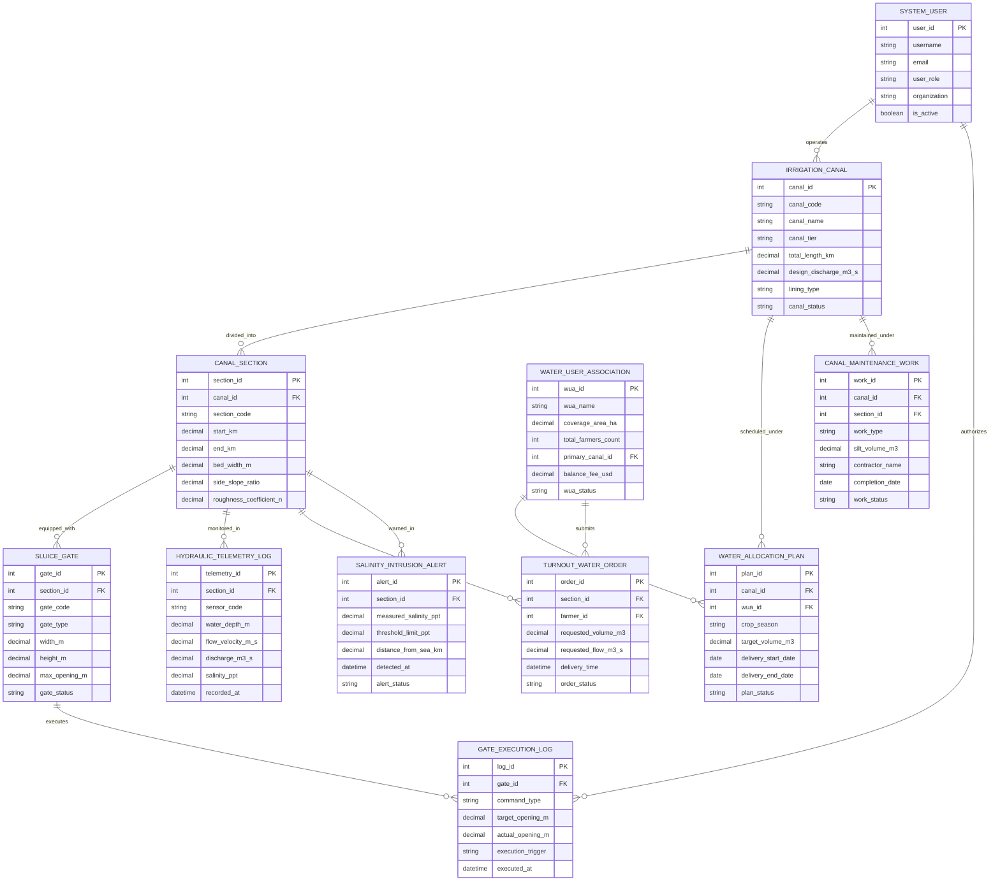

# Conceptual ERD — Irrigation Canal Management System

## Mermaid Code

## Entity Description Table | Bang Mo Ta Entity

| # | Entity Name | Vietnamese Name | Description | Key Attributes | Main Relationships |
|---|-------------|-----------------|-------------|----------------|-------------------|
| 1 | IRRIGATION_CANAL | Kênh Dẫn Nuớc Master | Stores primary/secondary/tertiary canal master profiles, length ($km$), design discharge ($m^3/s$), lining type, and status | canal_id, canal_code, canal_name, canal_tier, total_length_km, design_discharge_m3_s, canal_status | Divided into CANAL_SECTION, scheduled under ALLOCATION_PLAN |
| 2 | CANAL_SECTION | Đoạn Kênh Thủy Lợi | Represents specific canal reaches, start/end kilometer markers, bed width ($m$), side slope, and Manning roughness $n$ | section_id, canal_id, section_code, start_km, end_km, bed_width_m, roughness_coefficient_n | Belongs to IRRIGATION_CANAL, equipped with SLUICE_GATE |
| 3 | SLUICE_GATE | Cống Đầu Mối / Cống Điều Tiết | Stores motorized sluice gate hardware profiles, gate types (radial, vertical slide), max opening ($m$), and status | gate_id, section_id, gate_code, gate_type, width_m, height_m, max_opening_m, gate_status | Equipped in CANAL_SECTION, executes GATE_EXECUTION_LOG |
| 4 | HYDRAULIC_TELEMETRY_LOG | Nhật Ký Thủy Văn Kênh | High-frequency telemetry storing water depth ($m$), flow velocity ($m/s$), discharge ($m^3/s$), and salinity ($ppt$) | telemetry_id, section_id, sensor_code, water_depth_m, flow_velocity_m_s, discharge_m3_s, recorded_at | Monitored in CANAL_SECTION |
| 5 | GATE_EXECUTION_LOG | Nhật Ký Vận Hành Cống SCADA | Records automated gate position command executions ($0-100\%$), target opening ($m$), execution trigger, and timestamp | log_id, gate_id, command_type, target_opening_m, actual_opening_m, execution_trigger, executed_at | Executed by SLUICE_GATE, authorized by SYSTEM_USER |
| 6 | WATER_ALLOCATION_PLAN | Kế Hoạch Phân Phối Nước | Stores seasonal crop water demand allocation plans, WUA target volumes ($m^3$), delivery start/end dates, and status | plan_id, canal_id, wua_id, crop_season, target_volume_m3, delivery_start_date, plan_status | Scheduled for IRRIGATION_CANAL, managed by WUA |
| 7 | TURNOUT_WATER_ORDER | Đơn Đặt Nước Cống Lấy Nước | Tracks farm turnout gate water orders submitted by farmers, requested flow ($m^3/s$), volume ($m^3$), and delivery timing | order_id, section_id, farmer_id, requested_volume_m3, requested_flow_m3_s, order_status | Supplied by CANAL_SECTION, submitted by WUA/Farmer |
| 8 | WATER_USER_ASSOCIATION | Tổ Hợp Tác Dùng Nước (WUA) | Represents agricultural Water User Associations, coverage area ($ha$), total farmers, primary canal, and fee balance | wua_id, wua_name, coverage_area_ha, total_farmers_count, primary_canal_id, wua_status | Manages WATER_ALLOCATION_PLAN, submits TURNOUT_ORDER |
| 9 | SALINITY_INTRUSION_ALERT | Cảnh Báo Mặn Xâm Nhập | Records estuarine salinity intrusion events, measured salinity ($ppt$), distance from sea ($km$), and alert status | alert_id, section_id, measured_salinity_ppt, threshold_limit_ppt, distance_from_sea_km, detected_at | Warned in CANAL_SECTION |
| 10 | CANAL_MAINTENANCE_WORK | Công Trình Nạo Vét Kênh | Manages canal desilting and maintenance projects, silt volume ($m^3$), contractor details, completion date, and status | work_id, canal_id, section_id, work_type, silt_volume_m3, contractor_name, work_status | Maintained under IRRIGATION_CANAL |
| 11 | SYSTEM_USER | Người Dùng Hệ Thống | User accounts, roles (Hydraulic Engineer, WUA Manager, Farmer, Admin), organizations, and security rights | user_id, username, user_role, organization, is_active | Operates IRRIGATION_CANAL, authorizes GATE_EXECUTION_LOG |

## Relationship Description | Mo ta Quan he

| # | From Entity | Cardinality | To Entity | Relationship Label | Business Explanation |
|---|-------------|-------------|-----------|-------------------|----------------------|
| 1 | IRRIGATION_CANAL | one-to-many | CANAL_SECTION | divided_into | An irrigation canal is divided into multiple sequential hydraulic reach sections |
| 2 | CANAL_SECTION | one-to-many | SLUICE_GATE | equipped_with | A canal section is equipped with motorized sluice gates or check structures for water regulation |
| 3 | CANAL_SECTION | one-to-many | HYDRAULIC_TELEMETRY_LOG | monitored_in | A canal section is monitored by continuous time-series water stage, velocity, and discharge logs |
| 4 | SLUICE_GATE | one-to-many | GATE_EXECUTION_LOG | executes | A sluice gate executes multiple automated SCADA opening position command logs over time |
| 5 | IRRIGATION_CANAL | one-to-many | WATER_ALLOCATION_PLAN | scheduled_under | An irrigation canal operates under scheduled seasonal crop water allocation plans |
| 6 | WATER_USER_ASSOCIATION | one-to-many | WATER_ALLOCATION_PLAN | manages_plan | A Water User Association manages seasonal water allocation plans for its member farmers |
| 7 | CANAL_SECTION | one-to-many | TURNOUT_WATER_ORDER | supplies | A canal section supplies water to multiple farm turnout water delivery orders |
| 8 | CANAL_SECTION | one-to-many | SALINITY_INTRUSION_ALERT | warned_in | Coastal canal sections can trigger estuarine salinity intrusion alerts during high tides |
| 9 | IRRIGATION_CANAL | one-to-many | CANAL_MAINTENANCE_WORK | maintained_under | An irrigation canal undergoes periodic desilting and embankment maintenance work projects |
| 10 | WATER_USER_ASSOCIATION | one-to-many | TURNOUT_WATER_ORDER | submits | A Water User Association aggregates and submits farm turnout water orders for its farmers |
| 11 | SYSTEM_USER | one-to-many | IRRIGATION_CANAL | operates | A canal hydraulic engineer system user operates irrigation canal networks and headworks |
| 12 | SYSTEM_USER | one-to-many | GATE_EXECUTION_LOG | authorizes | A hydraulic engineer system user authorizes manual or automated SCADA sluice gate commands |
