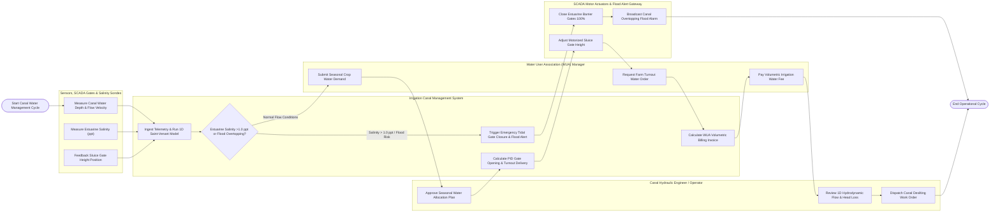

# Swimlane Diagram — Irrigation Canal Management System

## Mermaid Code

## Flow Description | Mo ta luong

| Lane | Actor | Role in Flow |
|------|-------|-------------|
| 1 | Sensors, SCADA Gates & Salinity Sondes | Ultrasonic level sensors measure canal water stage ($m$) and Doppler velocity ($m/s$), estuarine salinity sondes measure salinity ($ppt$), and SCADA gate encoders provide position feedback |
| 2 | Irrigation Canal Management System | Ingests telemetry, runs 1D Saint-Venant unsteady flow hydrodynamic models, calculates PID sluice gate opening commands, manages salinity protection closures, and computes volumetric WUA water billing |
| 3 | Canal Hydraulic Engineer / Operator | Reviews 1D hydrodynamic flow profiles, approves seasonal water allocation plans, monitors head loss, and dispatches drone bathymetry canal desilting work orders |
| 4 | Water User Association (WUA) Manager | Submits seasonal cropping pattern water demands, requests farm turnout water delivery orders, coordinates irrigation turns, and pays volumetric water service fees |
| 5 | SCADA Motor Actuators & Flood Alert Gateway | Motorized check gate actuators adjust sluice gate heights, estuarine barrier gates close 100% during salt intrusion, and flood alert gateways broadcast emergency warnings |
