# Action Tree — Irrigation Canal Management System

## Mermaid Code

```mermaid
graph TD
    Root["Irrigation Canal Management System"]

    Root --> M1["Canal Infrastructure & Sluice Gate Registry"]
    Root --> M2["Real-Time Telemetry & Flow Ingestion"]
    Root --> M3["SCADA Sluice Gate Automation & PID Control"]
    Root --> M4["Unsteady Flow Hydrodynamics & Salinity Protection"]
    Root --> M5["Water Allocation Scheduling & WUA Billing"]
    Root --> M6["Canal Desilting, Dredging & Maintenance"]
    Root --> M7["Hydro-Modelling Rules & System Admin"]

    M1 --> A11["Register Canal Network GIS Geometry & Sections"]
    M1 --> A12["Define Sluice Gate Hardware Specs & Motor Power"]
    M1 --> A13["Set Bed Slopes & Manning Roughness Coefficients"]
    M1 --> A14["Map Farm Turnout Gate Locations & WUA Coverage"]

    M2 --> A21["Ingest 1-Minute Ultrasonic Water Level Telemetry"]
    M2 --> A22["Ingest ADCP Flow Velocity & Compute Discharge"]
    M2 --> A23["Monitor Upstream Reservoir Release Feeds"]
    M2 --> A24["Detect Gauge Outliers & Trash Rack Obstructions"]

    M3 --> A31["Execute PID Closed-Loop Sluice Gate Position Control"]
    M3 --> A32["Transmit DNP3 & Modbus Gate Opening Commands"]
    M3 --> A33["Modulate Check Structure Gates for Level Regulation"]
    M3 --> A34["Trigger Feedforward Gate Pre-Opening for Turnouts"]

    M4 --> A41["Run 1D Saint-Venant Unsteady Flow Simulation"]
    M4 --> A42["Monitor Estuarine Salinity Intrusion Levels"]
    M4 --> A43["Trigger Automatic Coastal Barrier Gate Closure"]
    M4 --> A44["Calculate Canal Seepage & Conveyance Losses"]

    M5 --> A51["Calculate FAO CROPWAT Seasonal Crop Water Demands"]
    M5 --> A52["Generate Rotational Canal Water Delivery Schedules"]
    M5 --> A53["Process Farmer Turnout Water Orders & Delivery"]
    M5 --> A54["Calculate WUA Volumetric Irrigation Billing Invoices"]

    M6 --> A61["Ingest Drone Bathymetric Sonar Siltation Maps"]
    M6 --> A62["Calculate Required Canal Dredging Volumes"]
    M6 --> A63["Dispatch Canal Embankment & Gate Work Orders"]
    M6 --> A64["Track Maintenance Contractor Completion Verification"]

    M7 --> A71["Configure SCADA PID Gain & Target Level Setpoints"]
    M7 --> A72["Manage Salinity Safety Thresholds & Alarm Rules"]
    M7 --> A73["Export National Water Balance & Efficiency Reports"]
    M7 --> A74["Manage User Access Roles & Security Credentials"]
```

## Module Description | Mo ta Module

| # | Module | Description | Actions |
|---|--------|-------------|---------|
| 1 | Canal Infrastructure & Sluice Gate Registry | Manages canal network GIS geometry, section profiles, bed slopes, Manning roughness coefficients $n$, sluice gate hardware, and WUA boundaries | Register Canal Network GIS Geometry & Sections, Define Sluice Gate Hardware Specs & Motor Power, Set Bed Slopes & Manning Roughness Coefficients, Map Farm Turnout Gate Locations & WUA Coverage |
| 2 | Real-Time Telemetry & Flow Ingestion | Ingests 1-minute water stage ($m$), ADCP velocity ($m/s$), computes discharge ($m^3/s$), monitors reservoir releases, and filters data outliers | Ingest 1-Minute Ultrasonic Water Level Telemetry, Ingest ADCP Flow Velocity & Compute Discharge, Monitor Upstream Reservoir Release Feeds, Detect Gauge Outliers & Trash Rack Obstructions |
| 3 | SCADA Sluice Gate Automation & PID Control | Executes PID closed-loop gate control, transmits DNP3/Modbus commands, regulates check structure water levels, and feedforward pre-opens gates | Execute PID Closed-Loop Sluice Gate Position Control, Transmit DNP3 & Modbus Gate Opening Commands, Modulate Check Structure Gates for Level Regulation, Trigger Feedforward Gate Pre-Opening for Turnouts |
| 4 | Unsteady Flow Hydrodynamics & Salinity Protection | Runs 1D Saint-Venant unsteady flow models, monitors coastal salinity ($ppt$), triggers automated barrier gate closure ($>1.0\text{ ppt}$), and models seepage loss | Run 1D Saint-Venant Unsteady Flow Simulation, Monitor Estuarine Salinity Intrusion Levels, Trigger Automatic Coastal Barrier Gate Closure, Calculate Canal Seepage & Conveyance Losses |
| 5 | Water Allocation Scheduling & WUA Billing | Calculates seasonal crop water demands (FAO CROPWAT), formulates rotational delivery schedules, tracks turnout orders, and bills WUAs volumetrically | Calculate FAO CROPWAT Seasonal Crop Water Demands, Generate Rotational Canal Water Delivery Schedules, Process Farmer Turnout Water Orders & Delivery, Calculate WUA Volumetric Irrigation Billing Invoices |
| 6 | Canal Desilting, Dredging & Maintenance | Analyzes drone bathymetric siltation maps, calculates dredging volumes ($m^3$), dispatches embankment repair work orders, and verifies contractor completion | Ingest Drone Bathymetric Sonar Siltation Maps, Calculate Required Canal Dredging Volumes, Dispatch Canal Embankment & Gate Work Orders, Track Maintenance Contractor Completion Verification |
| 7 | Hydro-Modelling Rules & System Admin | Configures SCADA PID gain parameters, manages salinity safety thresholds, exports national water balance reports (MARD), and controls security access roles | Configure SCADA PID Gain & Target Level Setpoints, Manage Salinity Safety Thresholds & Alarm Rules, Export National Water Balance & Efficiency Reports, Manage User Access Roles & Security Credentials |
