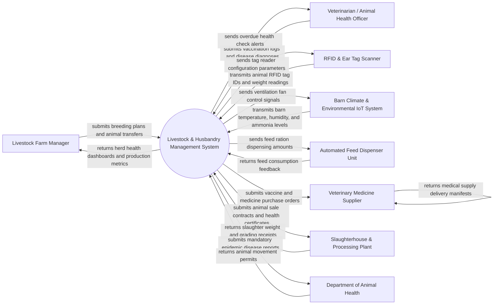

# Context Diagram — Livestock & Animal Husbandry Management System

## Mermaid Code

## Actor & Interaction Table | Bang Actor & Tuong tac

| # | Actor | Actor Type | Data Sent TO System | Data Received FROM System | Notes |
|---|-------|------------|---------------------|---------------------------|-------|
| 1 | Livestock Farm Manager | Primary | Breeding schedules, animal transfer requests, herd culling orders | Herd health status, daily milk/meat production metrics, feed costs | Overall farm supervisor managing herd operations and financial performance |
| 2 | Veterinarian / Animal Health Officer | Primary | Vaccination logs, disease diagnoses, surgical notes, drug dosage logs | Overdue health alerts, animal medical history, quarantine flags | Licensed veterinary specialist managing herd biosecurity and medical care |
| 3 | RFID & Ear Tag Scanner | Supporting System | Electronic RFID ear tag IDs (ISO 11784/11785), automated scale weights | Tag reader configuration, audio-visual scanning confirmation | Handheld or chute-mounted readers capturing individual animal identities |
| 4 | Barn Climate & Environmental IoT System | Supporting System | Barn temperature, relative humidity, hydrogen sulfide, and ammonia (NH3) levels | Ventilation fan speed triggers, misting pump controls, alarm setpoints | Environmental sensor network maintaining indoor air quality for livestock |
| 5 | Automated Feed Dispenser Unit | Supporting System | Actual feed consumption volume (kg), feeder trough occupancy timestamps | Individualized feed ration dispensing commands, mineral mix ratios | Smart feeding stations dispensing tailored feed portions based on RFID scans |
| 6 | Veterinary Medicine Supplier | Supporting | Vaccine availability, pharmaceutical pricing, drug batch expiration dates | Medicine purchase orders, vaccine replenishment requisitions | Commercial vendor supplying certified livestock vaccines and antibiotics |
| 7 | Slaughterhouse & Processing Plant | Supporting | Carcass weight receipts, meat quality grades (fat cover, marbling), payout invoices | Animal sales contracts, animal health origin certificates, traceability tags | Commercial meat processor purchasing mature livestock for slaughter |
| 8 | Department of Animal Health | Regulatory System | Mandatory vaccination mandates, epidemic quarantine notices, official disease alerts | Outbreak notifications, animal movement permit applications, herd audit logs | Government authority regulating livestock biosecurity and disease containment |

## System Boundary Description | Mo ta Pham vi He thong

The **Livestock & Animal Husbandry Management System** is a comprehensive software platform designed to manage individual animal life cycles, herd genetics, veterinary care, feeding logistics, and barn environments. The system boundary encompasses electronic RFID animal identification, artificial insemination tracking, vaccination schedule compliance, automated feed ration calculations, milk and meat yield recording, barn climate IoT integration, and regulatory animal movement certification. Excluded from the system boundary are physical RFID ear tag manufacturing, chemical drug formulation, physical slaughterhouse carcass processing, and live animal transport vehicle operation. The system interfaces securely via RESTful APIs and industrial IoT protocols (Modbus, MQTT) to sync sensor telemetry and compliance reports.
