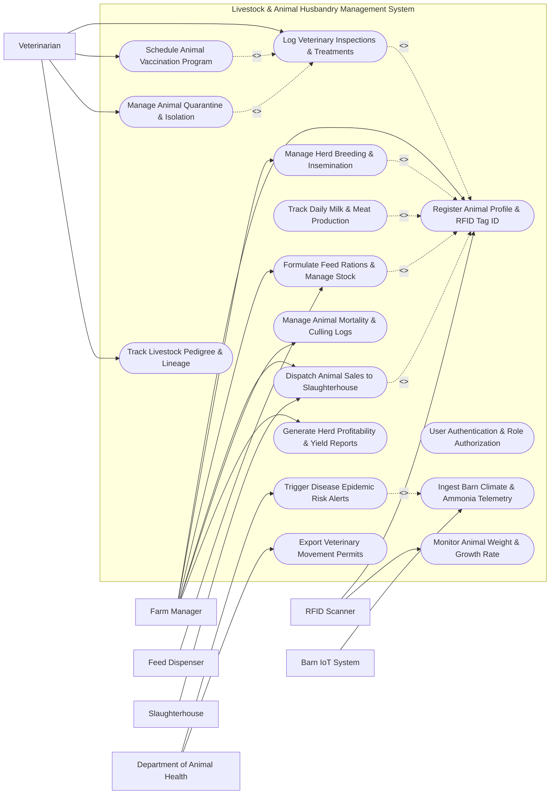

# Use Case Diagram — Livestock & Animal Husbandry Management System

## Mermaid Code

## Actor Table | Bang Actor

| # | Actor | Actor Type | Role Description | Related Use Cases |
|---|-------|------------|------------------|-------------------|
| 1 | Farm Manager | Primary | Manages herd registration, breeding schedules, feed formulation, animal sales, and farm financials | UC01, UC02, UC03, UC06, UC12, UC14, UC15 |
| 2 | Veterinarian | Primary | Oversees animal health examinations, administers vaccinations, diagnoses diseases, and enforces quarantine protocols | UC02, UC04, UC05, UC10, UC11 |
| 3 | RFID Scanner | Secondary | Reads electronic ear tags (ISO 11784/11785) and transmits animal ID and weight metrics | UC01, UC09 |
| 4 | Barn IoT System | Secondary | Measures barn temperature, humidity, and toxic ammonia levels continuously | UC07, UC13 |
| 5 | Feed Dispenser | Secondary | Receives feed portion commands and dispenses customized nutritional rations | UC06 |
| 6 | Slaughterhouse | Secondary | Receives animal sales dispatches and uploads carcass yield and quality grading receipts | UC12 |
| 7 | Department of Animal Health | System | Receives outbreak alerts and issues official digital animal movement permits | UC13, UC16 |

## Use Case Table | Bang Use Case

| # | UC ID | Use Case Name | Primary Actor | Secondary Actor | Description | Priority |
|---|-------|---------------|---------------|-----------------|-------------|----------|
| 1 | UC01 | Register Animal Profile & RFID Tag ID | Farm Manager | RFID Scanner | Registers individual livestock animals with electronic RFID ear tags, birth date, breed, and gender | High |
| 2 | UC02 | User Authentication & Role Authorization | Farm Manager | Veterinarian | Enforces secure login and restricts access according to user role (Manager vs. Veterinarian) | High |
| 3 | UC03 | Manage Herd Breeding & Insemination | Farm Manager | Veterinarian | Logs heat cycles, artificial insemination (AI) events, pregnancy checks, and expected calving dates | High |
| 4 | UC04 | Log Veterinary Inspections & Treatments | Veterinarian | Farm Manager | Records physical health checks, diagnoses, drug treatments, withdrawal periods, and recovery status | High |
| 5 | UC05 | Schedule Animal Vaccination Program | Veterinarian | None | Programs recurring mandatory vaccination calendars (Foot-and-Mouth, Anthrax) and tracks compliance | High |
| 6 | UC06 | Formulate Feed Rations & Manage Stock | Farm Manager | Feed Dispenser | Computes nutritional feed formulas (Dry Matter, Crude Protein) and controls automated feeders | High |
| 7 | UC07 | Ingest Barn Climate & Ammonia Telemetry | Barn IoT System | Farm Manager | Collects ambient barn temperature, humidity, and hazardous gas levels to ensure animal comfort | Medium |
| 8 | UC08 | Track Daily Milk & Meat Production | Farm Manager | None | Logs daily individual and herd milk yields (liters, fat/protein %) or average daily weight gain | High |
| 9 | UC09 | Monitor Animal Weight & Growth Rate | Farm Manager | RFID Scanner | Captures automated chute scale weights during animal passage to monitor Average Daily Gain (ADG) | High |
| 10 | UC10 | Manage Animal Quarantine & Isolation | Veterinarian | Farm Manager | Flags contagious animals, moves them to isolated quarantine barns, and locks movement permits | High |
| 11 | UC11 | Track Livestock Pedigree & Lineage | Veterinarian | Farm Manager | Maintains multi-generational genetic family trees to prevent inbreeding and optimize sire selection | Medium |
| 12 | UC12 | Dispatch Animal Sales to Slaughterhouse | Farm Manager | Slaughterhouse | Generates sales contracts, logs pre-slaughter weights, and transmits origin traceability files | High |
| 13 | UC13 | Trigger Disease Epidemic Risk Alerts | Barn IoT System | Department of Animal Health | Sends urgent alerts to health authorities when cluster sickness or high mortality is detected | High |
| 14 | UC14 | Manage Animal Mortality & Culling Logs | Farm Manager | Veterinarian | Logs animal deaths, cause of mortality, necropsy findings, and safe disposal certifications | Medium |
| 15 | UC15 | Generate Herd Profitability & Yield Reports | Farm Manager | None | Calculates feed conversion ratios (FCR), milk production revenue, and overall herd margin analytics | High |
| 16 | UC16 | Export Veterinary Movement Permits | Farm Manager | Department of Animal Health | Exports official electronic health certificates and movement permits required for livestock transport | High |

## Use Case Specification | Dac ta Use Case

---

### UC01 — Register Animal Profile & RFID Tag ID

| Field | Detail |
|-------|--------|
| **UC ID** | UC01 |
| **Use Case Name** | Register Animal Profile & RFID Tag ID |
| **Actor(s)** | Primary: Farm Manager / Secondary: RFID Scanner |
| **Description** | Enrolls a newborn or newly acquired livestock animal into the digital herd registry, linking its physical 15-digit ISO 11784/11785 RFID ear tag with species, breed, dam/sire lineage, and initial birth weight. |
| **Precondition** | 1. User is authenticated with Farm Manager privileges (UC02).   2. Electronic RFID ear tag scanner is connected via Bluetooth or USB. |
| **Main Flow** | 1. Farm Manager opens the "Animal Registration" module and scans the animal's new RFID ear tag.   2. RFID Scanner transmits 15-digit electronic ID string (e.g., `982 000123456789`) to the system.   3. System checks database to verify the RFID tag ID is unique and unregistered.   4. Manager inputs animal details: species (Cattle/Swine/Sheep), breed (Holstein/Angus), gender, birth date, birth weight (kg), and dam/sire IDs.   5. Manager assigns animal to a specific barn and pen location.   6. System saves animal record, updates herd headcount, and generates an electronic passport file. |
| **Alternative Flow** | **AF1** — Visual Ear Tag Dual Registration: System generates a short visual ear tag number (e.g., `COW-402`) printed on physical plastic tags, linking it as an alias to the 15-digit RFID code.   **AF2** — Bulk Calf Batch Registration: Manager registers multiple calves born on the same day. System auto-increments RFID numbers and inherits dam breed characteristics. |
| **Exception Flow** | **EX1** — Duplicate RFID Tag Error: System detects the scanned RFID tag is already assigned to an active animal. System displays "Duplicate Tag Error" and blocks registration until tag is replaced.   **EX2** — Invalid Lineage Parent: Manager inputs Dam ID that is male or non-existent. System prompts "Invalid Parent Lineage" error message. |
| **Postcondition** | Animal profile is activated in the herd registry, RFID tag is bound to animal ID, and pedigree tree is updated. |
| **Business Rule** | **BR1**: All registered livestock must be assigned a globally unique 15-digit RFID tag compliant with ISO 11784/11785 standards.   **BR2**: Birth registration must occur within 72 hours of calving/farrowing for biosecurity compliance. |

---

### UC03 — Manage Herd Breeding & Insemination

| Field | Detail |
|-------|--------|
| **UC ID** | UC03 |
| **Use Case Name** | Manage Herd Breeding & Insemination |
| **Actor(s)** | Primary: Farm Manager / Secondary: Veterinarian |
| **Description** | Tracks reproductive cycles for female livestock, recording heat detection, artificial insemination (AI) events, sire straw batch numbers, pregnancy diagnosis, and predicted calving dates. |
| **Precondition** | 1. Target female animal profile is active and in breeding age.   2. Sire semen inventory and straw lot numbers are registered in system. |
| **Main Flow** | 1. Farm Manager or Veterinarian logs estrus/heat observation for Female Cow #402.   2. System checks cow's voluntary waiting period (VWP) and calculates optimal insemination window (AM/PM rule).   3. Technician performs Artificial Insemination (AI) and inputs sire ID, semen straw lot number, and technician ID.   4. System saves AI event and calculates estimated gestation timeline (283 days for cattle).   5. System queues an automated "Pregnancy Check Reminder" alert for 35 days post-insemination.   6. Veterinarian conducts ultrasound pregnancy check at 35 days, confirms pregnancy status as "Pregnant", and System locks expected calving date window. |
| **Alternative Flow** | **AF1** — Natural Service Breeding: Manager registers natural pasture breeding group. System links herd bull ID with assigned female group for estimated sire attribution.   **AF2** — Embryo Transfer (ET): Technician logs embryo transfer event, recording surrogate dam ID, donor dam ID, and genetic sire ID. |
| **Exception Flow** | **EX1** — Repeat Heat Detection: Female cow shows heat signs 21 days post-insemination. System flags AI event as "Failed — Open", updates reproductive status, and prompts re-insemination.   **EX2** — Abortion Event Logging: Veterinarian logs premature pregnancy loss. System updates animal status to "Aborted", logs medical cause, and alerts manager. |
| **Postcondition** | Breeding record is committed, pregnancy status is updated, and expected calving reminders are scheduled. |
| **Business Rule** | **BR1**: Animals cannot be inseminated before completing mandatory voluntary waiting period (e.g., minimum 50 days post-calving).   **BR2**: Semen straw lot numbers must be recorded for every AI event to preserve genetic traceability. |

---

### UC04 — Log Veterinary Inspections & Treatments

| Field | Detail |
|-------|--------|
| **UC ID** | UC04 |
| **Use Case Name** | Log Veterinary Inspections & Treatments |
| **Actor(s)** | Primary: Veterinarian / Secondary: Farm Manager |
| **Description** | Records physical health examinations, clinical disease diagnoses, prescribed veterinary drug treatments, dosage levels, and mandatory milk/meat withdrawal safety periods. |
| **Precondition** | 1. Veterinarian user is authenticated (UC02).   2. Animal profile is registered in the system (UC01). |
| **Main Flow** | 1. Veterinarian scans animal RFID tag during sick pen rounds.   2. System displays animal's complete medical history, temperature logs, and recent production metrics.   3. Veterinarian enters clinical symptoms (e.g., fever, mastitis) and selects disease diagnosis from veterinary database.   4. Veterinarian selects prescribed antibiotic/medication, inputs dosage (ml/kg), administration route (IM/IV/SubQ), and treatment duration.   5. System automatically calculates mandatory milk withdrawal period (e.g., 72 hours) and meat withdrawal period (e.g., 28 days) based on drug regulatory data.   6. System saves treatment record, flags animal status as "Under Medical Treatment — Milk/Meat Withheld", and notifies farm manager. |
| **Alternative Flow** | **AF1** — Mass Herd Prophylactic Treatment: Veterinarian logs group deworming for an entire barn pen. System applies medical treatment record to all animals assigned to that pen simultaneously.   **AF2** — Treatment Completion Clearance: After treatment duration ends and withdrawal period expires, Veterinarian inspects animal and updates status to "Healthy — Cleared for Production". |
| **Exception Flow** | **EX1** — Drug Safety Interval Violation: System detects attempt to schedule animal dispatch for slaughter (UC12) during active meat withdrawal period. System blocks dispatch order with warning "Active Drug Withdrawal Violation".   **EX2** — Restrictive Prescription Warning: Veterinarian selects a prescription restricted under national antibiotic stewardship rules. System requires entering official prescription approval license code. |
| **Postcondition** | Medical diagnosis and drug administration are recorded, withdrawal flags are activated, and production safety locks are enforced. |
| **Business Rule** | **BR1**: Animals under active drug withdrawal periods must be automatically blocked from milk tank collection and slaughter dispatch.   **BR2**: Veterinary treatment logs must be digitally signed by a licensed veterinarian. |

---

### UC05 — Schedule Animal Vaccination Program

| Field | Detail |
|-------|--------|
| **UC ID** | UC05 |
| **Use Case Name** | Schedule Animal Vaccination Program |
| **Actor(s)** | Primary: Veterinarian / Secondary: None |
| **Description** | Establishes automated herd-wide vaccination calendars for mandatory infectious diseases (Foot-and-Mouth, Anthrax, Brucellosis), tracking vaccine batch lot numbers and booster schedules. |
| **Precondition** | 1. Approved vaccine inventory and lot numbers are registered in system.   2. Herd animals are categorized by age group and health status. |
| **Main Flow** | 1. Veterinarian creates a new "Vaccination Campaign" (e.g., "Annual FMD Vaccination Round 1").   2. Veterinarian selects target animal age group (e.g., Calves 3–6 months old) and selects vaccine product.   3. System identifies 120 eligible animals matching criteria and schedules campaign date.   4. On campaign day, Veterinarian scans animal RFID tags as vaccines are administered, recording vaccine lot serial number and dosage.   5. System marks individual animals as "Vaccinated" and calculates required booster date (e.g., booster in 30 days).   6. System updates herd immunity coverage percentage and generates an official Vaccination Compliance Certificate. |
| **Alternative Flow** | **AF1** — Individual Calf Routine Vaccination: System automatically triggers calf vaccination tasks based on age milestones (e.g., Rotavirus vaccine at Day 14). Task appears on daily veterinarian work list.   **AF2** — Outbreak Ring Vaccination: Following a local disease outbreak alert (UC13), Veterinarian initiates urgent emergency ring vaccination for all animals within a 5km radius barn zone. |
| **Exception Flow** | **EX1** — Expired Vaccine Batch Warning: Veterinarian scans a vaccine vial lot past its expiration date. System alerts "Vaccine Lot Expired" and blocks administration logging.   **EX2** — Sick Animal Exclusion: System detects animal is currently under active treatment (UC04). System alerts veterinarian to exclude sick animal from live-vaccine administration. |
| **Postcondition** | Animal immunization records are updated, booster tasks are scheduled, and regulatory vaccination compliance logs are generated. |
| **Business Rule** | **BR1**: Mandatory statutory vaccinations must be completed within government-mandated seasonal timeframes.   **BR2**: Vaccine lot serial numbers and manufacturer expiry dates must be recorded for 100% of administered doses. |

---

### UC08 — Track Daily Milk & Meat Production

| Field | Detail |
|-------|--------|
| **UC ID** | UC08 |
| **Use Case Name** | Track Daily Milk & Meat Production |
| **Actor(s)** | Primary: Farm Manager / Secondary: None |
| **Description** | Captures individual and herd-level daily production metrics, including morning/evening milk yields, fat/protein percentages, somatic cell counts (SCC), and beef carcass average daily weight gain (ADG). |
| **Precondition** | 1. Milking parlor automation or scale hardware is integrated with system.   2. Animal profiles are active in production herd status. |
| **Main Flow** | 1. Female Cow #402 enters milking stall and RFID scanner identifies animal.   2. Automated milking meter measures morning milk yield volume (e.g., 18.5 liters).   3. Milk quality sensor samples fat percentage (3.8%), protein percentage (3.2%), and Somatic Cell Count (SCC: 150,000 cells/ml).   4. System transmits milk production payload to central database.   5. System compares daily yield against cow's 7-day rolling average.   6. System updates cow's lactation curve chart and updates daily farm milk tank aggregate total. |
| **Alternative Flow** | **AF1** — Bulk Tank Manual Logging: For smaller farms, manager manually enters aggregate bulk milk tank volume (liters) and lab quality test invoice data.   **AF2** — Beef Weight Gain Calculation: Animal passes over chute scale during weighing session (UC09). System subtracts previous weight, divides by days elapsed, and logs Average Daily Gain (e.g., 1.4 kg/day). |
| **Exception Flow** | **EX1** — Sudden Milk Drop Warning: Cow's milk yield drops by >25% compared to 7-day average. System flags "Abnormal Yield Loss" alert on manager dashboard, indicating potential acute mastitis or illness.   **EX2** — High SCC Mastitis Alert: Milk analyzer detects SCC >400,000 cells/ml. System triggers "Subclinical Mastitis Alert" and routes cow to veterinary inspection queue. |
| **Postcondition** | Individual and herd production metrics are recorded, lactation curves are updated, and health warning flags are triggered if anomalies exist. |
| **Business Rule** | **BR1**: Milk from cows flagged with active drug withdrawal periods must be automatically diverted from bulk cooling tanks.   **BR2**: Somatic Cell Counts exceeding 400,000 cells/ml must trigger mandatory individual quarter milk testing. |
