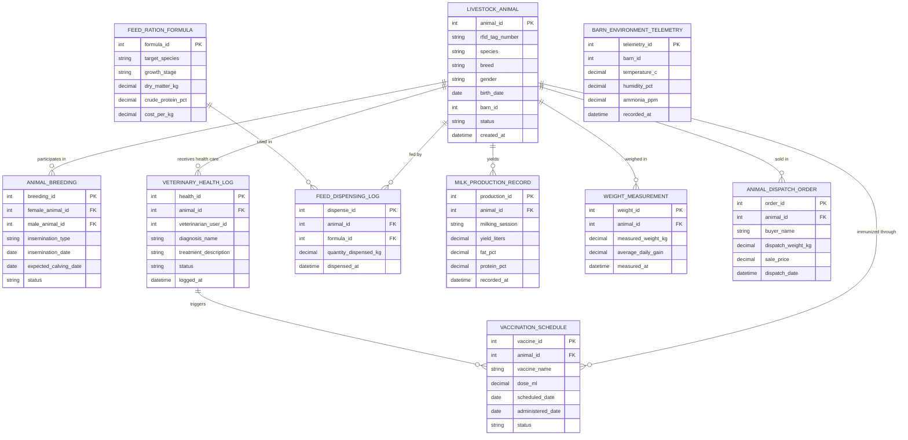

# Conceptual ERD — Livestock & Animal Husbandry Management System

## Mermaid Code

## Entity Description Table | Bang mo ta Entity

| # | Entity Name | Vietnamese Name | Description | Key Attributes | Main Relationships |
|---|-------------|-----------------|-------------|----------------|-------------------|
| 1 | LIVESTOCK_ANIMAL | Hồ Sơ Vật Nuôi | Core individual animal registry record identified by a 15-digit ISO RFID ear tag | animal_id, rfid_tag_number, species, breed, gender, birth_date, status | Has many ANIMAL_BREEDING, VETERINARY_HEALTH_LOG, VACCINATION_SCHEDULE, FEED_DISPENSING_LOG, MILK_PRODUCTION_RECORD, WEIGHT_MEASUREMENT, ANIMAL_DISPATCH_ORDER |
| 2 | ANIMAL_BREEDING | Nhật Ký Phối Giống | Reproductive event record tracking heat cycles, artificial insemination, and expected calving dates | breeding_id, female_animal_id, male_animal_id, insemination_type, expected_calving_date | Belongs to LIVESTOCK_ANIMAL (Female & Male) |
| 3 | VETERINARY_HEALTH_LOG | Hồ Sơ Sức Khỏe | Clinical examination record detailing disease diagnoses, drug treatments, and drug withdrawal periods | health_id, animal_id, veterinarian_user_id, diagnosis_name, treatment_description, status | Belongs to LIVESTOCK_ANIMAL; triggers VACCINATION_SCHEDULE |
| 4 | VACCINATION_SCHEDULE | Lịch Tiêm Phòng | Scheduled or completed vaccination event tracking vaccine product name, dosage, and lot serial numbers | vaccine_id, animal_id, vaccine_name, dose_ml, scheduled_date, status | Belongs to LIVESTOCK_ANIMAL; linked to VETERINARY_HEALTH_LOG |
| 5 | FEED_RATION_FORMULA | Công Thức Khẩu Phần Feed | Nutritional formulation specification calculating Dry Matter, Crude Protein, and cost per kg for herd groups | formula_id, target_species, growth_stage, dry_matter_kg, crude_protein_pct | Has many FEED_DISPENSING_LOG |
| 6 | FEED_DISPENSING_LOG | Nhật Ký Cho Ăn | Execution log recording actual feed quantities dispensed to specific animals by automated feeders | dispense_id, animal_id, formula_id, quantity_dispensed_kg, dispensed_at | Belongs to LIVESTOCK_ANIMAL, FEED_RATION_FORMULA |
| 7 | MILK_PRODUCTION_RECORD | Nhật Ký Sản Lượng Sữa | Daily milk production record capturing volume yield (liters), fat %, protein %, and Somatic Cell Count | production_id, animal_id, milking_session, yield_liters, fat_pct, protein_pct | Belongs to LIVESTOCK_ANIMAL |
| 8 | WEIGHT_MEASUREMENT | Nhật Ký Cân Nặng | Automated chute scale measurement capturing body weight (kg) and Average Daily Gain (ADG) | weight_id, animal_id, measured_weight_kg, average_daily_gain, measured_at | Belongs to LIVESTOCK_ANIMAL |
| 9 | BARN_ENVIRONMENT_TELEMETRY | Dữ Liệu Môi Trường Chuồng | IoT sensor telemetry record capturing barn temperature, humidity, and toxic ammonia (NH3) levels | telemetry_id, barn_id, temperature_c, humidity_pct, ammonia_ppm, recorded_at | Monitored per barn location |
| 10 | ANIMAL_DISPATCH_ORDER | Đơn Bán & Vận Chuyển | Sales transaction and dispatch manifest recording final animal sales weight, price, and buyer info | order_id, animal_id, buyer_name, dispatch_weight_kg, sale_price, dispatch_date | Belongs to LIVESTOCK_ANIMAL |

## Relationship Description | Mo ta Quan he

| # | From Entity | Cardinality | To Entity | Relationship Label | Business Explanation |
|---|-------------|-------------|-----------|-------------------|----------------------|
| 1 | LIVESTOCK_ANIMAL | one-to-many | ANIMAL_BREEDING | participates in | Một vật nuôi cá thể (mái hoặc đực) tham gia vào nhiều đợt phối giống/sinh sản. |
| 2 | LIVESTOCK_ANIMAL | one-to-many | VETERINARY_HEALTH_LOG | receives health care | Một vật nuôi có thể có nhiều bản ghi thăm khám y tế và điều trị bệnh. |
| 3 | LIVESTOCK_ANIMAL | one-to-many | VACCINATION_SCHEDULE | immunized through | Một vật nuôi nhận nhiều đợt tiêm vaccine phòng bệnh theo lịch định kỳ. |
| 4 | LIVESTOCK_ANIMAL | one-to-many | FEED_DISPENSING_LOG | fed by | Một vật nuôi nhận được nhiều khẩu phần thức ăn được cấp từ máy cho ăn tự động. |
| 5 | LIVESTOCK_ANIMAL | one-to-many | MILK_PRODUCTION_RECORD | yields | Một vật nuôi cái cho sản lượng sữa được ghi nhận theo từng ca vắt sữa hàng ngày. |
| 6 | LIVESTOCK_ANIMAL | one-to-many | WEIGHT_MEASUREMENT | weighed in | Một vật nuôi được cân kiểm tra trọng lượng và tốc độ tăng trọng qua các giai đoạn. |
| 7 | LIVESTOCK_ANIMAL | one-to-many | ANIMAL_DISPATCH_ORDER | sold in | Một vật nuôi xuất bán được gắn với đơn hàng và giấy chứng nhận vận chuyển. |
| 8 | FEED_RATION_FORMULA | one-to-many | FEED_DISPENSING_LOG | used in | Một công thức dinh dưỡng chuẩn được áp dụng cho nhiều lượt cấp thức ăn. |
| 9 | VETERINARY_HEALTH_LOG | one-to-many | VACCINATION_SCHEDULE | triggers | Một bản ghi chẩn đoán y tế có thể kích hoạt các đợt tiêm phòng bổ sung hoặc điều trị. |
