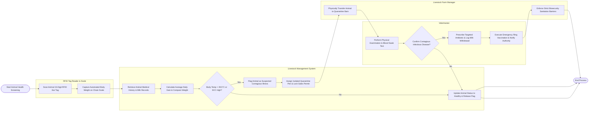

# Swimlane Diagram — Livestock & Animal Husbandry Management System

## Mermaid Code

## Flow Description | Mo ta luong

| Lane | Actor / Subsystem | Role in Flow |
|------|-------------------|--------------|
| RFID Tag Reader & Scale | Hardware Sensor Array | Scans 15-digit ISO RFID ear tags as livestock pass through handling chutes and captures real-time body weight metrics. |
| Livestock Management System | Central Platform | Queries medical history, calculates weight gain trends, evaluates fever and milk quality anomalies, flags contagious disease suspects, isolates permits, and logs withdrawal periods. |
| Veterinarian | Animal Health Officer | Conducts clinical examinations, performs diagnostic blood swabs, confirms infectious disease presence, prescribes antibiotics, and notifies government veterinary authorities. |
| Livestock Farm Manager | Operational Supervisor | Executes physical transfer of sick animals to quarantine barns and enforces biosecurity sanitation barriers across farm premises. |
