# Action Tree — Livestock & Animal Husbandry Management System

## Mermaid Code

```mermaid
graph TD
    Root["Livestock & Animal Husbandry Management System"]

    Root --> M1["Animal Identification & Pedigree Registry"]
    Root --> M2["Breeding & Reproductive Lifecycle"]
    Root --> M3["Veterinary Health & Vaccination Program"]
    Root --> M4["Feed Ration & Nutrition Management"]
    Root --> M5["Production & Growth Performance Tracking"]
    Root --> M6["Barn Environment & Regulatory Compliance"]

    M1 --> A11["Register ISO 15-Digit RFID Ear Tags"]
    M1 --> A12["Maintain Multi-Generational Pedigree Trees"]
    M1 --> A13["Manage Barn & Pen Location Transfers"]

    M2 --> A21["Log Estrus Heat Detection Events"]
    M2 --> A22["Record Artificial Insemination & Straw Lots"]
    M2 --> A23["Track Ultrasound Pregnancy Confirmations"]
    M2 --> A24["Schedule Expected Calving & Farrowing Dates"]

    M3 --> A31["Record Clinical Diagnoses & Medical Notes"]
    M3 --> A32["Enforce Drug Milk & Meat Withdrawal Locks"]
    M3 --> A33["Schedule Mandatory Disease Vaccination Rounds"]
    M3 --> A34["Manage Animal Quarantine & Biosecurity Isolation"]

    M4 --> A41["Formulate Dry Matter & Crude Protein Rations"]
    M4 --> A42["Dispatch Automated Feeder Dispensing Commands"]
    M4 --> A43["Track Feed Inventory Stock & Reorder Levels"]

    M5 --> A51["Record Daily Individual Milk Yield & Quality"]
    M5 --> A52["Capture Chute Scale Body Weights & ADG"]
    M5 --> A53["Manage Slaughterhouse Sales & Carcass Grading"]

    M6 --> A61["Ingest Barn IoT Temp, Humidity & Ammonia Logs"]
    M6 --> A62["Trigger Emergency Disease Outbreak Notifications"]
    M6 --> A63["Export Animal Movement & Health Certificates"]
    M6 --> A64["Generate Herd Profitability & FCR Reports"]
```

## Module Description | Mo ta Module

| # | Module | Description | Actions |
|---|--------|-------------|---------|
| 1 | Animal Identification & Pedigree Registry | Registers 15-digit ISO RFID ear tags, maintains multi-generational genetic family trees, and manages barn pen transfers | Register ISO 15-Digit RFID Ear Tags, Maintain Multi-Generational Pedigree Trees, Manage Barn & Pen Location Transfers |
| 2 | Breeding & Reproductive Lifecycle | Tracks estrus heat cycles, artificial insemination (AI) straw lots, ultrasound pregnancy checks, and expected calving timelines | Log Estrus Heat Detection Events, Record Artificial Insemination & Straw Lots, Track Ultrasound Pregnancy Confirmations, Schedule Expected Calving & Farrowing Dates |
| 3 | Veterinary Health & Vaccination Program | Manages clinical disease diagnoses, enforces mandatory drug withdrawal safety locks, schedules vaccination rounds, and manages quarantine isolation | Record Clinical Diagnoses & Medical Notes, Enforce Drug Milk & Meat Withdrawal Locks, Schedule Mandatory Disease Vaccination Rounds, Manage Animal Quarantine & Biosecurity Isolation |
| 4 | Feed Ration & Nutrition Management | Calculates species-specific nutritional formulas (Dry Matter, Crude Protein), controls smart feeder dispensers, and tracks feed inventory | Formulate Dry Matter & Crude Protein Rations, Dispatch Automated Feeder Dispensing Commands, Track Feed Inventory Stock & Reorder Levels |
| 5 | Production & Growth Performance Tracking | Captures daily milk volume and quality (fat/protein/SCC), tracks chute scale weights for Average Daily Gain (ADG), and manages slaughter sales | Record Daily Individual Milk Yield & Quality, Capture Chute Scale Body Weights & ADG, Manage Slaughterhouse Sales & Carcass Grading |
| 6 | Barn Environment & Regulatory Compliance | Monitors indoor climate IoT sensors (temperature, ammonia), triggers epidemic alerts, exports official movement permits, and analyzes herd FCR | Ingest Barn IoT Temp Humidity & Ammonia Logs, Trigger Emergency Disease Outbreak Notifications, Export Animal Movement & Health Certificates, Generate Herd Profitability & FCR Reports |
