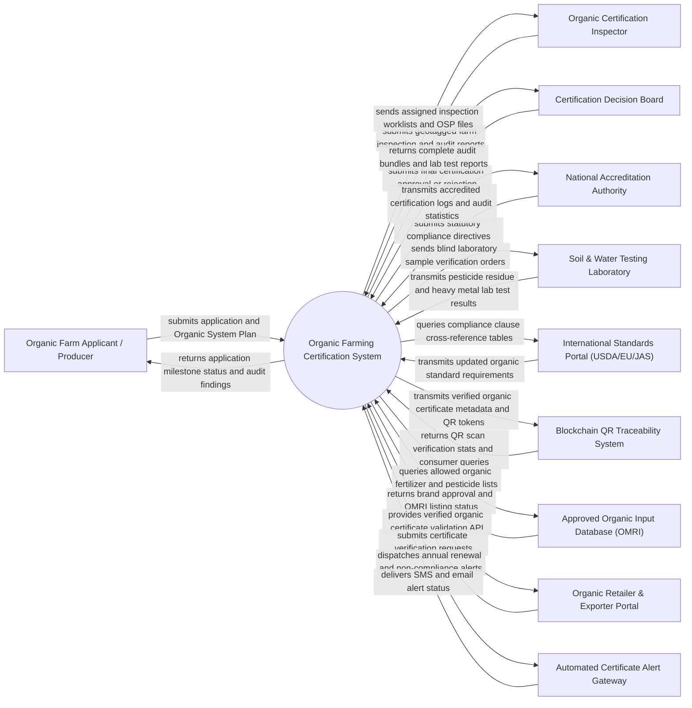

# Context Diagram — Organic Farming Certification System

## Mermaid Code

## Actor & Interaction Table | Bang Actor & Tuong tac

| # | Actor | Actor Type | Data Sent TO System | Data Received FROM System | Notes |
|---|-------|------------|---------------------|---------------------------|-------|
| 1 | Organic Farm Applicant / Producer | Primary | Certification applications, Organic System Plan (OSP), land history proofs, input logs | Application status, inspection schedules, corrective action notices, digital organic certificates | Farmer, cooperative, or enterprise applying for organic certification under USDA/EU/TCVN standards |
| 2 | Organic Certification Inspector | Primary | Geotagged inspection reports, physical audit checklists, tissue/soil sample logs, evidence photos | Assigned inspection tasks, applicant OSP details, historical farm audit records | Certified organic inspector evaluating physical farm operations, buffer zones, and input storage |
| 3 | Certification Decision Board | Primary | Final certification approval signoffs, conditions, scope suspensions, appeal decisions | Complete audit file bundles, inspector recommendations, lab residue reports, compliance scores | Independent technical board reviewing inspection files to ensure impartial certification decisions |
| 4 | National Accreditation Authority | Regulatory System | Accredited scope mandates, auditor qualification standards, regulatory audit directives | Annual certification registries, suspended certificate logs, accreditation compliance reports | Government accreditation body oversight (e.g., USDA NOP, EU Competent Authority, BOA Vietnam) |
| 5 | Soil & Water Testing Laboratory | Supporting System | Quantitative pesticide residue analysis (LC-MS/MS), heavy metal assays, GMO screening, soil pH | Blind sample tracking codes, chain of custody logs, test order parameters | ISO/IEC 17025 accredited laboratory testing soil, water, and plant tissue samples for synthetic residues |
| 6 | International Standards Portal (USDA/EU/JAS) | Supporting System | Standard rulesets, banned substance lists, allowed input categories, international equivalence rules | Regulatory query payloads, standard mapping cross-references | International organic standard authorities defining legal certification criteria and import/export rules |
| 7 | Blockchain QR Traceability System | Supporting System | QR code scan events, consumer verification queries, supply chain batch tracking codes | Cryptographically signed certificate metadata, valid organic license status, parcel boundary geo-data | Public supply chain traceability platform allowing consumers to verify organic authenticity via QR code |
| 8 | Approved Organic Input Database (OMRI) | Supporting System | OMRI-listed product catalogs, approved bio-fertilizer brands, permitted botanical pesticides | Commercial brand lookup queries, active ingredient CAS numbers | Recognized database verifying whether commercial farm inputs comply with organic standards |
| 9 | Organic Retailer & Exporter Portal | Supporting System | Certificate verification requests, supplier license lookup queries | Valid certificate status, certified crop scope, certificate expiration dates, acreage limits | Commercial buyers, supermarkets, and international exporters verifying supplier organic claims |
| 10 | Automated Certificate Alert Gateway | Supporting System | SMS delivery logs, email transmission confirmations | Annual renewal reminders, corrective action deadline warnings, inspection appointment alerts | Notification gateway managing automated communications with applicants, inspectors, and board members |

## System Boundary Description | Mo ta Pham vi He thong

The **Organic Farming Certification System** is an end-to-end regulatory and workflow platform governing the lifecycle of organic agricultural certification, from application submission and Organic System Plan (OSP) evaluation to physical inspection management, chemical residue lab integration, decision board review, certificate issuance, and public QR traceability.

The **system boundary** encompasses applicant onboarding, OSP document verification, buffer zone GIS compliance checking, multi-standard rules engines (USDA Organic, EU 2018/848, TCVN 11041), lab test result integration, non-compliance tracking, digital certificate generation, and public verification APIs.

**External to the system boundary** are physical soil/water sampling, laboratory LC-MS/MS spectrograph hardware operation, physical farm weeding and composting actions, civil court legal enforcement, and consumer smartphone QR scanner camera operation. System interactions use secure HTTPS REST web services, ISO 19115 GIS geospatial feeds, and encrypted JSON payload APIs.
