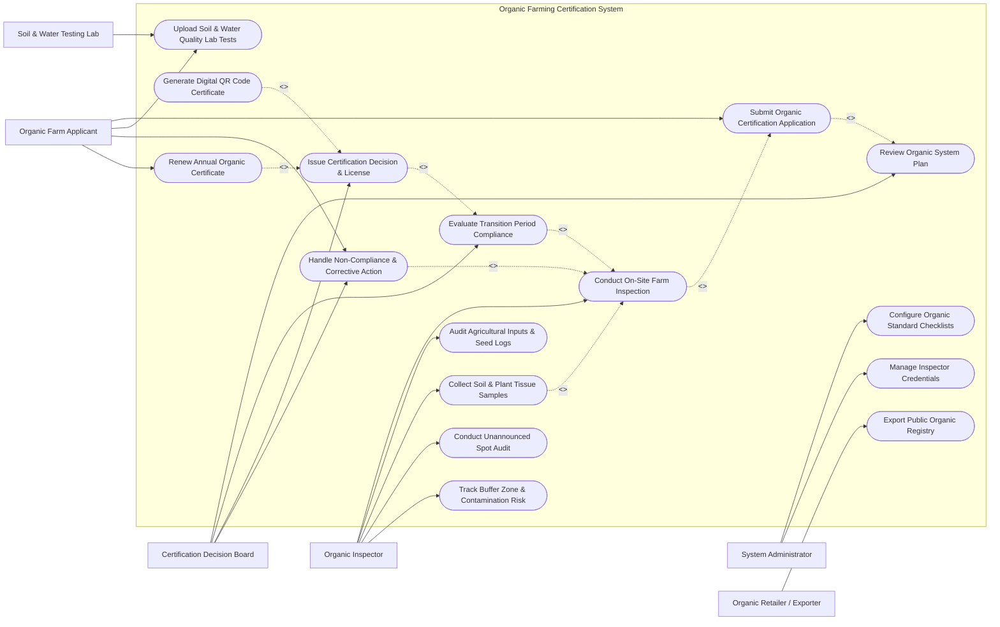

# Use Case Diagram — Organic Farming Certification System

## Mermaid Code

## Actor Table | Bang Actor

| # | Actor | Actor Type | Role Description | Related Use Cases |
|---|-------|------------|------------------|-------------------|
| 1 | Organic Farm Applicant | Primary | Agricultural producer or cooperative applying for or maintaining organic certification | UC01, UC02, UC11, UC12 |
| 2 | Organic Inspector | Primary | Certified auditor conducting physical farm inspections, evaluating inputs, and collecting samples | UC04, UC05, UC06, UC10, UC13 |
| 3 | Certification Decision Board | Primary | Technical board evaluating completed audit files and issuing official certification decisions | UC03, UC07, UC08, UC11 |
| 4 | System Administrator | Primary | Administrator managing system rulesets, standard checklists, and inspector ISO credentials | UC15, UC16 |
| 5 | Soil & Water Testing Lab | Secondary / System | ISO 17025 accredited laboratory processing soil, water, and tissue residue analysis | UC02 |
| 6 | Organic Retailer / Exporter | Secondary / System | Commercial buyer verifying organic certificate validity and public registry compliance | UC14 |

## Use Case Table | Bang Use Case

| # | UC ID | Use Case Name | Primary Actor | Secondary Actor | Description | Priority |
|---|-------|---------------|---------------|-----------------|-------------|----------|
| 1 | UC01 | Submit Organic Certification Application | Organic Farm Applicant | None | Submits formal application, farm land history, parcel GIS boundaries, and crop scope | High |
| 2 | UC02 | Upload Soil & Water Quality Lab Tests | Organic Farm Applicant | Testing Lab | Uploads accredited lab analysis reports for heavy metals, synthetic pesticides, and GMOs | High |
| 3 | UC03 | Review Organic System Plan (OSP) | Decision Board | None | Reviews producer's OSP detailing crop rotation, soil management, and pest control practices | High |
| 4 | UC04 | Conduct On-Site Farm Inspection | Organic Inspector | None | Performs physical farm audit, verifies land boundaries, inspects storage, and logs findings | High |
| 5 | UC05 | Audit Agricultural Inputs & Seed Logs | Organic Inspector | None | Verifies seed organic certificates, compost sources, bio-pesticides, and OMRI listing compliance | High |
| 6 | UC06 | Collect Soil & Plant Tissue Samples | Organic Inspector | Testing Lab | Collects geotagged tissue/soil samples during inspection for laboratory residue screening | Medium |
| 7 | UC07 | Evaluate Transition Period Compliance | Decision Board | None | Verifies 36-month (or 24-month) conversion period during which no prohibited inputs were used | High |
| 8 | UC08 | Issue Certification Decision & License | Decision Board | None | Formally approves organic certification, defines crop scope, and issues official license | High |
| 9 | UC09 | Generate Digital QR Code Certificate | System | None | Generates tamper-proof digital certificate with QR code for supply chain traceability | High |
| 10 | UC10 | Conduct Unannounced Spot Audit | Organic Inspector | None | Conducts surprise field audit on 5% of certified producers annually to verify continuous compliance | Medium |
| 11 | UC11 | Handle Non-Compliance & Corrective Action | Decision Board | Applicant | Issues Non-Compliance Notice, evaluates producer corrective evidence, or revokes license | High |
| 12 | UC12 | Renew Annual Organic Certificate | Organic Farm Applicant | Decision Board | Submits annual OSP update, schedules re-inspection, and renews expiring organic license | High |
| 13 | UC13 | Track Buffer Zone & Contamination Risk | Organic Inspector | None | Inspects physical buffer zones ($>8\text{m}$) separating organic fields from conventional neighbors | High |
| 14 | UC14 | Export Public Organic Registry | Retailer / Exporter | System | Publishes online searchable database of active, suspended, and revoked organic certificates | Medium |
| 15 | UC15 | Configure Organic Standard Checklists | System Administrator | None | Updates compliance audit checklists for USDA Organic, EU 2018/848, and TCVN standards | Medium |
| 16 | UC16 | Manage Inspector Credentials | System Administrator | None | Manages inspector ISO 19011 qualifications, conflict of interest declarations, and assignments | Low |

## Use Case Specification | Dac ta Use Case

---

### UC01 — Submit Organic Certification Application

| Field | Detail |
|-------|--------|
| **UC ID** | UC01 |
| **Use Case Name** | Submit Organic Certification Application |
| **Actor(s)** | Primary: Organic Farm Applicant / Producer   Secondary: None |
| **Description** | Allows an agricultural producer to create a digital application, select target organic standards (USDA, EU, TCVN), define farm parcel GIS boundaries, declare crop species, and submit required land history proofs. |
| **Precondition** | 1. Applicant is registered in the system portal with verified business identity (tax ID).   2. Farm parcel cadastral maps and land ownership/lease documents are available. |
| **Main Flow** | 1. Applicant selects "New Organic Certification Application" on the portal.   2. Applicant selects target organic standards (e.g., USDA NOP 7 CFR Part 205, EU Regulation 2018/848, TCVN 11041).   3. Applicant inputs farm site details: Total Acreage, Organic Acreage, Geo-coordinates, and uploads GIS parcel polygon shapefile.   4. Applicant lists target crop species, estimated annual harvest yield ($tons$), and cultivation methods.   5. Applicant submits mandatory 3-year prior land history declaration confirming no synthetic pesticides or fertilizers were applied.   6. Applicant uploads initial Organic System Plan (OSP) document (UC03) and soil/water lab test reports (UC02).   7. System validates document completeness and calculates application fee.   8. Applicant pays application fee via integrated gateway.   9. System records application, generates Application ID, and assigns status to `SUBMITTED_PENDING_OSP_REVIEW`. |
| **Alternative Flow** | **AF1** — Group Certification Application: A smallholder farmer cooperative submits a group certification application with an Internal Control System (ICS) manager list.   **AF2** — Split Operation Declaration: Applicant declares a "split farm operation" (part organic, part conventional), triggering mandatory strict physical segregation protocol submission. |
| **Exception Flow** | **EX1** — Incomplete 3-Year Land History: Applicant fails to provide 36-month land history proof, system blocks application submission until missing documents are provided.   **EX2** — Prohibited Chemical Declared: Application discloses synthetic input use within 12 months, system sets application status to `ELIGIBLE_FOR_TRANSITION_ONLY`. |
| **Postcondition** | Application record created in database with status `SUBMITTED_PENDING_OSP_REVIEW` and routed to certification decision board intake queue. |
| **Business Rule** | **BR1**: Land history declaration must cover a minimum continuous 36-month period prior to harvest. |

---

### UC03 — Review Organic System Plan (OSP)

| Field | Detail |
|-------|--------|
| **UC ID** | UC03 |
| **Use Case Name** | Review Organic System Plan (OSP) |
| **Actor(s)** | Primary: Certification Decision Board   Secondary: Organic Farm Applicant |
| **Description** | Conducts technical desk audit of the producer's Organic System Plan (OSP) to verify planned crop rotations, soil fertility practices, pest management strategies, seed sources, and contamination prevention protocols prior to scheduling physical inspection. |
| **Precondition** | 1. Application status is `SUBMITTED_PENDING_OSP_REVIEW`.   2. Complete OSP document bundle is submitted by applicant. |
| **Main Flow** | 1. Decision Board reviewer opens pending OSP file in the audit workspace.   2. Reviewer evaluates Section 1: Crop Rotation Plan (verifies leguminous green manure crops and biodiversity practices).   3. Reviewer evaluates Section 2: Soil Fertility & Manure Management (verifies raw manure composting 120-day pre-harvest rule).   4. Reviewer evaluates Section 3: Seeds & Planting Stock (verifies non-GMO certification and organic seed preference).   5. Reviewer evaluates Section 4: Pest, Disease & Weed Management (verifies mechanical/cultural controls prioritized over OMRI inputs).   6. Reviewer evaluates Section 5: Buffer Zones & Drift Prevention (verifies minimum 8-meter physical barrier from neighboring conventional fields).   7. Reviewer checks declared commercial inputs against the Approved Organic Input Database (OMRI).   8. Reviewer completes OSP Evaluation Checklist and marks status as `OSP_APPROVED_FOR_INSPECTION`.   9. System updates application status and prompts scheduling of on-site inspection (UC04). |
| **Alternative Flow** | **AF1** — OSP Revision Request: Reviewer identifies missing information (e.g., uncertified seed source), sets status to `OSP_REVISION_REQUIRED`, and dispatches query notice to applicant with 14-day deadline. |
| **Exception Flow** | **EX1** — GMO Seed / Prohibited Input Discovered: OSP explicitly declares use of GMO seeds or synthetic herbicide, reviewer rejects OSP and issues formal Application Rejection Notice. |
| **Postcondition** | OSP evaluation checklist saved in database and application status updated to `OSP_APPROVED_FOR_INSPECTION`. |
| **Business Rule** | **BR1**: Raw uncomposted animal manure application must cease at least 120 days prior to harvest of crops for human consumption.   **BR2**: All commercial input products declared in OSP must hold active OMRI or equivalent organic listing. |

---

### UC04 — Conduct On-Site Farm Inspection

| Field | Detail |
|-------|--------|
| **UC ID** | UC04 |
| **Use Case Name** | Conduct On-Site Farm Inspection |
| **Actor(s)** | Primary: Organic Certification Inspector   Secondary: Organic Farm Applicant |
| **Description** | Allows a certified organic inspector to perform a physical on-site audit of farm fields, inspect buffer zones, examine input storage sheds, audit harvest logs, take geotagged photos, and log compliance findings in the mobile inspection app. |
| **Precondition** | 1. Application status is `OSP_APPROVED_FOR_INSPECTION`.   2. Inspector is assigned with no conflict of interest declarations for the target farm. |
| **Main Flow** | 1. Inspector arrives at farm site, conducts opening meeting with applicant, and opens inspection assignment on mobile app.   2. App displays approved OSP details, parcel GIS boundaries, and standard compliance checklist (USDA/EU/TCVN).   3. Inspector conducts physical walk-through of all registered farm fields, verifying crop species and acreage against application.   4. Inspector inspects physical buffer zones separating organic fields from conventional neighbors, capturing geotagged photos and measuring distance.   5. Inspector audits input storage sheds, fuel storage, equipment washing bays, and tool sanitation practices.   6. Inspector conducts mass-balance audit (compares planted seed quantities vs harvested volume vs sales invoices).   7. Inspector collects soil or plant tissue samples for lab residue testing (UC06) if risk indicators exist.   8. Inspector completes digital inspection checklist, records minor/major non-compliance observations, and conducts exit meeting.   9. Both inspector and applicant sign the digital inspection summary on the mobile tablet.   10. App uploads geotagged inspection package to system and sets status to `INSPECTION_COMPLETED`. |
| **Alternative Flow** | **AF1** — Offline Mobile Inspection: Inspector executes audit in remote area without cellular signal; app saves photos and checklist locally and syncs automatically upon returning to connectivity. |
| **Exception Flow** | **EX1** — Evidence of Prohibited Input Use: Inspector finds empty synthetic pesticide containers in farm shed or fresh chemical burn marks on crop; inspector flags Critical Non-Compliance and requests immediate emergency sample testing. |
| **Postcondition** | Complete geotagged inspection report, evidence photos, and checklist saved in system database and routed to Decision Board. |
| **Business Rule** | **BR1**: Inspection must cover 100% of organic parcels and physical storage buildings.   **BR2**: Geotagged inspection photos must be captured within 20 meters of parcel boundary coordinates. |

---

### UC07 — Evaluate Transition Period Compliance

| Field | Detail |
|-------|--------|
| **UC ID** | UC07 |
| **Use Case Name** | Evaluate Transition Period Compliance |
| **Actor(s)** | Primary: Certification Decision Board   Secondary: None |
| **Description** | Evaluates and tracks the mandatory multi-year conversion/transition period (typically 36 months for perennial crops, 24 months for annuals) during which the farm operates strictly under organic management before full organic certification can be granted. |
| **Precondition** | 1. Inspection report and lab residue test results are submitted.   2. Land conversion start date is verified by historical documentation. |
| **Main Flow** | 1. Decision Board reviewer opens pending transition evaluation file.   2. Reviewer calculates total elapsed transition time from verified last prohibited input application date to target harvest date.   3. Reviewer verifies that all inspection reports during the transition period confirm zero synthetic input use.   4. Reviewer checks laboratory residue test results (UC02/UC06) for non-detectable synthetic pesticide levels ($< 0.01\text{ ppm}$).   5. If transition period is incomplete (e.g., 20 months completed out of 36 required), reviewer grants "In-Conversion / Transition Organic" status.   6. System issues Transition Status Certificate permitting crop labeling as "Product in Conversion to Organic Farming" (per EU rules).   7. If full 36-month transition requirement is satisfied, reviewer marks status as `TRANSITION_COMPLETED_ELIGIBLE_FOR_FULL_CERT`.   8. System advances file to final certification issuance (UC08). |
| **Alternative Flow** | **AF1** — Transition Retroactive Reduction: Applicant submits official state government land abandonment proof showing land was fallow for 3 years; Decision Board approves partial retroactive transition credit. |
| **Exception Flow** | **EX1** — Prohibited Chemical Used During Transition: Prohibited input is detected during year 2 of transition; Decision Board resets transition clock back to Day 0 (36 months restarted). |
| **Postcondition** | Transition compliance evaluation recorded in database with status `TRANSITION_COMPLETED` or `IN_TRANSITION`. |
| **Business Rule** | **BR1**: Full organic status requires a minimum 36 continuous months of verified organic management prior to initial organic harvest. |

---

### UC08 — Issue Certification Decision & License

| Field | Detail |
|-------|--------|
| **UC ID** | UC08 |
| **Use Case Name** | Issue Certification Decision & License |
| **Actor(s)** | Primary: Certification Decision Board   Secondary: System |
| **Description** | Formally approves organic certification, defines certified crop species, land parcels, and annual production caps, signs the official decision, and issues the digital Organic Certificate and License. |
| **Precondition** | 1. OSP is approved (UC03), inspection completed (UC04), lab tests clean (UC02), and transition period satisfied (UC07).   2. Decision Board holds valid accreditation authority signoff credentials. |
| **Main Flow** | 1. Decision Board conducts final dossier review encompassing OSP, inspection report, lab assays, and transition audit.   2. Board votes to `APPROVE` certification.   3. Board Chair signs official Certification Decision document using hardware digital certificate key.   4. System updates application status to `CERTIFIED_ORGANIC`.   5. System generates formal Organic Certificate record specifying: Certificate Number, Producer Name, Certified Parcel List, Certified Crop Scope (e.g., Organic Arabica Coffee), Standard Type (USDA Organic / EU Organic), Issue Date, and Expiry Date (1 year from issue).   6. System triggers UC09 to generate tamper-proof QR code and cryptographic blockchain payload.   7. System sends automated approval notification email to applicant with downloadable PDF certificate and QR badge.   8. System adds certificate entry to Public Organic Registry (UC14). |
| **Alternative Flow** | **AF1** — Conditional Certification: Board approves certification subject to minor conditions (e.g., plant additional hedgerow in buffer zone within 60 days).   **AF2** — Certification Denial: Board votes to `DENY` certification due to unresolved major non-compliance; system dispatches formal Denial Notice detailing appeal rights. |
| **Exception Flow** | **EX1** — Accreditation Scope Exceeded: System blocks certificate issuance if target crop category is outside the certification body's accredited scope. |
| **Postcondition** | Official Organic Certificate issued, producer status set to `CERTIFIED_ORGANIC`, and certificate published to public registry. |
| **Business Rule** | **BR1**: Certificates are valid for exactly 12 months and require annual renewal (UC12).   **BR2**: Dual-signature by Decision Board Chair and Technical Director is required for certificate validity. |
