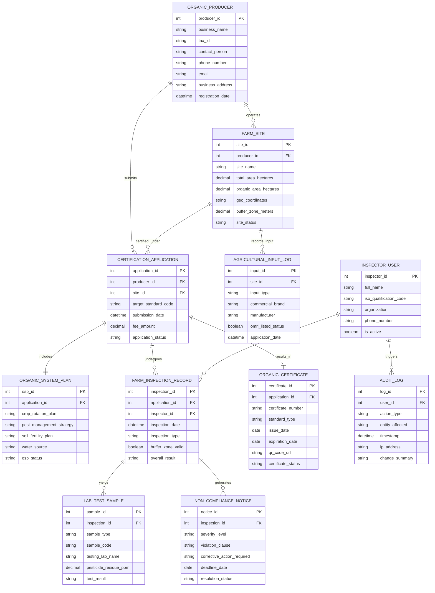

# Conceptual ERD — Organic Farming Certification System

## Mermaid Code

## Entity Description Table | Bang mo ta Entity

| # | Entity Name | Vietnamese Name | Description | Key Attributes | Main Relationships |
|---|-------------|-----------------|-------------|----------------|-------------------|
| 1 | ORGANIC_PRODUCER | Chủ Thể Sản Xuất Hữu Cơ | Stores corporate profile, business registration, tax identity, and primary contact for certified producers | producer_id, business_name, tax_id, contact_person, phone_number | Operates FARM_SITE, submits CERTIFICATION_APPLICATION |
| 2 | FARM_SITE | Trang Trại / Vùng Trồng | Represents physical farm land sites, total/organic acreage, GIS polygon coordinates, and buffer zones | site_id, producer_id, site_name, total_area_hectares, buffer_zone_meters | Belongs to PRODUCER, certified under APPLICATION, records INPUT_LOG |
| 3 | CERTIFICATION_APPLICATION | Hồ Sơ Đăng Ký Cấp Chứng Nhận | Central application claim capturing target organic standards (USDA, EU, TCVN), submission dates, and status | application_id, producer_id, site_id, target_standard_code, application_status | Submits by PRODUCER, includes OSP, undergoes INSPECTION, results in CERTIFICATE |
| 4 | ORGANIC_SYSTEM_PLAN | Kế Hoạch Sản Xuất Hữu Cơ | Document detailing producer crop rotations, soil fertility management, pest controls, and seed sources | osp_id, application_id, crop_rotation_plan, pest_management_strategy, osp_status | Included in CERTIFICATION_APPLICATION |
| 5 | FARM_INSPECTION_RECORD | Biên Bản Đánh Giá Thực Địa | Records on-site physical farm audit findings, buffer zone measurements, storage checks, and inspection status | inspection_id, application_id, inspector_id, inspection_date, overall_result | Undergone by APPLICATION, conducted by INSPECTOR, yields SAMPLE, generates NOTICE |
| 6 | LAB_TEST_SAMPLE | Mẫu Kiếm Nghiệm Phân Tích | Captures laboratory test results for soil, water, and tissue samples (pesticide residues in ppm, heavy metals) | sample_id, inspection_id, sample_type, sample_code, pesticide_residue_ppm, test_result | Yielded by FARM_INSPECTION_RECORD |
| 7 | AGRICULTURAL_INPUT_LOG | Nhật Ký Vẫn Tư Đầu Vào | Logs all fertilizers, composts, bio-pesticides, and seeds applied on farm sites, tracking OMRI listing status | input_id, site_id, input_type, commercial_brand, omri_listed_status, application_date | Recorded on FARM_SITE |
| 8 | NON_COMPLIANCE_NOTICE | Thông Báo Vi Phạm Hữu Cơ | Records formal non-compliance issues identified during inspections, required corrective actions, and deadlines | notice_id, inspection_id, severity_level, violation_clause, deadline_date, resolution_status | Generated by FARM_INSPECTION_RECORD |
| 9 | ORGANIC_CERTIFICATE | Chứng Nhận Sản Phẩm Hữu Cơ | Stores issued digital organic certificates, unique certificate numbers, issue/expiry dates, and QR code URLs | certificate_id, application_id, certificate_number, standard_type, issue_date, expiration_date, qr_code_url | Results from CERTIFICATION_APPLICATION |
| 10 | INSPECTOR_USER | Chuyên Viên Đánh Giá Hữu Cơ | Stores certified organic inspector profiles, ISO 19011 auditor qualification codes, and organizational affiliation | inspector_id, full_name, iso_qualification_code, organization, is_active | Conducts FARM_INSPECTION_RECORD, triggers AUDIT_LOG |
| 11 | AUDIT_LOG | Nhật Ký Hệ Thống & Kiểm Toán | Immutable audit trail tracking user actions, certification decision changes, and security events | log_id, user_id, action_type, entity_affected, timestamp | Triggered by INSPECTOR_USER and other system users |

## Relationship Description | Mo ta Quan he

| # | From Entity | Cardinality | To Entity | Relationship Label | Business Explanation |
|---|-------------|-------------|-----------|-------------------|----------------------|
| 1 | ORGANIC_PRODUCER | one-to-many | FARM_SITE | operates | An organic producer can operate multiple physical farm land sites and production parcels |
| 2 | ORGANIC_PRODUCER | one-to-many | CERTIFICATION_APPLICATION | submits | A producer can submit multiple certification applications across different standards and years |
| 3 | FARM_SITE | one-to-many | CERTIFICATION_APPLICATION | certified_under | A farm site can be certified under multiple target standards (e.g., USDA Organic + EU Organic) |
| 4 | FARM_SITE | one-to-many | AGRICULTURAL_INPUT_LOG | records_input | A farm site records multiple agricultural inputs (fertilizers, composts, seeds) applied over time |
| 5 | CERTIFICATION_APPLICATION | one-to-one | ORGANIC_SYSTEM_PLAN | includes | A certification application includes exactly one complete Organic System Plan (OSP) document |
| 6 | CERTIFICATION_APPLICATION | one-to-many | FARM_INSPECTION_RECORD | undergoes | An application undergoes one or more initial, surveillance, or spot farm inspections |
| 7 | INSPECTOR_USER | one-to-many | FARM_INSPECTION_RECORD | conducts | A certified organic inspector conducts multiple physical on-site farm inspections |
| 8 | FARM_INSPECTION_RECORD | one-to-many | LAB_TEST_SAMPLE | yields | A farm inspection can yield multiple soil, water, or plant tissue samples for lab residue testing |
| 9 | FARM_INSPECTION_RECORD | one-to-many | NON_COMPLIANCE_NOTICE | generates | A farm inspection can generate non-compliance notices for identified standard violations |
| 10 | CERTIFICATION_APPLICATION | one-to-one | ORGANIC_CERTIFICATE | results_in | An approved certification application results in exactly one official Organic Certificate |
| 11 | INSPECTOR_USER | one-to-many | AUDIT_LOG | triggers | User actions and certification decisions trigger immutable security audit log entries |
