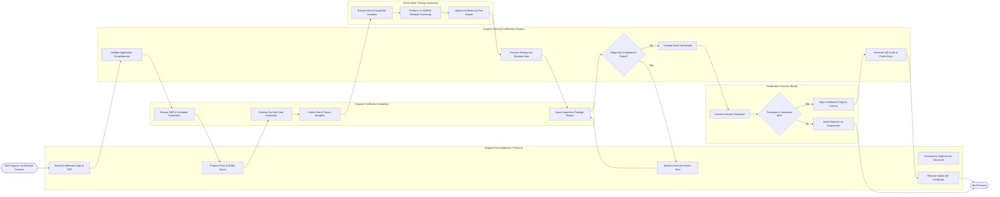

# Swimlane Diagram — Organic Farming Certification System

## Mermaid Code

## Flow Description | Mo ta luong

| Lane | Actor | Role in Flow |
|------|-------|-------------|
| 1 | Organic Farm Applicant / Producer | Submits organic certification application and Organic System Plan (OSP), prepares land and buffer zones, accompanies inspector during on-site audit, submits corrective action plans for identified non-compliances, and receives official digital QR certificate |
| 2 | Organic Farming Certification System | Validates document completeness, ingests laboratory residue assay reports, tracks non-compliance resolution workflows, compiles complete audit file bundles for decision board review, and generates public QR code verification entries |
| 3 | Soil & Water Testing Laboratory | Receives blind soil, water, and plant tissue samples from inspectors, performs LC-MS/MS multi-residue pesticide and heavy metal screening, and uploads certified digital lab test reports |
| 4 | Organic Certification Inspector | Reviews applicant OSP, conducts physical farm inspection, inspects buffer zones and input storage sheds, collects geotagged soil/tissue samples, and files comprehensive inspection reports |
| 5 | Certification Decision Board | Evaluates complete audit dossiers, verifies 36-month transition compliance, reviews lab test results, votes on certification approval, and digitally signs official organic licenses |
