# Action Tree — Organic Farming Certification System

## Mermaid Code

```mermaid
graph TD
    Root["Organic Farming Certification System"]

    Root --> M1["Producer & Farm Site Registration"]
    Root --> M2["Application & Organic System Plan Management"]
    Root --> M3["On-Site Inspection & Audit Operations"]
    Root --> M4["Lab Testing & Chemical Residue Screening"]
    Root --> M5["Non-Compliance & Corrective Action Resolution"]
    Root --> M6["Certification Issuance & QR Traceability"]
    Root --> M7["Standards Configuration & Public Registry Admin"]

    M1 --> A11["Register Organic Producer Profile"]
    M1 --> A12["Define Farm Site & Parcel GIS Polygons"]
    M1 --> A13["Set Physical Buffer Zone Boundaries"]
    M1 --> A14["Upload 36-Month Prior Land History"]

    M2 --> A21["Submit Organic Certification Application"]
    M2 --> A22["Formulate Organic System Plan"]
    M2 --> A23["Cross-Check Inputs with OMRI Allowed List"]
    M2 --> A24["Conduct Desktop OSP Audit Review"]

    M3 --> A31["Assign Certified Organic Inspector"]
    M3 --> A32["Execute Physical Farm & Storage Audit"]
    M3 --> A33["Capture Geotagged Evidence Photos"]
    M3 --> A34["Execute Mass-Balance Harvest Audit"]

    M4 --> A41["Collect Geotagged Soil & Tissue Samples"]
    M4 --> A42["Ingest LC-MS/MS Pesticide Residue Assays"]
    M4 --> A43["Screen Heavy Metal & GMO Contamination"]
    M4 --> A44["Verify Non-Detectable Residue Thresholds"]

    M5 --> A51["Issue Non-Compliance Notice"]
    M5 --> A52["Submit Corrective Action Evidence"]
    M5 --> A53["Verify Corrective Resolution Implementation"]
    M5 --> A54["Execute Unannounced Spot Audits"]

    M6 --> A61["Evaluate 36-Month Transition Compliance"]
    M6 --> A62["Grant Formal Organic Certification Decision"]
    M6 --> A63["Generate Cryptographic Digital QR Certificate"]
    M6 --> A64["Process Annual Certificate Renewal"]

    M7 --> A71["Configure USDA, EU & TCVN Standards Rulesets"]
    M7 --> A72["Manage Inspector ISO 19011 Qualifications"]
    M7 --> A73["Publish Searchable Public Organic Registry"]
    M7 --> A74["Export Accreditation Body Audit Reports"]
```

## Module Description | Mo ta Module

| # | Module | Description | Actions |
|---|--------|-------------|---------|
| 1 | Producer & Farm Site Registration | Manages organic producer business profiles, farm site parcel GIS polygons, physical buffer zone settings, and 3-year prior land history documentation | Register Organic Producer Profile, Define Farm Site & Parcel GIS Polygons, Set Physical Buffer Zone Boundaries, Upload 36-Month Prior Land History |
| 2 | Application & Organic System Plan Management | Handles certification application submissions, Organic System Plan (OSP) compilation, input cross-checking with OMRI databases, and desktop OSP reviews | Submit Organic Certification Application, Formulate Organic System Plan, Cross-Check Inputs with OMRI Allowed List, Conduct Desktop OSP Audit Review |
| 3 | On-Site Inspection & Audit Operations | Manages inspector scheduling, physical on-site farm and storage audits, geotagged evidence photo capture, mass-balance harvest audits, and checklist logs | Assign Certified Organic Inspector, Execute Physical Farm & Storage Audit, Capture Geotagged Evidence Photos, Execute Mass-Balance Harvest Audit |
| 4 | Lab Testing & Chemical Residue Screening | Manages geotagged soil and plant tissue sampling, integrates laboratory LC-MS/MS pesticide residue results, screens heavy metals/GMOs, and verifies residue limits | Collect Geotagged Soil & Tissue Samples, Ingest LC-MS/MS Pesticide Residue Assays, Screen Heavy Metal & GMO Contamination, Verify Non-Detectable Residue Thresholds |
| 5 | Non-Compliance & Corrective Action Resolution | Issues formal Non-Compliance Notices, tracks producer corrective evidence submissions, verifies resolution implementation, and schedules unannounced spot audits | Issue Non-Compliance Notice, Submit Corrective Action Evidence, Verify Corrective Resolution Implementation, Execute Unannounced Spot Audits |
| 6 | Certification Issuance & QR Traceability | Evaluates 36-month transition period compliance, records decision board votes, generates digital QR code organic certificates, and manages annual license renewals | Evaluate 36-Month Transition Compliance, Grant Formal Organic Certification Decision, Generate Cryptographic Digital QR Certificate, Process Annual Certificate Renewal |
| 7 | Standards Configuration & Public Registry Admin | Configures USDA Organic, EU 2018/848, and TCVN standards checklists, manages inspector credentials, publishes public organic registries, and exports audit reports | Configure USDA, EU & TCVN Standards Rulesets, Manage Inspector ISO 19011 Qualifications, Publish Searchable Public Organic Registry, Export Accreditation Body Audit Reports |
