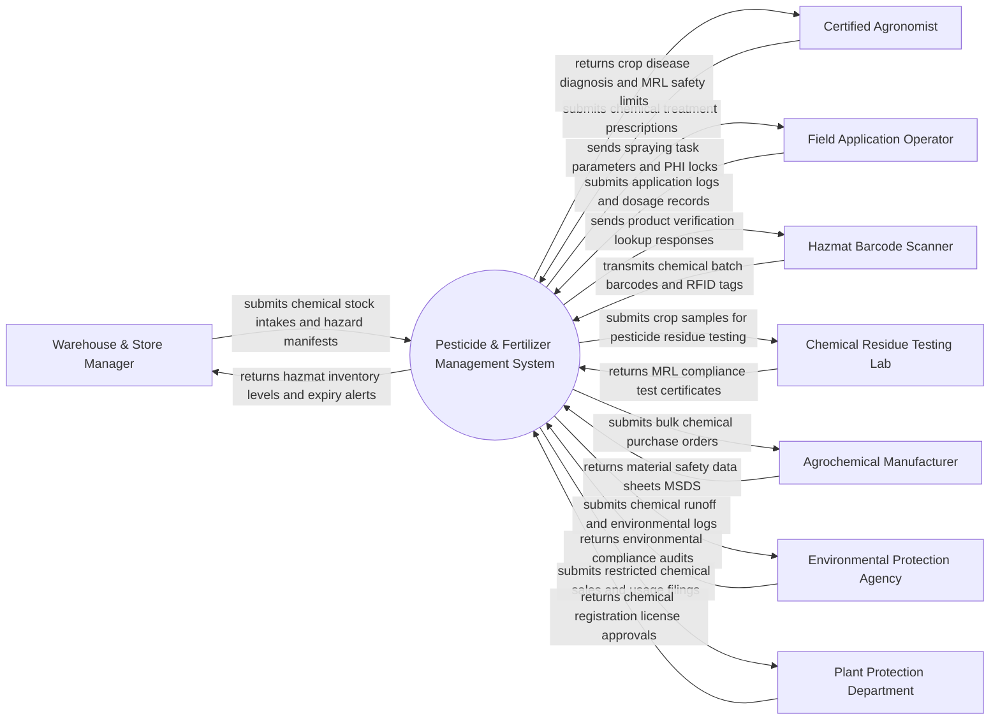

# Context Diagram — Pesticide & Fertilizer Management System

## Mermaid Code

## Actor & Interaction Table | Bang Actor & Tuong tac

| # | Actor | Actor Type | Data Sent TO System | Data Received FROM System | Notes |
|---|-------|------------|---------------------|---------------------------|-------|
| 1 | Warehouse & Store Manager | Primary | Chemical batch intake logs, storage location assignments, hazmat disposal records | Real-time stock availability, expiration warnings, hazard storage alerts | Primary warehouse operator managing agrochemical inventory and safety protocols |
| 2 | Certified Agronomist | Primary | Agrochemical prescriptions, target crop disease diagnoses, recommended dosages | Approved active ingredient lists, MRL legal limits, Pre-Harvest Intervals (PHI) | Licensed agronomist authorized to issue chemical spraying and fertilization plans |
| 3 | Field Application Operator | Primary | Actual chemical dosage applied, weather conditions, operator PPE verification | Spraying task dispatches, mandatory PHI harvest lock dates, safety guidelines | Field worker executing chemical spraying, fertigation, and fertilizer application |
| 4 | Hazmat Barcode Scanner | Supporting System | 2D DataMatrix barcodes, chemical batch lot numbers, RFID container tags | Product authenticity validation, toxicity hazard classification alerts | Handheld barcode scanner used in warehouses and field mixing stations |
| 5 | Chemical Residue Testing Lab | Supporting | Chemical residue test results (PPM), Gas Chromatography (GC-MS) assay files | Crop sample identification barcodes, target chemical testing requests | Accredited analytical laboratory testing harvested crops for Maximum Residue Limits |
| 6 | Agrochemical Manufacturer | Supporting | Material Safety Data Sheets (MSDS), CAS active ingredient profiles, bulk pricing | Purchase orders, inventory replenishment requests, defect complaints | Commercial chemical vendor supplying registered pesticides and fertilizers |
| 7 | Environmental Protection Agency | Regulatory System | National water protection standards, chemical runoff thresholds, disposal rules | Environmental chemical runoff logs, hazardous waste disposal filings | Government agency regulating chemical environmental impact and water contamination |
| 8 | Plant Protection Department | Regulatory System | Restricted pesticide lists, banned active ingredient decrees, license rules | Monthly restricted chemical sales filings, official usage audit logs | National government department licensing agrochemical products and application permits |

## System Boundary Description | Mo ta Pham vi He thong

The **Pesticide & Fertilizer Management System** is a specialized agricultural software platform regulating the procurement, storage, prescription, application, and environmental compliance of agrochemicals. The system boundary encompasses active ingredient registries, hazardous material (Hazmat) inventory management, certified agronomist prescription workflows, automated calculation of Pre-Harvest Intervals (PHI) and Maximum Residue Limits (MRL), field spraying safety validation, chemical residue lab integration, and regulatory reporting for restricted pesticides. Excluded from the system boundary are physical chemical synthesis manufacturing, raw laboratory Gas Chromatography hardware operation, physical hazardous waste incineration, and farm equipment engine mechanics. The platform interfaces via RESTful APIs and GS1 DataMatrix barcodes to track chemical containers and report compliance to government regulatory portals.
