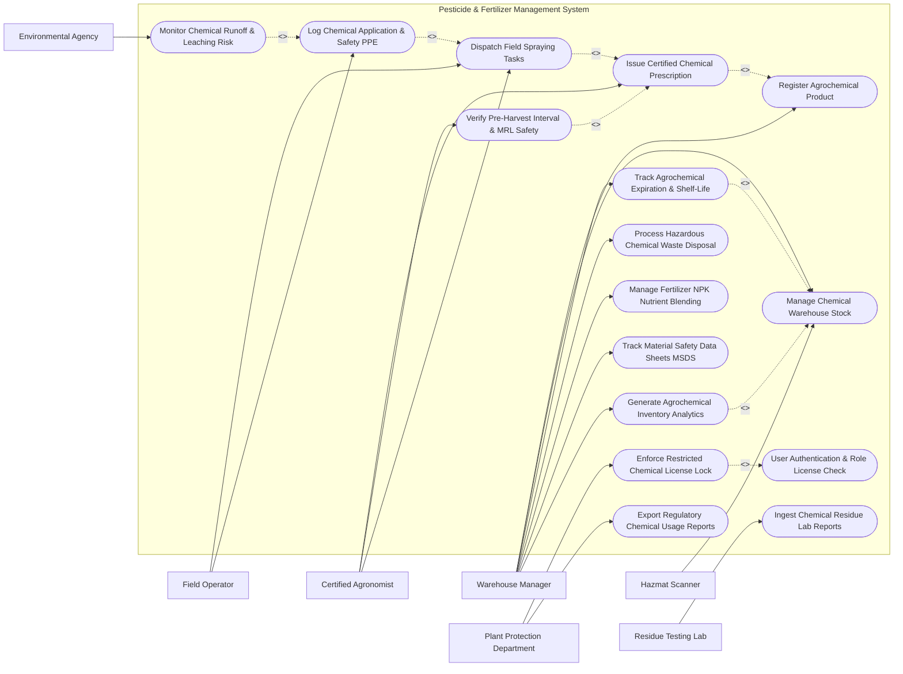

# Use Case Diagram — Pesticide & Fertilizer Management System

## Mermaid Code

## Actor Table | Bang Actor

| # | Actor | Actor Type | Role Description | Related Use Cases |
|---|-------|------------|------------------|-------------------|
| 1 | Warehouse Manager | Primary | Manages chemical stock intake, hazardous material (Hazmat) storage, expiration dates, and fertilizer blending | UC01, UC02, UC03, UC08, UC10, UC13, UC14, UC15 |
| 2 | Certified Agronomist | Primary | Issues legally binding chemical treatment prescriptions, calculates dosages, and verifies crop Pre-Harvest Intervals | UC02, UC04, UC05, UC06 |
| 3 | Field Operator | Primary | Receives chemical spraying tasks, verifies personal protective equipment (PPE), and logs field application details | UC02, UC06, UC07 |
| 4 | Hazmat Scanner | Secondary | Reads 2D DataMatrix barcodes and RFID tags to verify chemical container authenticity and batch lot numbers | UC03 |
| 5 | Residue Testing Lab | Secondary | Uploads Gas Chromatography (GC-MS) laboratory test reports for crop pesticide residue verification | UC11 |
| 6 | Environmental Agency | System | Receives environmental leaching metrics and monitors chemical runoff risk scores near water bodies | UC09 |
| 7 | Plant Protection Department | System | Enforces restricted pesticide licensing rules and receives mandatory monthly chemical usage audit reports | UC12, UC16 |

## Use Case Table | Bang Use Case

| # | UC ID | Use Case Name | Primary Actor | Secondary Actor | Description | Priority |
|---|-------|---------------|---------------|-----------------|-------------|----------|
| 1 | UC01 | Register Agrochemical Product | Warehouse Manager | None | Registers chemical trade name, active ingredients (CAS numbers), toxicity class, and official registration license | High |
| 2 | UC02 | User Authentication & Role License Check | Warehouse Manager | Certified Agronomist | Validates security credentials and verifies active professional licenses for agronomists and spray operators | High |
| 3 | UC03 | Manage Chemical Warehouse Stock | Warehouse Manager | Hazmat Scanner | Tracks chemical inventory levels, hazmat storage bin locations, climate controls, and container lot numbers | High |
| 4 | UC04 | Issue Certified Chemical Prescription | Certified Agronomist | None | Formulates legal chemical spraying or fertilization prescriptions specifying product, active ingredient, and dosage per hectare | High |
| 5 | UC05 | Verify Pre-Harvest Interval & MRL Safety | Certified Agronomist | None | Calculates mandatory Pre-Harvest Interval (PHI days) and verifies target crop Maximum Residue Limits (MRL ppm) | High |
| 6 | UC06 | Dispatch Field Spraying Tasks | Certified Agronomist | Field Operator | Assigns chemical application tasks to licensed operators, specifying target field zone, safety gear, and weather limits | High |
| 7 | UC07 | Log Chemical Application & Safety PPE | Field Operator | Certified Agronomist | Documents completed spraying activities, actual dosage applied, weather conditions (wind speed), and PPE compliance | High |
| 8 | UC08 | Track Agrochemical Expiration & Shelf-Life | Warehouse Manager | None | Monitors chemical batch manufacture/expiration dates and alerts manager of impending chemical shelf-life expiry | High |
| 9 | UC09 | Monitor Chemical Runoff & Leaching Risk | Environmental Agency | Field Operator | Evaluates field proximity to water bodies, soil permeability, and rainfall forecasts to calculate chemical leaching risk | Medium |
| 10 | UC10 | Process Hazardous Chemical Waste Disposal | Warehouse Manager | Environmental Agency | Logs expired chemicals and empty pesticide container triple-rinsing, turning over hazmat to certified disposal vendors | High |
| 11 | UC11 | Ingest Chemical Residue Lab Reports | Residue Testing Lab | Certified Agronomist | Ingests GC-MS chemical residue lab test results, comparing detected pesticide levels against legal MRL standards | High |
| 12 | UC12 | Enforce Restricted Chemical License Lock | Plant Protection Department | Certified Agronomist | Automatically restricts sale and prescription of Category I/II highly toxic pesticides unless valid user license is verified | High |
| 13 | UC13 | Manage Fertilizer NPK Nutrient Blending | Warehouse Manager | None | Formulates custom bulk fertilizer blends (Nitrogen-Phosphorus-Potassium ratios) based on soil test requirements | Medium |
| 14 | UC14 | Track Material Safety Data Sheets MSDS | Warehouse Manager | Field Operator | Maintains digital repository of official MSDS documents detailing chemical handling, toxicity, and emergency first aid | Medium |
| 15 | UC15 | Generate Agrochemical Inventory Analytics | Warehouse Manager | None | Compiles operational reports on chemical usage rates, inventory valuation, stock turnover, and reorder levels | High |
| 16 | UC16 | Export Regulatory Chemical Usage Reports | Plant Protection Department | Warehouse Manager | Exports standardized monthly chemical sales and application logs required by national plant protection authorities | High |

## Use Case Specification | Dac ta Use Case

---

### UC03 — Manage Chemical Warehouse Stock

| Field | Detail |
|-------|--------|
| **UC ID** | UC03 |
| **Use Case Name** | Manage Chemical Warehouse Stock |
| **Actor(s)** | Primary: Warehouse Manager / Secondary: Hazmat Scanner |
| **Description** | Handles chemical inventory receiving, hazmat bin allocation, climate-controlled storage monitoring, and real-time stock balance tracking for pesticides and fertilizers. |
| **Precondition** | 1. Chemical product profile is registered under UC01.   2. Warehouse Hazmat storage license is valid and active. |
| **Main Flow** | 1. Warehouse Manager scans incoming chemical container 2D DataMatrix barcode using Hazmat Scanner.   2. Scanner reads product GTIN, lot serial number, manufacturing date, and expiration date.   3. System checks chemical toxicity class (WHO Class I/II/III) and material compatibility rules (e.g., separate oxidizers from flammable solvents).   4. System assigns an optimal hazmat storage bin location equipped with secondary containment bunding.   5. Manager places chemical containers in assigned bin and scans bin location barcode to confirm placement.   6. System updates real-time warehouse inventory stock balance and logs batch lot numbers. |
| **Alternative Flow** | **AF1** — Bulk Liquid Fertilizer Tank Intake: Manager logs tanker truck delivery of liquid NPK solution directly into bulk storage tanks. System verifies tank level sensors and updates volume in liters.   **AF2** — Internal Facility Stock Transfer: Manager transfers 50 liters of herbicide from main warehouse to field mixing station. System updates source and destination stock balances. |
| **Exception Flow** | **EX1** — Incompatible Hazmat Storage Warning: Manager attempts to store acid compounds in the same bin as cyanide compounds. System flags "DANGEROUS CHEMICAL INCOMPATIBILITY ALERT" and blocks bin assignment.   **EX2** — Expired Batch Receipt: Scanner detects incoming batch expiration date is within 30 days. System alerts "Impending Expiry — Intake Rejected" and blocks receiving confirmation. |
| **Postcondition** | Chemical stock is registered in warehouse inventory, hazmat storage rules are enforced, and lot tracking is active. |
| **Business Rule** | **BR1**: Highly toxic Class I pesticides must be stored in locked, ventilated hazmat rooms equipped with spill containment sumps.   **BR2**: Incompatible chemical hazard classes (e.g., flammables vs. strong oxidizers) must maintain a minimum physical separation distance of 5 meters. |

---

### UC04 — Issue Certified Chemical Prescription

| Field | Detail |
|-------|--------|
| **UC ID** | UC04 |
| **Use Case Name** | Issue Certified Chemical Prescription |
| **Actor(s)** | Primary: Certified Agronomist / Secondary: None |
| **Description** | Formulates a legally binding agrochemical prescription for a specific crop disease or pest outbreak, establishing active ingredient selection, dosage rate per hectare, dilution ratio, and safety constraints. |
| **Precondition** | 1. Agronomist holds an active, verified professional license (UC02).   2. Target crop parcel and disease diagnosis are registered in system. |
| **Main Flow** | 1. Agronomist selects target crop parcel (e.g., Parcel B — Rice Field) exhibiting Brown Planthopper infestation.   2. System displays registered chemical products authorized for rice planthopper control.   3. Agronomist selects product (e.g., Pymetrozine 50% WG), specifies target area (10 hectares), and sets dosage rate (0.3 kg/hectare).   4. System calculates total required chemical volume (3.0 kg), water dilution volume (500 liters), and checks active warehouse stock.   5. System computes Pre-Harvest Interval (PHI: 14 days) and target Maximum Residue Limit (MRL: 0.05 ppm).   6. Agronomist digitally signs the prescription. System saves prescription file, locks chemical stock reservation, and unlocks spraying task creation (UC06). |
| **Alternative Flow** | **AF1** — Organic Biological Alternative: Agronomist selects "Organic Pest Management Mode". System populates approved bio-pesticides (e.g., Beauveria bassiana fungus) and neem oil extract alternatives.   **AF2** — Tank-Mix Prescription: Agronomist prescribes a combination tank-mix of one fungicide and one insecticide. System evaluates tank-mix chemical compatibility rules before approving prescription. |
| **Exception Flow** | **EX1** — Unregistered Crop Combination: Agronomist attempts to prescribe a pesticide not legally registered for use on the selected target crop. System blocks saving with error "Unlicensed Crop-Pesticide Combination".   **EX2** — Over-Dosage Warning: Agronomist inputs dosage exceeding maximum legal label rate by >20%. System flags "REGULATORY OVER-DOSAGE VIOLATION" and requires justification before override. |
| **Postcondition** | Digital chemical prescription is issued, chemical stock is reserved, and PHI harvest locks are queued in crop calendar. |
| **Business Rule** | **BR1**: Chemical prescriptions can only be issued by agronomists holding valid government certification credentials.   **BR2**: Prescribed dosage rates must not exceed the maximum registered label rate approved by national plant protection authorities. |

---

### UC05 — Verify Pre-Harvest Interval & MRL Safety

| Field | Detail |
|-------|--------|
| **UC ID** | UC05 |
| **Use Case Name** | Verify Pre-Harvest Interval & MRL Safety |
| **Actor(s)** | Primary: Certified Agronomist / Secondary: None |
| **Description** | Automatically calculates the mandatory Pre-Harvest Interval (PHI) safety window following chemical application and verifies target crop Maximum Residue Limits (MRL) to prevent illegal pesticide residues in food. |
| **Precondition** | 1. Chemical application execution log exists (UC07).   2. Crop target harvest date is scheduled in crop management calendar. |
| **Main Flow** | 1. System retrieves active chemical application log for Parcel B (applied Pymetrozine 50% WG on July 10).   2. System looks up statutory Pre-Harvest Interval for Pymetrozine on Rice (PHI = 14 days).   3. System calculates Earliest Safe Harvest Date (July 10 + 14 days = July 24).   4. System compares Earliest Safe Harvest Date against planned crop harvest date (July 20).   5. System detects harvest overlap conflict (planned harvest is 4 days before PHI expiration).   6. System automatically places an "ACTIVE PHI CHEMICAL LOCK" on Parcel B, blocking harvest authorization until July 24. |
| **Alternative Flow** | **AF1** — Multi-Chemical Compound PHI: Crop received 2 different chemical applications (Fungicide PHI = 7 days, Insecticide PHI = 21 days). System enforces the longer PHI period (21 days) as the binding harvest lock.   **AF2** — Export Market MRL Verification: Agronomist selects target export market (e.g., European Union). System checks EU-specific MRL standards (e.g., 0.01 ppm) which are stricter than domestic standards, adjusting PHI lock accordingly. |
| **Exception Flow** | **EX1** — Premature Harvest Attempt: Farm manager attempts to generate harvest dispatch invoice before PHI expiration date. System blocks transaction with error "CRITICAL PHI LOCK — PESTICIDE RESIDUE RISK".   **EX2** — Missing Regulatory MRL Data: Chemical lacks established MRL data for selected specialty crop. System defaults to zero-tolerance default MRL (0.01 ppm) and enforces maximum default PHI (30 days). |
| **Postcondition** | Pre-Harvest Interval lock is established on the crop parcel, preventing premature harvest and ensuring food safety compliance. |
| **Business Rule** | **BR1**: Crops subject to active chemical applications cannot be harvested or sold until 100% of the prescribed PHI period has elapsed.   **BR2**: MRL compliance calculations must default to the strictest threshold when exporting to international markets. |

---

### UC07 — Log Chemical Application & Operator Safety PPE

| Field | Detail |
|-------|--------|
| **UC ID** | UC07 |
| **Use Case Name** | Log Chemical Application & Operator Safety PPE |
| **Actor(s)** | Primary: Field Operator / Secondary: Certified Agronomist |
| **Description** | Captures detailed execution metrics during chemical spraying or fertigation, enforcing operator Personal Protective Equipment (PPE) verification, weather wind speed compliance, and actual dosage applied. |
| **Precondition** | 1. Spraying task is dispatched to licensed Field Operator (UC06).   2. Chemical containers have been checked out from warehouse stock. |
| **Main Flow** | 1. Field Operator arrives at target field parcel with tractor sprayer or backpack spray unit.   2. Operator opens mobile app task, scans chemical container barcode, and completes mandatory PPE Safety Checklist (respirator mask, chemical gloves, suit, goggle verification).   3. Operator inputs current weather conditions: wind speed (4 km/h), ambient temperature (26°C), and rain status (clear).   4. System verifies wind speed is within safe spraying bounds (<15 km/h) to prevent chemical drift.   5. Operator executes spraying application across 10 hectares and inputs final actual chemical volume used (3.0 kg).   6. System updates task status to "Completed", updates warehouse stock balance to "Consumed", and initiates PHI harvest timer (UC05). |
| **Alternative Flow** | **AF1** — Smart Tractor GPS Spray Tracking: Spray tractor equipped with rate controller automatically streams applied dosage, GPS swath coverage map, and nozzle flow rates directly to system.   **AF2** — Drone Aerial Spray Logging: Certified agricultural drone operator uploads flight log payload detailing flight altitude, spray swath width, and total fluid volume applied. |
| **Exception Flow** | **EX1** — Excessive Wind Speed Abort: Operator inputs wind speed = 22 km/h. System flags "HIGH DRIFT RISK — SPRAYING ABORTED", halts task execution, and alerts agronomist to reschedule.   **EX2** — PPE Safety Non-Compliance: Operator fails to check mandatory respirator mask box on safety checklist. System blocks application logging with error "PPE Safety Non-Compliance". |
| **Postcondition** | Application execution log is saved with weather and PPE data, warehouse stock is consumed, and PHI lock is activated. |
| **Business Rule** | **BR1**: Chemical spraying must be automatically aborted if wind speed exceeds 15 km/h or ambient temperature exceeds 35°C.   **BR2**: Operators must verify complete mandatory PPE compliance prior to opening chemical container seals. |

---

### UC12 — Enforce Restricted Chemical License Lock

| Field | Detail |
|-------|--------|
| **UC ID** | UC12 |
| **Use Case Name** | Enforce Restricted Chemical License Lock |
| **Actor(s)** | Primary: Plant Protection Department / Secondary: Certified Agronomist |
| **Description** | Automatically restricts the sale, checkout, and prescription of Category I and II highly toxic or regulated pesticides unless a valid, unexpired user application license is verified against government databases. |
| **Precondition** | 1. Government Plant Protection Department regulatory license database is connected via API.   2. User profile contains professional license credentials. |
| **Main Flow** | 1. Certified Agronomist attempts to issue a prescription for a Category I Restricted Use Pesticide (e.g., Methomyl).   2. System intercepts transaction and queries government license verification API using Agronomist's License Number.   3. Government API returns license status: "ACTIVE — Category I Restricted Chemical Endorsement Valid".   4. System verifies license expiration date (valid for 12 more months) and checks farm operator's certified applicator permit.   5. System approves transaction and allows prescription issuance.   6. System logs license verification audit event in government compliance log. |
| **Alternative Flow** | **AF1** — Banned Chemical Instant Block: Agronomist attempts to select a chemical active ingredient recently banned by national decree (e.g., Paraquat). System instantly blocks selection with message "BANNED CHEMICAL — LEGISLATION DECREE #402".   **AF2** — Quota-Restricted Purchasing: Government imposes seasonal quota on specific restricted chemical. System checks farm's cumulative annual purchase volume against quota cap before approving order. |
| **Exception Flow** | **EX1** — License Expired Rejection: Government API returns status "EXPIRED". System immediately blocks prescription creation and alerts user "Professional License Expired — Renewal Required".   **EX2** — Unauthorized Applicator Permit: Assigned field operator lacks mandatory Hazmat applicator certification. System blocks task assignment (UC06) until a certified operator is assigned. |
| **Postcondition** | Restricted chemical access is legally validated, unauthorized usage is blocked, and regulatory audit trails are updated. |
| **Business Rule** | **BR1**: Category I and II restricted pesticides cannot be prescribed, sold, or applied without verified, active professional licenses.   **BR2**: Banned active ingredients must be hard-disabled in the system within 24 hours of official government decree publication. |
