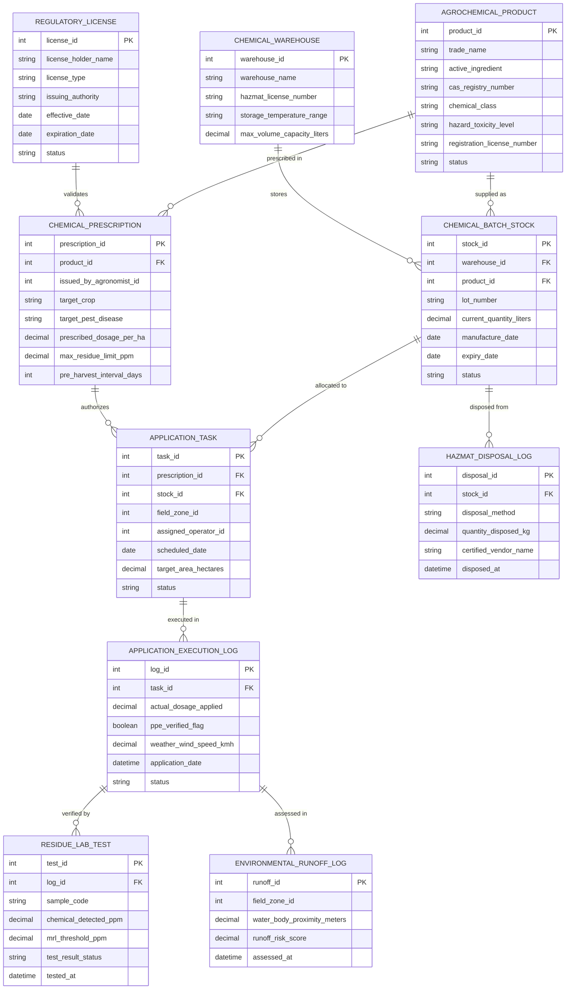

# Conceptual ERD — Pesticide & Fertilizer Management System

## Mermaid Code

## Entity Description Table | Bang mo ta Entity

| # | Entity Name | Vietnamese Name | Description | Key Attributes | Main Relationships |
|---|-------------|-----------------|-------------|----------------|-------------------|
| 1 | AGROCHEMICAL_PRODUCT | Sản Phẩm Hóa Chất | Master catalog record defining trade names, CAS active ingredients, toxicity ratings, and official EPA registration numbers | product_id, trade_name, active_ingredient, cas_registry_number, hazard_toxicity_level | Has many CHEMICAL_BATCH_STOCK, CHEMICAL_PRESCRIPTION |
| 2 | CHEMICAL_WAREHOUSE | Kho Thuốc & Phân Bón | Licensed hazardous material storage facility equipped with climate controls and spill containment bunding | warehouse_id, warehouse_name, hazmat_license_number, storage_temperature_range | Has many CHEMICAL_BATCH_STOCK |
| 3 | CHEMICAL_BATCH_STOCK | Tồn Kho Lô Hóa Chất | Specific inventory batch record tracking container lot numbers, current quantities, manufacture dates, and shelf-life expiration | stock_id, warehouse_id, product_id, lot_number, current_quantity_liters, expiry_date | Belongs to CHEMICAL_WAREHOUSE, AGROCHEMICAL_PRODUCT; has APPLICATION_TASK, HAZMAT_DISPOSAL_LOG |
| 4 | CHEMICAL_PRESCRIPTION | Đơn Thuốc Bảo Vệ Thực Vật | Certified legal prescription issued by an agronomist specifying product, target crop, dosage, PHI, and MRL limits | prescription_id, product_id, issued_by_agronomist_id, target_crop, prescribed_dosage_per_ha, pre_harvest_interval_days | Belongs to AGROCHEMICAL_PRODUCT; validated by REGULATORY_LICENSE; has APPLICATION_TASK |
| 5 | APPLICATION_TASK | Lệnh Phun Thuốc Đồng Ruộng | Operational field dispatch task assigning chemical application duties, field target area, and operator IDs | task_id, prescription_id, stock_id, field_zone_id, assigned_operator_id, target_area_hectares | Belongs to CHEMICAL_PRESCRIPTION, CHEMICAL_BATCH_STOCK; has APPLICATION_EXECUTION_LOG |
| 6 | APPLICATION_EXECUTION_LOG | Nhật Ký Phun Hóa Chất | Execution record capturing actual chemical dosage applied, operator PPE safety verification, and wind speed weather metrics | log_id, task_id, actual_dosage_applied, ppe_verified_flag, weather_wind_speed_kmh, application_date | Belongs to APPLICATION_TASK; has RESIDUE_LAB_TEST, ENVIRONMENTAL_RUNOFF_LOG |
| 7 | RESIDUE_LAB_TEST | Xét Nghiệm Tồn Dư Hóa Chất | Laboratory Gas Chromatography assay report comparing detected chemical PPM against legal Maximum Residue Limits (MRL) | test_id, log_id, sample_code, chemical_detected_ppm, mrl_threshold_ppm, test_result_status | Belongs to APPLICATION_EXECUTION_LOG |
| 8 | HAZMAT_DISPOSAL_LOG | Nhật Ký Tiêu Hủy Hóa Chất | Record of expired chemical destruction or empty container triple-rinsing turned over to certified hazardous waste vendors | disposal_id, stock_id, disposal_method, quantity_disposed_kg, certified_vendor_name | Belongs to CHEMICAL_BATCH_STOCK |
| 9 | ENVIRONMENTAL_RUNOFF_LOG | Nhật Ký Giám Sát Dạt Hóa Chất | Assessment log computing soil leaching risk scores and chemical drift hazards near protected water bodies | runoff_id, field_zone_id, water_body_proximity_meters, runoff_risk_score, assessed_at | Belongs to APPLICATION_EXECUTION_LOG |
| 10 | REGULATORY_LICENSE | Giấy Phép Sử Dụng Hóa Chất | Government license record certifying agronomists and spray applicators for handling restricted Class I/II pesticides | license_id, license_holder_name, license_type, issuing_authority, effective_date, expiration_date | Validates CHEMICAL_PRESCRIPTION |

## Relationship Description | Mo ta Quan he

| # | From Entity | Cardinality | To Entity | Relationship Label | Business Explanation |
|---|-------------|-------------|-----------|-------------------|----------------------|
| 1 | AGROCHEMICAL_PRODUCT | one-to-many | CHEMICAL_BATCH_STOCK | supplied as | Mot san pham hoa chat duoc nhap va luu kho duoi nhieu lo hang va so lot khac nhau. |
| 2 | AGROCHEMICAL_PRODUCT | one-to-many | CHEMICAL_PRESCRIPTION | prescribed in | Mot san pham hoa chat duoc ke don trong nhieu don thuoc bao ve thuc vat. |
| 3 | CHEMICAL_WAREHOUSE | one-to-many | CHEMICAL_BATCH_STOCK | stores | Mot kho hoa chat hazmat quan ly va luu tru nhieu lo hang ton kho trong cac o ke. |
| 4 | CHEMICAL_BATCH_STOCK | one-to-many | APPLICATION_TASK | allocated to | Mot lo hang hoa chat ton kho duoc xuat phan bo cho nhieu lenh phun thuoc dong ruong. |
| 5 | CHEMICAL_BATCH_STOCK | one-to-many | HAZMAT_DISPOSAL_LOG | disposed from | Mot lo hang hoa chat het han duoc xuat tieu huy va ghi nhan vao nhat ky hazmat. |
| 6 | CHEMICAL_PRESCRIPTION | one-to-many | APPLICATION_TASK | authorizes | Mot don thuoc hop le cho phép tao va phan cong nhieu lenh phun thuoc thuc te. |
| 7 | APPLICATION_TASK | one-to-many | APPLICATION_EXECUTION_LOG | executed in | Mot lenh phun thuoc duoc thuc hien va ghi nhan chi tiet trong nhat ky phun hoa chat. |
| 8 | APPLICATION_EXECUTION_LOG | one-to-many | RESIDUE_LAB_TEST | verified by | Mot nhat ky phun hoa chat duoc kiem tra xac nhan qua cac ket qua xet nghiem ton du MRL. |
| 9 | APPLICATION_EXECUTION_LOG | one-to-many | ENVIRONMENTAL_RUNOFF_LOG | assessed in | Mot nhat ky phun duoc danh gia muc do nguy co dat hoa chat va troi xuong nguon nuoc. |
| 10 | REGULATORY_LICENSE | one-to-many | CHEMICAL_PRESCRIPTION | validates | Mot giay phep hanh nghe hop le xac thuc quyen ke don hoa chat cua ky su nong nghiep. |
