# Swimlane Diagram — Pesticide & Fertilizer Management System

## Mermaid Code

```mermaid
flowchart LR
    Start(["Start Agrochemical Treatment Cycle"])

    subgraph Lane1["Certified Agronomist"]
        AG1["Diagnose Crop Pest Infestation & Select Product"]
        AG2["Formulate Chemical Prescription & Target Dosage"]
        AG3["Sign & Issue Digital Prescription"]
    end

    subgraph Lane2["Pesticide & Fertilizer Management System"]
        SYS1["Verify Professional License & Government Restrictions"]
        SYS2{"Restricted Chemical License Valid?"}
        SYS3["Calculate Mandatory PHI Days & Target MRL Limits"]
        SYS4["Dispatch Spraying Task & PPE Safety Checklist"]
        SYS5["Lock Crop Harvest Calendar for PHI Duration"]
        SYS6["Validate GC-MS Lab Test vs MRL Threshold"]
        SYS7{"Pesticide Residue < MRL Threshold?"}
        SYS8["Release Harvest Lock & Issue Safety Certificate"]
        SYS9["Reject Harvest Clearance & Enforce Disposal"]
    end

    subgraph Lane3["Field Application Operator"]
        OP1["Scan Hazmat Barcode & Verify PPE Compliance"]
        OP2["Check Wind Speed & Execute Field Spraying"]
        OP3["Log Actual Applied Volume & Weather Metrics"]
    end

    subgraph Lane4["Chemical Residue Testing Lab"]
        LAB1["Collect Pre-Harvest Crop Tissue Samples"]
        LAB2["Perform GC-MS Assay & Upload Residue PPM Data"]
    end

    Finish(["End Process"])

    Start --> AG1 --> AG2 --> AG3 --> SYS1 --> SYS2
    SYS2 -->|"Yes"| SYS3 --> SYS4 --> OP1 --> OP2 --> OP3 --> SYS5 --> LAB1 --> LAB2 --> SYS6 --> SYS7
    SYS2 -->|"No — License Expired"| AG1
    SYS7 -->|"Pass — MRL Safe"| SYS8 --> Finish
    SYS7 -->|"Fail — MRL Exceeded"| SYS9 --> Finish
```

## Flow Description | Mo ta luong

| Lane | Actor / Subsystem | Role in Flow |
|------|-------------------|--------------|
| Certified Agronomist | Authorized Prescriber | Diagnoses crop diseases, selects registered active ingredients, formulates chemical prescriptions, and signs digital treatment authorizations. |
| Pesticide & Fertilizer Management System | Central Core Platform | Verifies regulatory licenses, calculates Pre-Harvest Intervals (PHI), dispatches safety checklists, locks harvest calendars, and checks laboratory residue MRL thresholds. |
| Field Application Operator | Spray Technician | Scans chemical container DataMatrix barcodes, verifies Personal Protective Equipment (PPE), checks wind speed constraints, and logs application details. |
| Chemical Residue Testing Lab | Analytical Laboratory | Collects pre-harvest crop samples, executes Gas Chromatography (GC-MS) chemical assays, and uploads quantitative residue PPM test files. |
