# Action Tree — Pesticide & Fertilizer Management System

## Mermaid Code

```mermaid
graph TD
    Root["Pesticide & Fertilizer Management System"]

    Root --> M1["Agrochemical Registry & Toxicity Classification"]
    Root --> M2["Hazmat Warehouse Inventory & Expiry Management"]
    Root --> M3["Agronomic Prescription & Dosage Formulation"]
    Root --> M4["Field Application & Operator Safety Compliance"]
    Root --> M5["Residue Testing MRL & Pre-Harvest Interval PHI"]
    Root --> M6["Environmental Runoff & Regulatory Audit Compliance"]

    M1 --> A11["Register CAS Active Ingredients & Trade Names"]
    M1 --> A12["Classify WHO Toxicity & Hazard Categories"]
    M1 --> A13["Manage MSDS Material Safety Repositories"]

    M2 --> A21["Scan 2D DataMatrix Chemical Barcode Intakes"]
    M2 --> A22["Assign Climate-Controlled Hazmat Storage Bins"]
    M2 --> A23["Track Batch Expiration & Shelf-Life Expiry"]
    M2 --> A24["Process Triple-Rinsed Container Hazmat Waste"]

    M3 --> A31["Formulate Certified Agronomist Prescriptions"]
    M3 --> A32["Calculate Target Hectare Dosage Dilution Rates"]
    M3 --> A33["Calculate NPK Custom Bulk Fertilizer Blends"]

    M4 --> A41["Dispatch Field Spraying & Application Tasks"]
    M4 --> A42["Verify Operator PPE Safety Gear Compliance"]
    M4 --> A43["Log Application Weather & Wind Drift Metrics"]

    M5 --> A51["Calculate Statutory Pre-Harvest Interval PHI Days"]
    M5 --> A52["Lock Crop Parcel Calendars During Active PHI"]
    M5 --> A53["Ingest GC-MS Lab Pesticide Residue Test PPM"]

    M6 --> A61["Verify Agronomist & Operator Licenses"]
    M6 --> A62["Enforce Banned Active Ingredient Decrees"]
    M6 --> A63["Assess Water Body Chemical Runoff Leaching Risk"]
    M6 --> A64["Export Monthly Restricted Chemical Usage Audits"]
```

## Module Description | Mo ta Module

| # | Module | Description | Actions |
|---|--------|-------------|---------|
| 1 | Agrochemical Registry & Toxicity Classification | Registers CAS active ingredients, WHO hazard classes (Category I-IV), registration licenses, and MSDS safety datasheets | Register CAS Active Ingredients & Trade Names, Classify WHO Toxicity & Hazard Categories, Manage MSDS Material Safety Repositories |
| 2 | Hazmat Warehouse Inventory & Expiry Management | Manages DataMatrix barcode intakes, hazmat bin allocation, incompatibility separation, shelf-life expiry alerts, and container disposal | Scan 2D DataMatrix Chemical Barcode Intakes, Assign Climate-Controlled Hazmat Storage Bins, Track Batch Expiration & Shelf-Life Expiry, Process Triple-Rinsed Container Hazmat Waste |
| 3 | Agronomic Prescription & Dosage Formulation | Enables certified agronomists to formulate chemical spraying prescriptions, calculate dilution rates, and blend custom NPK fertilizers | Formulate Certified Agronomist Prescriptions, Calculate Target Hectare Dosage Dilution Rates, Calculate NPK Custom Bulk Fertilizer Blends |
| 4 | Field Application & Operator Safety Compliance | Coordinates spraying task dispatches, enforces Personal Protective Equipment (PPE) verification, and logs weather wind drift constraints | Dispatch Field Spraying & Application Tasks, Verify Operator PPE Safety Gear Compliance, Log Application Weather & Wind Drift Metrics |
| 5 | Residue Testing MRL & Pre-Harvest Interval PHI | Calculates mandatory PHI safety days, locks crop harvest calendars, and ingests laboratory GC-MS pesticide residue PPM test files | Calculate Statutory Pre-Harvest Interval PHI Days, Lock Crop Parcel Calendars During Active PHI, Ingest GC-MS Lab Pesticide Residue Test PPM |
| 6 | Environmental Runoff & Regulatory Audit Compliance | Validates professional licenses, enforces government banned chemical lists, evaluates water runoff leaching risks, and exports audit files | Verify Agronomist & Operator Licenses, Enforce Banned Active Ingredient Decrees, Assess Water Body Chemical Runoff Leaching Risk, Export Monthly Restricted Chemical Usage Audits |
