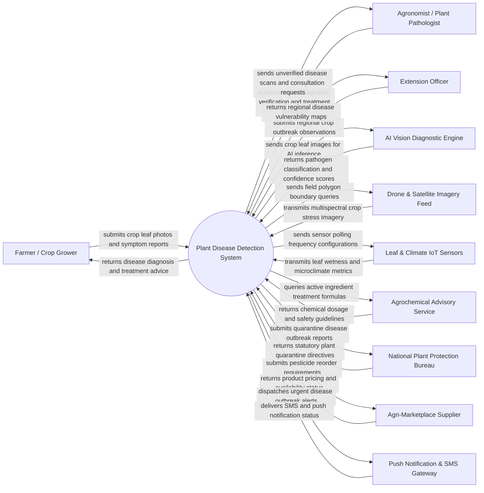

# Context Diagram — Plant Disease Detection System

## Mermaid Code

## Actor & Interaction Table | Bang Actor & Tuong tac

| # | Actor | Actor Type | Data Sent TO System | Data Received FROM System | Notes |
|---|-------|------------|---------------------|---------------------------|-------|
| 1 | Farmer / Crop Grower | Primary | Crop leaf photos, field GPS location, plant species, visible symptom observations | Instant disease identification, infection severity score, customized treatment steps, treatment schedules | Primary end user capturing crop health photos via mobile app in field conditions |
| 2 | Agronomist / Plant Pathologist | Primary | Verified pathogen classifications, treatment prescriptions, scientific disease notes | Complex/uncertain disease scan cases, AI confidence warnings, expert consultation queries | Certified plant pathologist validating AI detection results and prescribing specialized remedies |
| 3 | Extension Officer | Primary | Field survey reports, local disease outbreak observations, community crop health trends | Regional disease heatmaps, epidemic warning bulletins, local intervention guidelines | Field advisor helping local farming communities manage disease outbreaks and proper pesticide application |
| 4 | AI Vision Diagnostic Engine | Supporting System | Pathogen identity, confidence scores, bounding box coordinates, leaf spot area percentage | Raw crop leaf imagery, camera metadata, crop species contextual tags | Deep learning computer vision microservice trained on agricultural image datasets (e.g., PlantVillage) |
| 5 | Drone & Satellite Imagery Feed | Supporting System | Multispectral aerial imagery, thermal stress maps, NDVI vegetation health indices | Field parcel GIS boundaries, spectral query timestamps, target crop coordinates | Remote sensing infrastructure providing macro-level field canopy infection tracking |
| 6 | Leaf & Climate IoT Sensors | Supporting System | Leaf wetness duration, canopy temperature, relative humidity, solar radiation | Polling frequency configurations, sensor calibration offsets, alert thresholds | In-field hardware measuring environmental microclimate conditions that favor fungal/bacterial spores |
| 7 | Agrochemical Advisory Service | Supporting System | Certified pesticide/fungicide databases, active ingredient dosages, pre-harvest safety intervals | Disease pathogen codes, crop species, resistance risk profiles | External agricultural database matching plant pathogens with approved agrochemical remedies |
| 8 | National Plant Protection Bureau | Regulatory System | Statutory quarantine lists, restricted pesticide advisories, regulated disease directives | Aggregated epidemic outbreak reports, geographic disease spread metrics | Government authority managing national biosecurity, invasive pest containment, and chemical safety |
| 9 | Agri-Marketplace Supplier | Supporting System | Fungicide stock levels, commercial pricing, delivery lead times, product safety data sheets | Direct product order payloads, farmer delivery coordinates, prescription requirements | Commercial vendor supplying certified fungicides, biological control agents, and spray equipment |
| 10 | Push Notification & SMS Gateway | Supporting System | Message delivery logs, carrier delivery status, recipient receipt timestamps | Automated outbreak warning alerts, consultation updates, treatment reminder notifications | Communication gateway alerting farmers immediately when high-risk diseases emerge nearby |

## System Boundary Description | Mo ta Pham vi He thong

The **Plant Disease Detection System** is an intelligent precision agriculture software platform designed to identify crop diseases early using computer vision, microclimate analysis, and expert agronomist validation. 

The **system boundary** includes leaf image preprocessing, AI inference workflow management, IoT environmental telemetry integration, disease risk modeling, treatment plan generation, expert consultation routing, regional epidemiology mapping, and supplier integration. 

**External to the system boundary** are physical camera optical sensors on farmer smartphones, drone flight controls, raw deep learning model training infrastructure, physical agrochemical manufacturing, and government field quarantine enforcement actions. The platform connects with external systems using secure REST APIs, MQTT IoT brokers, and geospatial image processing feeds.
