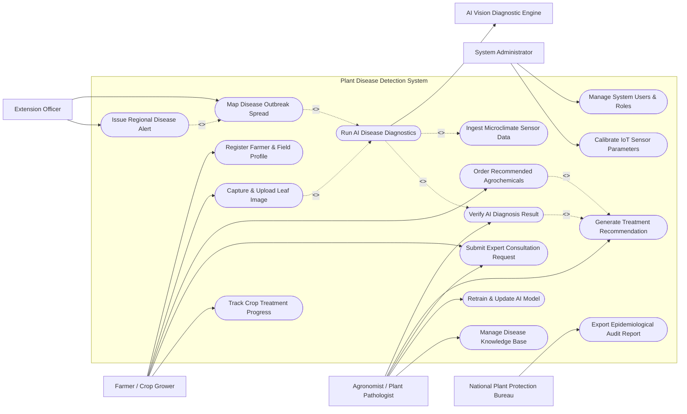

# Use Case Diagram — Plant Disease Detection System

## Mermaid Code

## Actor Table | Bang Actor

| # | Actor | Actor Type | Role Description | Related Use Cases |
|---|-------|------------|------------------|-------------------|
| 1 | Farmer / Crop Grower | Primary | Agriculture practitioner taking crop leaf photos and seeking disease treatment advice | UC01, UC02, UC07, UC09, UC12 |
| 2 | Agronomist / Plant Pathologist | Primary | Domain specialist reviewing AI disease detections, creating treatment protocols, and answering queries | UC05, UC06, UC09, UC10, UC14 |
| 3 | Extension Officer | Primary | Government field advisor monitoring regional crop health and issuing community outbreak warnings | UC08, UC11 |
| 4 | System Administrator | Primary | Technical administrator managing AI pipelines, sensor configs, user roles, and security | UC15, UC16 |
| 5 | AI Vision Diagnostic Engine | Secondary / System | Automated deep learning vision model classifying leaf pathogens and computing infection metrics | UC03 |
| 6 | National Plant Protection Bureau | Secondary / Regulatory | External regulatory authority monitoring plant quarantine diseases and chemical compliance | UC13 |

## Use Case Table | Bang Use Case

| # | UC ID | Use Case Name | Primary Actor | Secondary Actor | Description | Priority |
|---|-------|---------------|---------------|-----------------|-------------|----------|
| 1 | UC01 | Register Farmer & Field Profile | Farmer / Crop Grower | None | Sets up farmer account and registers spatial plot boundaries and crop varieties | High |
| 2 | UC02 | Capture & Upload Leaf Image | Farmer / Crop Grower | None | Captures high-res leaf photos via mobile app with GPS and symptom tags | High |
| 3 | UC03 | Run AI Disease Diagnostics | System | AI Vision Diagnostic Engine | Processes leaf image through computer vision neural network to detect pathogens | High |
| 4 | UC04 | Ingest Microclimate Sensor Data | System | IoT Sensor Network | Integrates leaf wetness, humidity, and temperature data to score infection risk | Medium |
| 5 | UC05 | Verify AI Diagnosis Result | Agronomist | None | Reviews low-confidence or high-risk AI diagnosis and confirms pathogen identity | High |
| 6 | UC06 | Generate Treatment Recommendation | Agronomist | Advisory Service | Formulates tailored fungicide/pesticide dosage, application rules, and safety intervals | High |
| 7 | UC07 | Order Recommended Agrochemicals | Farmer / Crop Grower | Chemical Supplier | Allows direct ordering of prescribed treatment chemicals from certified suppliers | Medium |
| 8 | UC08 | Map Disease Outbreak Spread | Extension Officer | Geospatial Service | Aggregates geotagged diagnosis records to generate regional epidemic heatmaps | High |
| 9 | UC09 | Submit Expert Consultation Request | Farmer / Crop Grower | Agronomist | Routes complex disease symptoms to certified plant pathologist for direct feedback | High |
| 10 | UC10 | Retrain & Update AI Model | Agronomist | AI Vision Diagnostic Engine | Feeds expert-verified leaf images back into deep learning training dataset | Medium |
| 11 | UC11 | Issue Regional Disease Alert | Extension Officer | Notification Gateway | Dispatches SMS and push warning alerts to farmers in high-risk outbreak zones | High |
| 12 | UC12 | Track Crop Treatment Progress | Farmer / Crop Grower | None | Logs application dates, dosage history, and follow-up leaf recovery photos | Medium |
| 13 | UC13 | Export Epidemiological Audit Report | National Plant Protection Bureau | System | Generates statutory reports on disease prevalence, quarantine pests, and chemical usage | Medium |
| 14 | UC14 | Manage Disease Knowledge Base | Agronomist | None | Maintains reference catalog of plant diseases, pathogens, symptoms, and remedies | High |
| 15 | UC15 | Manage System Users & Roles | System Administrator | None | Configures user accounts, agronomist credentials, and access permissions | Medium |
| 16 | UC16 | Calibrate IoT Sensor Parameters | System Administrator | IoT Sensor Network | Adjusts microclimate sensor polling intervals, threshold alerts, and offsets | Low |

## Use Case Specification | Dac ta Use Case

---

### UC02 — Capture & Upload Leaf Image

| Field | Detail |
|-------|--------|
| **UC ID** | UC02 |
| **Use Case Name** | Capture & Upload Leaf Image |
| **Actor(s)** | Primary: Farmer / Crop Grower   Secondary: None |
| **Description** | Enables a farmer to take macro photos of infected crop leaves using the mobile application camera, attach GPS coordinates, select crop species, and upload image for automated AI analysis. |
| **Precondition** | 1. Farmer is logged into the mobile application.   2. Mobile device camera and GPS location permissions are granted. |
| **Main Flow** | 1. Farmer selects "Scan Crop Disease" on the mobile application homepage.   2. Farmer selects target farm field parcel and crop species (e.g., Tomato, Rice, Potato).   3. Mobile camera view displays interactive leaf framing guide overlay (focus, distance, lighting indicator).   4. Farmer captures 1 to 3 clear photos of top/bottom leaf surface exhibiting lesions or discoloration.   5. App automatically extracts EXIF metadata, GPS latitude/longitude, and capture timestamp.   6. Farmer optionally selects visible symptoms (e.g., yellow spots, wilting, powdery mildew).   7. Farmer clicks "Analyze Scan".   8. App compresses image payload, uploads to cloud storage, and triggers UC03 (Run AI Disease Diagnostics). |
| **Alternative Flow** | **AF1** — Upload from Gallery: Farmer selects previously captured crop leaf images from phone photo gallery instead of live camera.   **AF2** — Offline Capture: If mobile internet is unavailable, app saves geotagged images in offline queue and uploads automatically when network reconnects. |
| **Exception Flow** | **EX1** — Blurry / Low Quality Image Detected: On-device quality check flags image blur or extreme glare, prompting farmer to retake photo before submission.   **EX2** — Unsupported Crop Type: Farmer selects crop species not yet supported by AI model, system routes case directly to manual Agronomist review. |
| **Postcondition** | Image file stored in cloud repository, metadata recorded in database with status `PENDING_ANALYSIS`. |
| **Business Rule** | **BR1**: Image resolution must be at least 1080x1080 pixels with RGB color profile.   **BR2**: Geotag must fall within registered farm field parcel boundaries. |

---

### UC03 — Run AI Disease Diagnostics

| Field | Detail |
|-------|--------|
| **UC ID** | UC03 |
| **Use Case Name** | Run AI Disease Diagnostics |
| **Actor(s)** | Primary: System   Secondary: AI Vision Diagnostic Engine |
| **Description** | Processes uploaded leaf imagery through deep convolutional neural networks (CNN / Vision Transformers) to classify pathogens, compute infection severity percentage, and output diagnostic confidence scores. |
| **Precondition** | 1. Leaf image status is `PENDING_ANALYSIS`.   2. AI Vision Diagnostic Engine REST endpoint is healthy. |
| **Main Flow** | 1. System sends image URL, crop species tag, and microclimate sensor context to AI Vision Engine.   2. AI Vision Engine executes leaf segmentation to isolate infected leaf areas from background.   3. AI Vision Engine runs multi-class classification model trained on target plant disease taxonomy.   4. Model outputs top pathogen predictions (e.g., *Phytophthora infestans* / Late Blight) with confidence scores (e.g., 94.5%).   5. Model calculates percentage of diseased leaf surface area (infection severity index).   6. AI Vision Engine returns diagnostic payload to System.   7. If confidence score exceeds 85%, System generates automated diagnosis report and triggers UC06.   8. System sets scan status to `DIAGNOSED_AUTOMATED`. |
| **Alternative Flow** | **AF1** — Microclimate Context Fusion: System incorporates recent leaf wetness duration data from IoT sensors to boost model confidence for fungal diseases.   **AF2** — Low Confidence Routing: If confidence score is between 50% and 85%, System sets status to `NEEDS_EXPERT_VERIFICATION` and triggers UC05. |
| **Exception Flow** | **EX1** — Healthy Leaf Result: Model detects no disease symptoms (>95% healthy confidence), system returns "Healthy Crop" notification with preventative care tips.   **EX2** — AI Microservice Timeout: If AI model endpoint fails to respond within 10 seconds, system queues image for secondary inference node. |
| **Postcondition** | Diagnosis record created with detected disease ID, confidence percentage, infected area metric, and status `DIAGNOSED`. |
| **Business Rule** | **BR1**: Automated diagnosis display requires AI model confidence $\ge 85\%$.   **BR2**: Quarantine-listed diseases automatically require human Agronomist signoff regardless of confidence score. |

---

### UC05 — Verify AI Diagnosis Result

| Field | Detail |
|-------|--------|
| **UC ID** | UC05 |
| **Use Case Name** | Verify AI Diagnosis Result |
| **Actor(s)** | Primary: Agronomist / Plant Pathologist   Secondary: None |
| **Description** | Allows a certified plant pathologist to review low-confidence AI scans, examine leaf images with bounding boxes, confirm or correct pathogen identification, and approve official diagnostic findings. |
| **Precondition** | 1. Disease scan status is `NEEDS_EXPERT_VERIFICATION` or flagged for manual quality audit.   2. Agronomist is authenticated with active expert credentials. |
| **Main Flow** | 1. Agronomist opens the expert evaluation workspace and selects a pending disease scan.   2. Workspace displays high-res original leaf image, AI heatmap overlay, top 3 AI predictions, and local weather telemetry.   3. Agronomist inspects lesion patterns, fungal spore coloration, and symptom details using zoom/filter tools.   4. Agronomist confirms AI prediction or selects correct plant disease from official taxonomy dropdown.   5. Agronomist assesses infection severity rating (Mild, Moderate, Severe, Critical).   6. Agronomist adds clinical notes explaining diagnostic rationale and key visual markers.   7. Agronomist submits verification.   8. System updates scan status to `VERIFIED_BY_EXPERT` and generates treatment recommendation (UC06). |
| **Alternative Flow** | **AF1** — Sample Request: Agronomist determines image is inconclusive and requests farmer to upload additional stem/roots photo or submit physical tissue sample to local lab.   **AF2** — Flag for Model Retraining: Agronomist flags image as a novel symptom variation to be included in next AI retraining dataset (UC10). |
| **Exception Flow** | **EX1** — Quarantine Pest Identified: If verified pathogen is classified as a regulated quarantine disease (e.g., Citrus Greening / Huanglongbing), system triggers mandatory notification to National Plant Protection Bureau. |
| **Postcondition** | Diagnostic record updated with expert ID, verified disease taxonomy ID, clinical notes, and status `VERIFIED_BY_EXPERT`. |
| **Business Rule** | **BR1**: Expert verification must be completed within 24 hours of scan submission.   **BR2**: Expert correction overrides automated AI confidence scores in official records. |

---

### UC06 — Generate Treatment Recommendation

| Field | Detail |
|-------|--------|
| **UC ID** | UC06 |
| **Use Case Name** | Generate Treatment Recommendation |
| **Actor(s)** | Primary: Agronomist / Plant Pathologist   Secondary: Agrochemical Advisory Service |
| **Description** | Formulates an actionable, safe crop treatment prescription specifying chemical active ingredients, biological control measures, exact dosages per hectare, water mixing ratios, and pre-harvest safety intervals. |
| **Precondition** | 1. Disease scan status is `DIAGNOSED_AUTOMATED` or `VERIFIED_BY_EXPERT`. |
| **Main Flow** | 1. System fetches confirmed disease ID, crop species, acreage, and infection severity level.   2. System queries Agrochemical Advisory Service for approved chemical and organic remedies.   3. System matches active ingredients (e.g., Azoxystrobin, Copper Hydroxide) suitable for crop growth stage.   4. System calculates exact required chemical volume based on field parcel area (hectares).   5. System generates step-by-step application schedule (e.g., Spray Day 1, repeat Day 7 if wet weather persists).   6. System attaches mandatory safety instructions: personal protective equipment (PPE), spray drift warnings, and Pre-Harvest Interval (PHI) days.   7. Agronomist (or automated rules engine) signs off on prescription.   8. System attaches treatment recommendation report to farmer's mobile scan result page. |
| **Alternative Flow** | **AF1** — Organic Farming Mode: If farmer profile is marked as "Certified Organic", system restricts recommendations exclusively to Bio-fungicides (e.g., *Bacillus subtilis*), neem oil, or cultural controls.   **AF2** — Resistance Management Rotation: If farmer has applied the same chemical class 3 times continuously, system automatically prescribes an alternate fungicide mode of action (FRAC code) to prevent resistance. |
| **Exception Flow** | **EX1** — Extreme Infection / Total Loss Risk: If infection severity exceeds 85% and crop cannot be saved, system prescribes containment procedures (roguing/burning infected plants) to protect neighboring fields. |
| **Postcondition** | Complete treatment plan record created, linked to diagnosis ID, and pushed to farmer mobile app. |
| **Business Rule** | **BR1**: Chemical recommendations must comply with government approved pesticide registers and maximum residue limits (MRL).   **BR2**: Pre-harvest safety interval (PHI) warnings must be highlighted in red font. |

---

### UC09 — Submit Expert Consultation Request

| Field | Detail |
|-------|--------|
| **UC ID** | UC09 |
| **Use Case Name** | Submit Expert Consultation Request |
| **Actor(s)** | Primary: Farmer / Crop Grower   Secondary: Agronomist / Plant Pathologist |
| **Description** | Allows a farmer experiencing persistent or unclear crop disease issues to open a direct digital consultation ticket with a certified plant pathologist, attaching scan history and field notes. |
| **Precondition** | 1. Farmer has an active account with completed field profile.   2. Previous automated disease scan exists or new photo bundle is attached. |
| **Main Flow** | 1. Farmer opens "Ask an Agronomist" module in the mobile app.   2. Farmer selects affected field parcel, crop type, and links recent disease scan ID.   3. Farmer inputs detailed problem description (e.g., "Leaves turning yellow despite spraying fungicide X 5 days ago").   4. Farmer attaches supplementary photos (whole plant, stem cross-section, soil condition).   5. System creates consultation ticket, assigns priority based on crop value and urgency, and routes ticket to regional Agronomist pool.   6. Assigned Agronomist receives notification, reviews complete field history, and formulates expert reply.   7. Agronomist sends response containing diagnosis, custom treatment advice, or management adjustment.   8. Farmer receives push notification, views expert response, and rates consultation quality. |
| **Alternative Flow** | **AF1** — Tele-consultation Video Call: For high-value crops, farmer schedules a 10-minute live video consultation session with an agronomist. |
| **Exception Flow** | **EX1** — Unassigned Timeout: If no agronomist accepts ticket within 6 hours, system automatically escalates ticket to Senior Plant Pathologist supervisor queue. |
| **Postcondition** | Consultation ticket updated to status `RESOLVED` with conversation log and prescription adjustments preserved in field history. |
| **Business Rule** | **BR1**: Urgent tickets (high risk of crop destruction) must receive initial response within 2 hours during business operation times. |
