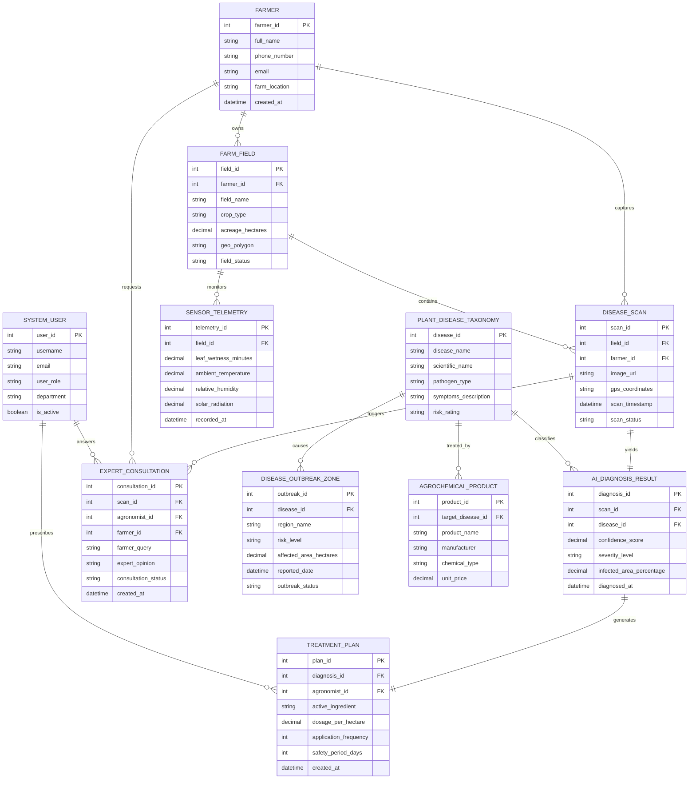

# Conceptual ERD — Plant Disease Detection System

## Mermaid Code

## Entity Description Table | Bang mo ta Entity

| # | Entity Name | Vietnamese Name | Description | Key Attributes | Main Relationships |
|---|-------------|-----------------|-------------|----------------|-------------------|
| 1 | FARMER | Nông Dân / Chủ Trang Trại | Stores profile information, contact details, and location of agricultural producers | farmer_id, full_name, phone_number, farm_location | Has many FARM_FIELD, DISEASE_SCAN, EXPERT_CONSULTATION |
| 2 | FARM_FIELD | Thửa Đất Nông Nghiệp | Represents registered farm parcels, cultivated crop species, and GIS spatial boundaries | field_id, farmer_id, field_name, crop_type, geo_polygon | Belongs to FARMER, has many DISEASE_SCAN, SENSOR_TELEMETRY |
| 3 | DISEASE_SCAN | Mẫu Quét Bệnh Cây | Captures leaf imagery metadata, camera GPS location, capture timestamps, and scan workflow status | scan_id, field_id, farmer_id, image_url, gps_coordinates, scan_status | Belongs to FIELD, yields AI_DIAGNOSIS_RESULT, triggers EXPERT_CONSULTATION |
| 4 | PLANT_DISEASE_TAXONOMY | Phân Loại Bệnh Cây | Reference repository of plant pathogens, scientific names, symptoms, and risk ratings | disease_id, disease_name, scientific_name, pathogen_type, risk_rating | Classifies AI_DIAGNOSIS_RESULT, causes OUTBREAK_ZONE, treated by AGROCHEMICAL |
| 5 | AI_DIAGNOSIS_RESULT | Kết Quả Chẩn Đoán AI | Holds neural network prediction results, confidence scores, and leaf infection severity metrics | diagnosis_id, scan_id, disease_id, confidence_score, severity_level | Linked to SCAN and TAXONOMY, generates TREATMENT_PLAN |
| 6 | TREATMENT_PLAN | Phác Đồ Điều Trị | Formulates active ingredient dosage, spray intervals, safety periods, and chemical application steps | plan_id, diagnosis_id, agronomist_id, active_ingredient, dosage_per_hectare | Linked to AI_DIAGNOSIS_RESULT, prescribed by SYSTEM_USER |
| 7 | EXPERT_CONSULTATION | Tư Vấn Chuyên Gia | Manages direct communication tickets between farmers and plant pathologists for complex cases | consultation_id, scan_id, agronomist_id, farmer_id, expert_opinion | Linked to SCAN, requested by FARMER, answered by SYSTEM_USER |
| 8 | SENSOR_TELEMETRY | Dữ Liệu Cảm Biến Vi Khí Hậu | Stores real-time microclimate metrics (leaf wetness, humidity, temperature) collected by field IoT sensors | telemetry_id, field_id, leaf_wetness_minutes, ambient_temperature, recorded_at | Belongs to FARM_FIELD |
| 9 | DISEASE_OUTBREAK_ZONE | Vùng Dịch Bệnh Nông Nghiệp | Tracks regional epidemic hotspots, affected hectares, risk ratings, and disease spread status | outbreak_id, disease_id, region_name, risk_level, affected_area_hectares | Caused by PLANT_DISEASE_TAXONOMY |
| 10 | AGROCHEMICAL_PRODUCT | Sản Phẩm Thuốc BVTV | Catalog of registered fungicides, bactericides, bio-pesticides, pricing, and active ingredients | product_id, target_disease_id, product_name, manufacturer, chemical_type | Treats PLANT_DISEASE_TAXONOMY |
| 11 | SYSTEM_USER | Người Dùng Hệ Thống | Stores user credentials, roles, and professional credentials for agronomists, admins, and officers | user_id, username, user_role, department, is_active | Prescribes TREATMENT_PLAN, answers EXPERT_CONSULTATION |

## Relationship Description | Mo ta Quan he

| # | From Entity | Cardinality | To Entity | Relationship Label | Business Explanation |
|---|-------------|-------------|-----------|-------------------|----------------------|
| 1 | FARMER | one-to-many | FARM_FIELD | owns | A farmer can own and manage multiple registered farm fields and crop parcels |
| 2 | FARMER | one-to-many | DISEASE_SCAN | captures | A farmer can capture and submit multiple crop leaf disease scans over time |
| 3 | FARM_FIELD | one-to-many | DISEASE_SCAN | contains | A farm field contains multiple disease scans captured within its geographic polygon |
| 4 | FARM_FIELD | one-to-many | SENSOR_TELEMETRY | monitors | A farm field is monitored by multiple in-situ IoT microclimate sensor telemetry readings |
| 5 | DISEASE_SCAN | one-to-one | AI_DIAGNOSIS_RESULT | yields | Each leaf image scan yields exactly one official AI diagnostic evaluation result |
| 6 | PLANT_DISEASE_TAXONOMY | one-to-many | AI_DIAGNOSIS_RESULT | classifies | A plant disease entry in taxonomy classifies multiple diagnostic inspection scan results |
| 7 | AI_DIAGNOSIS_RESULT | one-to-one | TREATMENT_PLAN | generates | A confirmed disease diagnosis generates one targeted treatment plan prescription |
| 8 | SYSTEM_USER | one-to-many | TREATMENT_PLAN | prescribes | An agronomist system user can prescribe or review multiple crop treatment plans |
| 9 | DISEASE_SCAN | one-to-many | EXPERT_CONSULTATION | triggers | A complex or low-confidence disease scan can trigger expert consultation tickets |
| 10 | FARMER | one-to-many | EXPERT_CONSULTATION | requests | A farmer can request multiple expert consultations for troubling plant disease symptoms |
| 11 | SYSTEM_USER | one-to-many | EXPERT_CONSULTATION | answers | A certified agronomist user answers expert consultation tickets from farmers |
| 12 | PLANT_DISEASE_TAXONOMY | one-to-many | DISEASE_OUTBREAK_ZONE | causes | A pathogen species can cause localized or regional disease outbreak risk zones |
| 13 | PLANT_DISEASE_TAXONOMY | one-to-many | AGROCHEMICAL_PRODUCT | treated_by | A plant disease pathogen can be treated by multiple commercial agrochemical products |
