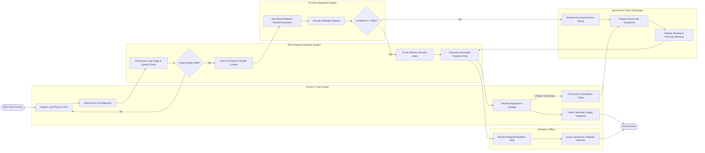

# Swimlane Diagram — Plant Disease Detection System

## Mermaid Code

## Flow Description | Mo ta luong

| Lane | Actor | Role in Flow |
|------|-------|-------------|
| 1 | Farmer / Crop Grower | Captures geotagged leaf images via mobile app, submits scan requests, reviews automated diagnosis and dosage instructions, orders agrochemicals, applies treatment, and logs recovery progress or files expert tickets |
| 2 | Plant Disease Detection System | Handles image quality preprocessing, ingests local microclimate IoT sensor telemetry, coordinates AI microservice execution, computes infection severity, generates treatment plans, and triggers outbreak alerts |
| 3 | AI Vision Diagnostic Engine | Ingests preprocessed leaf images, executes deep learning vision inference models, classifies disease pathogens, calculates bounding boxes, and outputs diagnostic confidence scores |
| 4 | Agronomist / Plant Pathologist | Manages low-confidence or high-risk disease scan queues, conducts clinical visual inspection, confirms or corrects pathogen classifications, and formulates specialized treatment prescriptions |
| 5 | Extension Officer | Tracks regional disease density heatmaps, identifies emerging epidemic outbreaks, and issues targeted community advisories to contain local crop disease spread |
