# Action Tree — Plant Disease Detection System

## Mermaid Code

```mermaid
graph TD
    Root["Plant Disease Detection System"]

    Root --> M1["Farmer & Farm Field Management"]
    Root --> M2["Image Capture & Diagnostic Processing"]
    Root --> M3["AI Vision & Infection Scoring"]
    Root --> M4["Agronomist Review & Consultation"]
    Root --> M5["Treatment Prescription & Store"]
    Root --> M6["Outbreak Mapping & Alerting"]
    Root --> M7["Knowledge Base & System Admin"]

    M1 --> A11["Register Farmer Profile"]
    M1 --> A12["Define Farm Field Boundaries"]
    M1 --> A13["Register Crop Varieties"]
    M1 --> A14["Link In-situ IoT Sensors"]

    M2 --> A21["Capture Geotagged Leaf Photo"]
    M2 --> A22["Perform Image Quality Check"]
    M2 --> A23["Attach Symptom Description Tags"]
    M2 --> A24["Upload Offline Scan Queue"]

    M3 --> A31["Run CNN Pathogen Classification"]
    M3 --> A32["Compute Leaf Infection Area"]
    M3 --> A33["Fuse Microclimate Weather Risk"]
    M3 --> A34["Generate AI Confidence Rating"]

    M4 --> A41["Review Low-Confidence Scans"]
    M4 --> A42["Confirm Pathogen Identification"]
    M4 --> A43["Answer Expert Consultation Ticket"]
    M4 --> A44["Flag Scans for AI Retraining"]

    M5 --> A51["Generate Chemical Dosage Plan"]
    M5 --> A52["Calculate Pre-Harvest Interval"]
    M5 --> A53["Apply Organic Farming Filter"]
    M5 --> A54["Order Prescribed Agrochemicals"]

    M6 --> A61["Aggregate Geotagged Infections"]
    M6 --> A62["Generate Regional Disease Heatmap"]
    M6 --> A63["Identify Quarantine Risk Zones"]
    M6 --> A64["Dispatch SMS Outbreak Bulletins"]

    M7 --> A71["Manage Disease Taxonomy Library"]
    M7 --> A72["Deploy Retrained Vision Models"]
    M7 --> A73["Calibrate IoT Sensor Thresholds"]
    M7 --> A74["Manage User Roles & Access"]
```

## Module Description | Mo ta Module

| # | Module | Description | Actions |
|---|--------|-------------|---------|
| 1 | Farmer & Farm Field Management | Manages farmer user profiles, registered field parcel polygons, crop species catalogues, and linked IoT microclimate sensor devices | Register Farmer Profile, Define Farm Field Boundaries, Register Crop Varieties, Link In-situ IoT Sensors |
| 2 | Image Capture & Diagnostic Processing | Handles mobile camera photo acquisition, image quality verification, EXIF/GPS metadata parsing, and offline scan queue uploading | Capture Geotagged Leaf Photo, Perform Image Quality Check, Attach Symptom Description Tags, Upload Offline Scan Queue |
| 3 | AI Vision & Infection Scoring | Executes deep learning vision classification models, calculates leaf lesion area percentage, fuses climate weather risk factors, and computes confidence scores | Run CNN Pathogen Classification, Compute Leaf Infection Area, Fuse Microclimate Weather Risk, Generate AI Confidence Rating |
| 4 | Agronomist Review & Consultation | Provides specialized web tools for plant pathologists to inspect inconclusive leaf scans, confirm disease taxonomy, answer farmer tickets, and flag retraining data | Review Low-Confidence Scans, Confirm Pathogen Identification, Answer Expert Consultation Ticket, Flag Scans for AI Retraining |
| 5 | Treatment Prescription & Store | Generates active ingredient spray prescriptions, calculates field-specific chemical dosages, enforces pre-harvest intervals, and enables direct agrochemical purchasing | Generate Chemical Dosage Plan, Calculate Pre-Harvest Interval, Apply Organic Farming Filter, Order Prescribed Agrochemicals |
| 6 | Outbreak Mapping & Alerting | Aggregates geographic infection reports to generate regional epidemiology heatmaps, identifies quarantine risk zones, and dispatches automated outbreak alerts | Aggregate Geotagged Infections, Generate Regional Disease Heatmap, Identify Quarantine Risk Zones, Dispatch SMS Outbreak Bulletins |
| 7 | Knowledge Base & System Admin | Maintains scientific plant pathogen repositories, manages deep learning model deployment versioning, calibrates IoT telemetry thresholds, and controls user security roles | Manage Disease Taxonomy Library, Deploy Retrained Vision Models, Calibrate IoT Sensor Thresholds, Manage User Roles & Access |
