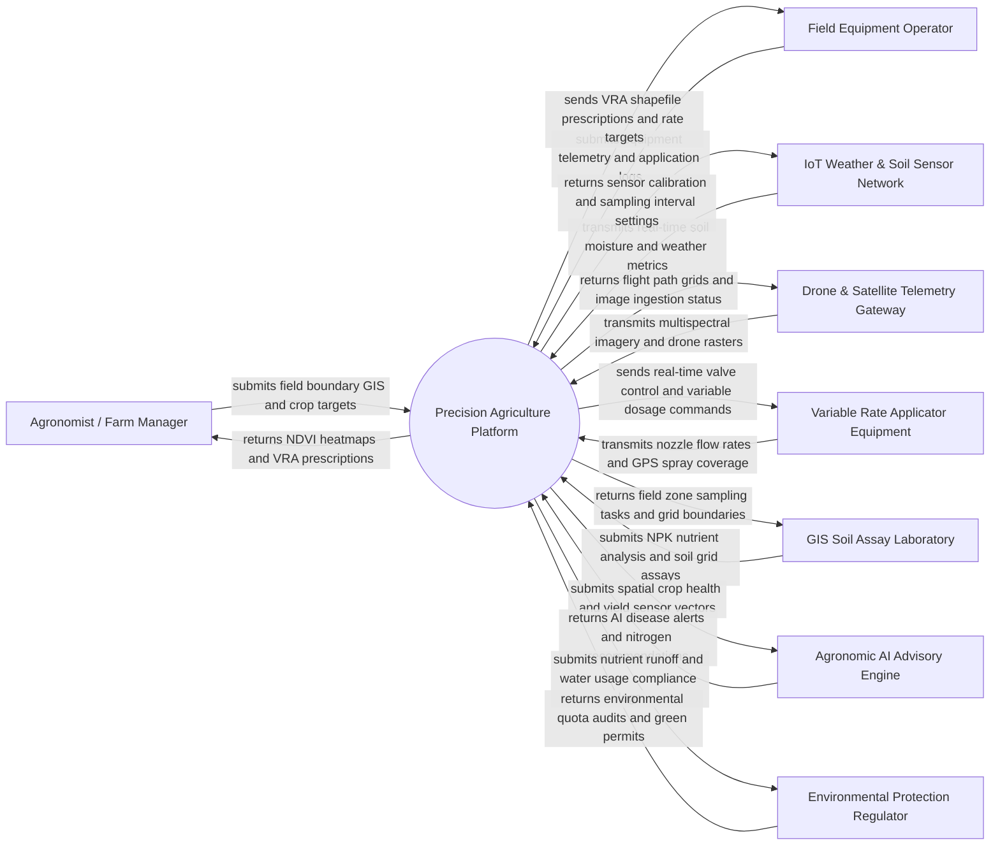

# Context Diagram — Precision Agriculture Platform

## Mermaid Code

## Actor & Interaction Table | Bang Actor & Tuong tac

| # | Actor | Actor Type | Data Sent TO System | Data Received FROM System | Notes |
|---|-------|------------|---------------------|---------------------------|-------|
| 1 | Agronomist / Farm Manager | Primary | Field GIS boundaries, management zones, target yield goals, crop variety profiles | Multispectral NDVI maps, Variable Rate Application (VRA) maps, economic ROI reports | Certified agronomist making precision farming decisions and input application plans |
| 2 | Field Equipment Operator | Primary | Tractor/sprayer telemetry logs, field task execution status, manual application overrides | VRA prescription shapefiles, real-time rate control targets, field coverage guidance | Operator driving precision tractors, smart sprayers, and fertilizer spreaders |
| 3 | IoT Weather & Soil Sensor Network | Supporting System | Soil moisture, EC electrical conductivity, soil temperature, leaf wetness, weather station data | Sensor sampling rate configs, battery health diagnostics, threshold alarm parameters | Distributed ground sensors and micro-weather stations deployed across farm fields |
| 4 | Drone & Satellite Telemetry Gateway | Supporting System | Multispectral aerial imagery (NIR, RedEdge, RGB), satellite Sentinel/Planet imagery rasters | Automated flight path grid boundaries, image upload receipts, processing status | UAV drones equipped with multispectral cameras and commercial satellite data feeds |
| 5 | Variable Rate Applicator Equipment | Supporting System | Actual nozzle flow rates, chemical application GPS points, section control status | ISO-BUS rate prescription commands, automatic section shutoff signals | Smart agricultural machinery capable of dynamically varying fertilizer/pesticide dosage |
| 6 | GIS Soil Assay Laboratory | Supporting System | Laboratory soil grid assay results (Nitrogen, Phosphorus, Potassium, pH, Organic Matter) | Soil grid sampling task maps, soil sample ID barcodes, lab analysis requests | Certified soil testing lab analyzing physical grid soil core samples |
| 7 | Agronomic AI Advisory Engine | Supporting System | Predictive crop disease models, yield optimization algorithms, pest risk indicators | Spatial soil nutrient layers, historical weather series, crop growth stage metrics | Cloud-based machine learning engine computing agronomic recommendations |
| 8 | Environmental Protection Regulator | Regulatory System | Regional nitrate runoff limits, water abstraction quotas, conservation compliance rules | Farm environmental compliance reports, water usage logs, chemical application audits | State environmental authority enforcing sustainable farming regulations |

## System Boundary Description | Mo ta Pham vi He thong

The **Precision Agriculture Platform** is a spatial decision-support and IoT telemetry system designed to optimize agricultural inputs (fertilizer, water, pesticides) on a sub-field management zone basis. The system boundary includes GIS field boundary mapping, soil grid sample data management, multispectral drone/satellite NDVI processing, automated Variable Rate Application (VRA) prescription generation, real-time IoT weather and soil telemetry ingestion, ISO-BUS machine telematics integration, and environmental compliance reporting. Excluded from the system boundary are physical tractor engine mechanics, drone hardware flight control mechanics, chemical reagent synthesis in soil laboratories, and commercial commodity market trading. The platform communicates via ISO-11783 (ISOBUS) standards, OGC geospatial REST APIs, and MQTT sensor protocols to achieve site-specific precision crop management.
