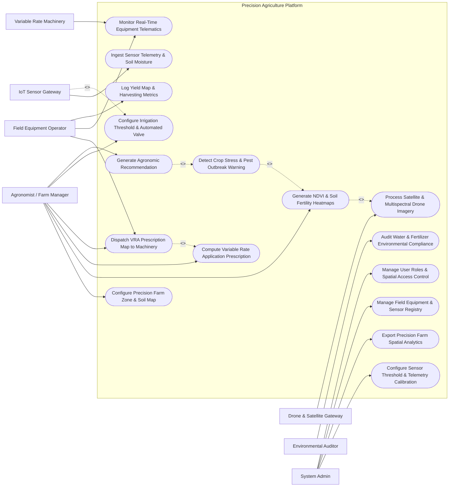

# Use Case Diagram — Precision Agriculture Platform

## Mermaid Code

## Actor Table | Bang Actor

| # | Actor | Actor Type | Role Description | Related Use Cases |
|---|-------|------------|------------------|-------------------|
| 1 | Agronomist / Farm Manager | Primary | Defines field management zones, analyzes crop vigor heatmaps, generates VRA maps, sets irrigation thresholds | UC01, UC04, UC05, UC06, UC09, UC11 |
| 2 | Field Equipment Operator | Primary | Loads VRA prescription maps into tractor terminals, executes smart spraying tasks, monitors yield maps during harvest | UC06, UC07, UC08 |
| 3 | IoT Sensor Gateway | System | Automatically streams micro-climate weather metrics, soil moisture readings, and EC sensor data | UC02, UC09 |
| 4 | Drone & Satellite Gateway | System | Ingests multispectral GeoTIFF imagery from UAV flights and Sentinel-2 satellite tiles | UC03, UC04 |
| 5 | Variable Rate Machinery | System | Receives ISOBUS VRA prescriptions, executes dynamic rate spraying, feeds back telemetry logs | UC06, UC07 |
| 6 | Environmental Auditor | Secondary | Inspects farm nitrogen runoff logs, water extraction metrics, and ecological compliance certificates | UC12 |
| 7 | System Admin | Administrator | Configures IoT sensor thresholds, manages machine device registries, provisions geospatial permissions | UC13, UC14, UC15, UC16 |

## Use Case Table | Bang Use Case

| # | UC ID | Use Case Name | Primary Actor | Secondary Actor | Description | Priority |
|---|-------|---------------|---------------|-----------------|-------------|----------|
| 1 | UC01 | Configure Precision Farm Zone & Soil Map | Agronomist / Farm Manager | System Admin | Digitizes field GIS polygons and establishes sub-field management zones based on soil EC | High |
| 2 | UC02 | Ingest Sensor Telemetry & Soil Moisture | IoT Sensor Gateway | None | Continuously records soil moisture, temperature, EC, and weather station metrics | High |
| 3 | UC03 | Process Satellite & Multispectral Drone Imagery | Drone & Satellite Gateway | None | Ingests NIR, RedEdge, and RGB raster images, performing radiometric calibration and orthomosaicing | High |
| 4 | UC04 | Generate NDVI & Soil Fertility Heatmaps | Agronomist / Farm Manager | Drone & Satellite Gateway | Computes Normalized Difference Vegetation Index (NDVI) and spatial soil nutrient raster layers | High |
| 5 | UC05 | Compute Variable Rate Application Prescription | Agronomist / Farm Manager | Agronomic AI Engine | Calculates site-specific nitrogen/water/pesticide dosage maps based on NDVI and soil deficit | High |
| 6 | UC06 | Dispatch VRA Prescription Map to Machinery | Agronomist / Farm Manager | Field Equipment Operator | Converts VRA prescription maps into ISO-XML / Shapefile format and transmits to tractor terminal | High |
| 7 | UC07 | Monitor Real-Time Equipment Telematics | Field Equipment Operator | Variable Rate Machinery | Displays real-time tractor speed, nozzle pressure, chemical flow rate, and GPS spray coverage | Medium |
| 8 | UC08 | Log Yield Map & Harvesting Metrics | Field Equipment Operator | None | Records combine harvester grain yield sensors, moisture content, and spatial harvest yield maps | High |
| 9 | UC09 | Configure Irrigation Threshold & Automated Valve | Agronomist / Farm Manager | IoT Sensor Gateway | Sets soil moisture trigger points for automated precision drip/pivot irrigation valve controls | Medium |
| 10 | UC10 | Detect Crop Stress & Pest Outbreak Warning | System (Automated) | Agronomist | Identifies rapid NDVI drops or thermal anomalies indicating crop disease or water stress | High |
| 11 | UC11 | Generate Agronomic Recommendation | Agronomist / Farm Manager | Agronomic AI Engine | Generates actionable field intervention recommendations for nitrogen top-dressing or fungicide | High |
| 12 | UC12 | Audit Water & Fertilizer Environmental Compliance | Environmental Auditor | System Admin | Generates official spatial reports on nitrogen application limits and water conservation compliance | Medium |
| 13 | UC13 | Configure Sensor Threshold & Telemetry Calibration | System Admin | IoT Sensor Gateway | Sets sensor ping frequencies, battery alert parameters, and soil sensor calibration formulas | Low |
| 14 | UC14 | Export Precision Farm Spatial Analytics | System Admin | Agronomist | Exports GeoTIFF, Shapefile, and PDF analytical reports on yield, input costs, and vigor history | Medium |
| 15 | UC15 | Manage Field Equipment & Sensor Registry | System Admin | None | Registers smart tractors, sprayers, drones, and soil probes with hardware IDs and ISOBUS specs | High |
| 16 | UC16 | Manage User Roles & Spatial Access Control | System Admin | None | Configures role-based access control (RBAC) and spatial boundary permissions for farm staff | High |

## Use Case Specification | Dac ta Use Case

---

### UC04 — Generate NDVI & Soil Fertility Heatmaps

| Field | Detail |
|-------|--------|
| **UC ID** | UC04 |
| **Use Case Name** | Generate NDVI & Soil Fertility Heatmaps |
| **Actor(s)** | Primary: Agronomist / Farm Manager   Secondary: Drone & Satellite Gateway |
| **Description** | Processes ingested multispectral drone or satellite imagery to calculate vegetation indices (NDVI, NDRE, EVI) and generate high-resolution spatial crop vigor and soil fertility heatmaps. |
| **Precondition** | 1. Field GIS boundary polygon is registered in UC01.   2. Multispectral raster image tile is uploaded and calibrated via UC03. |
| **Main Flow** | 1. Agronomist selects target field and date range in the Spatial Analytics portal.   2. System retrieves calibrated Near-Infrared (NIR) and Red spectral bands for selected field boundary.   3. System executes raster math formula: $NDVI = \frac{NIR - RED}{NIR + RED}$ for every pixel grid cell.   4. System applies false-color legend (Red = low vigor/stress, Yellow = moderate, Green = high vigor).   5. System overlays soil lab NPK grid data to produce composite soil fertility layer.   6. System displays interactive pan/zoom spatial heatmap on field GIS map.   7. Agronomist saves raster layer and approves it for VRA prescription generation. |
| **Alternative Flow** | **AF1** — NDRE Calculation for Dense Canopy: Agronomist selects RedEdge band index (NDRE) for late-stage dense corn crop to avoid NDVI saturation.   **AF2** — Historical Vigor Comparison: Agronomist selects side-by-side split screen view comparing current NDVI against same crop stage last season. |
| **Exception Flow** | **EX1** — Cloud Cover Interference: If satellite raster contains >20% cloud shadow pixels, System flags contaminated pixels and prompts user to use drone raster.   **EX2** — Alignment Error: If raster coordinate reference system (CRS) mismatches field boundary CRS, System performs auto-reproject to EPSG:4326. |
| **Postcondition** | Validated NDVI raster layer is stored in spatial database, indexed by field ID and date, ready for VRA computation. |
| **Business Rule** | **BR1**: Spatial resolution of drone-derived heatmaps must be equal or finer than 10cm/pixel; satellite heatmaps must be 10m/pixel (Sentinel-2). |

---

### UC05 — Compute Variable Rate Application (VRA) Prescription

| Field | Detail |
|-------|--------|
| **UC ID** | UC05 |
| **Use Case Name** | Compute Variable Rate Application Prescription |
| **Actor(s)** | Primary: Agronomist / Farm Manager   Secondary: Agronomic AI Advisory Engine |
| **Description** | Calculates site-specific variable fertilizer, seed, or chemical application rate maps based on NDVI crop vigor zones, soil nutrient deficits, and target yield goals. |
| **Precondition** | 1. Field management zones (UC01) and active NDVI heatmap (UC04) exist.   2. Agronomist has defined target chemical/fertilizer product (e.g., Urea 46% N). |
| **Main Flow** | 1. Agronomist opens the VRA Prescription Builder module and selects field management zones.   2. System retrieves latest NDVI layer and soil nitrogen grid assay values.   3. Agronomist enters target yield (e.g., 8.5 tons/hectare) and selects prescription algorithm (e.g., Nitrogen Crop Need Model).   4. System computes required nitrogen dosage per sub-zone: Zone 1 (High Vigor) = 80 kg/ha, Zone 2 (Moderate Vigor) = 120 kg/ha, Zone 3 (Low Vigor/Soil Deficit) = 160 kg/ha.   5. System generates spatial polygon shapefile with target application rate attributes for each grid cell.   6. System calculates total projected chemical volume and cost summary.   7. Agronomist reviews, adjusts rate boundaries if needed, and approves VRA prescription. |
| **Alternative Flow** | **AF1** — Variable Seed Density Prescription: Agronomist generates variable seeding rate map (e.g., 65,000 to 85,000 seeds/ha) based on soil organic matter zones. |
| **Exception Flow** | **EX1** — Maximum Dosage Exceeded: If calculated rate in any zone exceeds environmental safety threshold (e.g., >220 kg N/ha), System clamps dosage and issues environmental compliance warning.   **EX2** — Missing Soil Data: If soil test data is older than 24 months, System flags prescription as "Unverified Soil Baseline" requiring agronomist confirmation. |
| **Postcondition** | VRA Prescription map is generated, digitally signed by agronomist, and locked for machine dispatch. |
| **Business Rule** | **BR1**: VRA prescription rate zones must conform to minimum width matching tractor boom width (e.g., 18m, 24m, or 36m). |

---

### UC06 — Dispatch VRA Prescription Map to Machinery

| Field | Detail |
|-------|--------|
| **UC ID** | UC06 |
| **Use Case Name** | Dispatch VRA Prescription Map to Machinery |
| **Actor(s)** | Primary: Agronomist / Farm Manager   Secondary: Field Equipment Operator, Variable Rate Machinery |
| **Description** | Converts an approved VRA prescription map into machine-readable ISOBUS ISO-XML or ESRI Shapefile format and dispatches it wirelessly to smart tractor terminals. |
| **Precondition** | 1. VRA prescription map is approved (UC05).   2. Target tractor/sprayer machine is registered and online in UC15. |
| **Main Flow** | 1. Agronomist selects target VRA prescription map and clicks "Dispatch to Machine".   2. System selects target field tractor (e.g., `TRACTOR-JOHN-DEERE-01`) and terminal model.   3. System converts GIS prescription polygons into standard ISO 11783-10 (ISO-XML TaskData) format.   4. System transmits ISO-XML file via telemetry cellular link to machine terminal.   5. Machine terminal acknowledges receipt and verifies file integrity.   6. Field Equipment Operator receives task alert on tractor terminal screen, reviews rate map, and accepts task.   7. System updates task status to "Dispatched & Loaded on Machine". |
| **Alternative Flow** | **AF1** — USB Transfer Mode: If tractor cellular gateway is offline, System exports ISO-XML onto USB flash drive format for manual terminal loading. |
| **Exception Flow** | **EX1** — Machine Incompatibility Error: If target sprayer does not support multi-rate section control, System warns user and simplifies prescription into 2 rate zones.   **EX2** — Telemetry Transmission Failure: If cellular connection drops, System retries dispatch with exponential backoff and alerts operator. |
| **Postcondition** | VRA map is loaded into tractor rate controller ready for field execution. |
| **Business Rule** | **BR1**: All wireless machine transmissions must conform strictly to ISOBUS Task Controller (TC-BAS / TC-GEO) standard specifications. |

---

### UC09 — Configure Irrigation Threshold & Automated Valve

| Field | Detail |
|-------|--------|
| **UC ID** | UC09 |
| **Use Case Name** | Configure Irrigation Threshold & Automated Valve |
| **Actor(s)** | Primary: Agronomist / Farm Manager   Secondary: IoT Sensor Gateway |
| **Description** | Sets volumetric water content (VWC) moisture thresholds to trigger automated precision drip or center-pivot irrigation valve opening and closing. |
| **Precondition** | 1. Field zone has installed ground soil moisture probes linked to IoT gateway (UC02).   2. Automated solenoid irrigation valves are registered in system. |
| **Main Flow** | 1. Agronomist selects field zone and opens Precision Irrigation Controller page.   2. System displays live soil moisture profile across depths (10cm, 30cm, 60cm).   3. Agronomist sets Lower Trigger Threshold (e.g., VWC < 18% = Management Allowed Depletion point) and Upper Stop Threshold (VWC > 32% = Field Capacity).   4. Agronomist sets maximum daily water volume quota (e.g., 25 m³/ha).   5. System commits threshold parameters to edge IoT irrigation controller.   6. When IoT soil probe reports VWC < 18%, System automatically sends signal to open target zone solenoid valve.   7. System monitors VWC increase and automatically sends signal to close valve when VWC reaches 32% or max quota is hit. |
| **Alternative Flow** | **AF1** — Weather Forecast Integration: If rain forecast (>15mm within 12 hours) is received via weather API, System automatically delays irrigation trigger by 24 hours. |
| **Exception Flow** | **EX1** — Valve Sensor Fault: If moisture probe does not show VWC increase after 45 minutes of open valve command, System shuts valve, triggers Pipe Leak/Burst Alert, and emails manager.   **EX2** — Water Quota Exceeded: If daily water allocation is exhausted, System blocks valve activation and prompts manager override. |
| **Postcondition** | Automated precision irrigation rule is active, preventing over-watering and crop drought stress. |
| **Business Rule** | **BR1**: Automated valve activations must incorporate rain-delay logic to eliminate redundant irrigation. |

---

### UC10 — Detect Crop Stress & Pest Outbreak Warning

| Field | Detail |
|-------|--------|
| **UC ID** | UC10 |
| **Use Case Name** | Detect Crop Stress & Pest Outbreak Warning |
| **Actor(s)** | Primary: System (Automated)   Secondary: Agronomist / Farm Manager |
| **Description** | Automatically analyzes spatial NDVI drop trends, thermal camera anomalies, and weather humidity patterns to detect early crop disease, pest infestation, or drought stress. |
| **Precondition** | 1. Periodic NDVI imagery (UC04) and IoT weather series (UC02) are continuously updated. |
| **Main Flow** | 1. System automated background worker initiates weekly Spatial Anomaly Detection job for all active farm fields.   2. System calculates pixel-by-pixel NDVI change delta ($\Delta NDVI = NDVI_{current} - NDVI_{prior\_week}$).   3. System identifies spatial clusters where $\Delta NDVI < -0.15$ (indicative of sudden leaf chlorosis or defoliation).   4. System cross-references local IoT weather data (high humidity >85% + temperature 22°C-28°C favoring fungal pathogens).   5. System computes Disease Risk Score (e.g., Fungal Blight Risk = 88% High).   6. System generates spatial Crop Stress Alert Polygon on manager dashboard.   7. System sends instant SMS and push notification to Agronomist with field scouting GPS coordinates. |
| **Alternative Flow** | **AF1** — Thermal Stress Detection: System analyzes drone thermal infrared (TIR) layer; elevated canopy temperature indicates stomatal closure and severe water drought stress. |
| **Exception Flow** | **EX1** — False Positive Hail/Harvest Filter: If rapid NDVI drop occurs across 100% of field simultaneously, System cross-checks harvest log or hail report to avoid false disease alarm. |
| **Postcondition** | Early crop stress warning is logged, spatial hazard boundary is pinpointed, and scouting task dispatched. |
| **Business Rule** | **BR1**: Spatial anomaly detection algorithms must trigger alert within 6 hours of processing new aerial imagery. |
