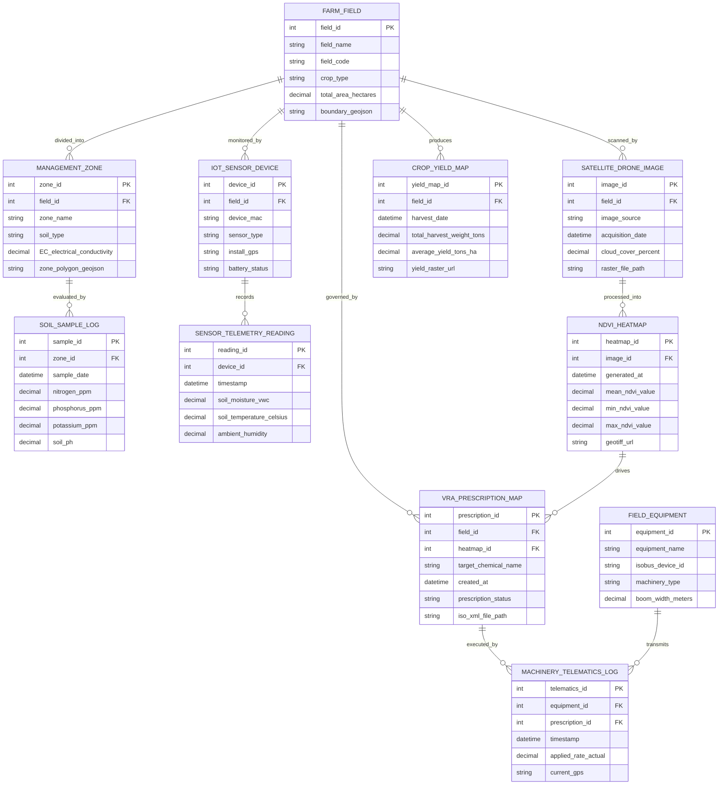

# Conceptual ERD — Precision Agriculture Platform

## Mermaid Code

## Entity Description Table | Bang mo ta Entity

| # | Entity Name | Vietnamese Name | Description | Key Attributes | Main Relationships |
|---|-------------|-----------------|-------------|----------------|-------------------|
| 1 | FARM_FIELD | Thua Dat Nong Nghiep | Represents a physical agricultural field boundary with GIS polygon coordinates | field_id, field_name, crop_type, total_area, boundary_geojson | Divided into MANAGEMENT_ZONE, monitored by IOT_SENSOR_DEVICE, scanned by SATELLITE_DRONE_IMAGE |
| 2 | MANAGEMENT_ZONE | Vung Quan Ly Chinh Xac | Sub-field spatial management zone grouped by soil EC, elevation, or fertility | zone_id, field_id, zone_name, EC_electrical_conductivity, zone_polygon_geojson | Belongs to FARM_FIELD, evaluated by SOIL_SAMPLE_LOG |
| 3 | SOIL_SAMPLE_LOG | Nhat Ky Mau Dat | Laboratory grid soil core analysis recording Nitrogen, Phosphorus, Potassium, and pH | sample_id, zone_id, sample_date, nitrogen_ppm, phosphorus_ppm, soil_ph | Belongs to MANAGEMENT_ZONE |
| 4 | IOT_SENSOR_DEVICE | Thiet Bi Cam Bien IoT | Ground-based wireless telemetry sensor hardware deployed in field | device_id, field_id, device_mac, sensor_type, install_gps | Belongs to FARM_FIELD, records SENSOR_TELEMETRY_READING |
| 5 | SENSOR_TELEMETRY_READING | Du Lieu Cam Bien Thoi Gian Thuc | High-frequency periodic readings of soil moisture, temperature, and micro-climate | reading_id, device_id, timestamp, soil_moisture_vwc, ambient_humidity | Belongs to IOT_SENSOR_DEVICE |
| 6 | SATELLITE_DRONE_IMAGE | Anh Ve Tinh va Drone | Raw or orthomosaiced multispectral raster imagery tile | image_id, field_id, image_source, acquisition_date, raster_file_path | Belongs to FARM_FIELD, processed into NDVI_HEATMAP |
| 7 | NDVI_HEATMAP | Ban Do Nhiet Chi So Suc Khoe Cay | Computed raster heatmap layer displaying spatial NDVI crop vigor values | heatmap_id, image_id, generated_at, mean_ndvi_value, geotiff_url | Belongs to SATELLITE_DRONE_IMAGE, drives VRA_PRESCRIPTION_MAP |
| 8 | VRA_PRESCRIPTION_MAP | Ban Do Ke Hoach Bieu Lieu Variable Rate | Spatial application prescription map defining target fertilizer/chemical rates per zone | prescription_id, field_id, heatmap_id, target_chemical_name, iso_xml_file_path | Belongs to FARM_FIELD, driven by NDVI_HEATMAP, executed by MACHINERY_TELEMATICS_LOG |
| 9 | FIELD_EQUIPMENT | Thiet Bi May Moc Dong Rai | Smart agricultural machinery (tractor, sprayer, spreader) with ISOBUS rate controller | equipment_id, equipment_name, isobus_device_id, boom_width_meters | Transmits MACHINERY_TELEMATICS_LOG |
| 10 | MACHINERY_TELEMATICS_LOG | Nhat Ky Telematics May Moc | Real-time rate controller telemetry recording actual applied chemical dosage and GPS | telematics_id, equipment_id, prescription_id, timestamp, applied_rate_actual | Belongs to FIELD_EQUIPMENT and VRA_PRESCRIPTION_MAP |
| 11 | CROP_YIELD_MAP | Ban Do Nang Suat Thu Hoach | Spatial yield sensor map recorded by combine harvester during crop harvest | yield_map_id, field_id, harvest_date, total_harvest_weight_tons, yield_raster_url | Belongs to FARM_FIELD |

## Relationship Description | Mo ta Quan he

| # | From Entity | Cardinality | To Entity | Relationship Label | Business Explanation |
|---|-------------|-------------|-----------|-------------------|----------------------|
| 1 | FARM_FIELD | one-to-many | MANAGEMENT_ZONE | divided_into | Mot thua dat duoc chia thành nhieu vung quan ly chinh xac dua tren dac tinh dat |
| 2 | FARM_FIELD | one-to-many | IOT_SENSOR_DEVICE | monitored_by | Mot thua dat duoc theo doi bang nhieu thiet bi cam bien dat va thoi tiet |
| 3 | FARM_FIELD | one-to-many | SATELLITE_DRONE_IMAGE | scanned_by | Mot thua dat duoc chup va quet nhieu lan bang ve tinh hoac drone multispectral |
| 4 | FARM_FIELD | one-to-many | VRA_PRESCRIPTION_MAP | governed_by | Mot thua dat duoc ap dung nhieu ban do ke hoach phun/bon phan bien lieu qua cac dot |
| 5 | FARM_FIELD | one-to-many | CROP_YIELD_MAP | produces | Mot thua dat tao ra cac ban do nang suat qua tung vu thu hoach |
| 6 | MANAGEMENT_ZONE | one-to-many | SOIL_SAMPLE_LOG | evaluated_by | Mot vung quan ly duoc danh gia qua nhieu lan lay mau va phan tich hoa hoc dat |
| 7 | IOT_SENSOR_DEVICE | one-to-many | SENSOR_TELEMETRY_READING | records | Mot thiet bi cam bien ghi nhan nhieu luot du lieu thoi gian thuc theo chu ky |
| 8 | SATELLITE_DRONE_IMAGE | one-to-many | NDVI_HEATMAP | processed_into | Mot anh multispectral duoc xu ly thanh cac ban do nhiet chi so NDVI va vegetation index |
| 9 | NDVI_HEATMAP | one-to-many | VRA_PRESCRIPTION_MAP | drives | Mot ban do NDVI duoc dung lam co so tinh toan nhieu ban do ke hoach VRA |
| 10 | VRA_PRESCRIPTION_MAP | one-to-many | MACHINERY_TELEMATICS_LOG | executed_by | Mot ban do VRA duoc thuc thi va ghi nhan telematics boi nhieu luot phun cua may moc |
| 11 | FIELD_EQUIPMENT | one-to-many | MACHINERY_TELEMATICS_LOG | transmits | Mot thiet bi may moc truyen nhieu luot du lieu telematics toc do va liem luong phun |
