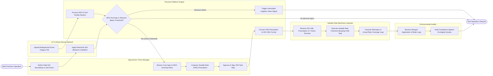

# Swimlane Diagram — Precision Agriculture Platform

## Mermaid Code

## Flow Description | Mo ta luong

| Lane | Actor | Role in Flow |
|------|-------|-------------|
| 1 | Agronomist / Farm Manager | Defines field GIS boundaries, monitors crop vigor alerts, computes VRA chemical prescriptions, and signs task maps. |
| 2 | IoT & Drone Sensor Network | Collects real-time ground soil moisture/weather data and captures high-resolution multispectral aerial imagery. |
| 3 | Precision Platform Engine | Core analytics engine computing NDVI rasters, evaluating anomaly thresholds, firing automated irrigation signals, and rendering ISO-XML maps. |
| 4 | Variable Rate Machinery Operator | Loads ISO-XML task files onto tractor terminals, drives field spraying routes, and streams actual applied rate telematics. |
| 5 | Environmental Auditor | Inspects logged chemical application rates and water extraction volumes to verify compliance with environmental conservation rules. |
