# Action Tree — Precision Agriculture Platform

## Mermaid Code

```mermaid
graph TD
    Root["Precision Agriculture Platform"]

    Root --> M1["Spatial Field & Soil Zone Management"]
    Root --> M2["IoT Telemetry & Remote Sensing"]
    Root --> M3["Agronomic Intelligence & VRA Engine"]
    Root --> M4["Machinery Telematics & Dispatch"]
    Root --> M5["Yield Mapping & Environmental Audit"]
    Root --> M6["Admin & Sensor Calibration"]

    M1 --> A1["Digitize Field GIS Polygon Boundaries"]
    M1 --> A2["Create Management Zones by Soil EC"]
    M1 --> A3["Import Soil Grid Laboratory Assays"]
    M1 --> A4["Configure Management Zone Soil Targets"]

    M2 --> B1["Ingest IoT Soil Moisture & Weather Feeds"]
    M2 --> B2["Process Multispectral Drone Orthomosaics"]
    M2 --> B3["Compute NDVI & NDRE Vegetation Heatmaps"]
    M2 --> B4["Trigger Automated Crop Stress Warnings"]

    M3 --> C1["Calculate Variable Nitrogen Prescriptions"]
    M3 --> C2["Generate Variable Seeding Rate Maps"]
    M3 --> C3["Set Irrigation Soil Moisture Thresholds"]
    M3 --> C4["Generate AI Agronomic Recommendations"]

    M4 --> D1["Convert Prescriptions to ISO-XML TaskData"]
    M4 --> D2["Dispatch Task Files Wireless to Tractor"]
    M4 --> D3["Monitor Real-time Sprayer Rate Control"]
    M4 --> D4["Log Section Shutoff & Coverage Mapping"]

    M5 --> E1["Ingest Combine Harvester Yield Sensors"]
    M5 --> E2["Generate Spatial Crop Yield Heatmaps"]
    M5 --> E3["Export Nitrogen Runoff & Water Audits"]
    M5 --> E4["Calculate Field Input Economic ROI"]

    M6 --> F1["Register Smart Tractors & Sprayers"]
    M6 --> F2["Calibrate Soil Moisture Probe Formulas"]
    M6 --> F3["Manage Spatial Permission RBAC Roles"]
    M6 --> F4["Configure Sensor Battery & Ping Alerts"]
```

## Module Description | Mo ta Module

| # | Module | Description | Actions |
|---|--------|-------------|---------|
| 1 | Spatial Field & Soil Zone Management | Digitize field GIS boundaries, establish sub-field management zones, and manage laboratory soil core analysis data. | Digitize GIS Boundaries, Create Management Zones, Import Soil Assays, Configure Soil Targets |
| 2 | IoT Telemetry & Remote Sensing | Ingest real-time ground soil probe readings, process multispectral drone rasters, and compute NDVI vegetation health indices. | Ingest Telemetry, Process Drone Orthomosaics, Compute NDVI Heatmaps, Trigger Stress Warnings |
| 3 | Agronomic Intelligence & VRA Engine | Calculate variable rate fertilizer, seed, and chemical application maps based on crop need models and configure smart irrigation. | Calculate VRA Prescriptions, Generate Seeding Maps, Set Irrigation Thresholds, Generate AI Recommendations |
| 4 | Machinery Telematics & Dispatch | Convert prescription maps to ISOBUS ISO-XML standards, dispatch wirelessly to tractor terminals, and monitor real-time rate application. | Convert to ISO-XML, Dispatch Task Files, Monitor Sprayer Control, Log Coverage Mapping |
| 5 | Yield Mapping & Environmental Audit | Import combine harvester spatial yield sensor logs, generate yield maps, calculate economic ROI, and produce compliance reports. | Ingest Yield Sensors, Generate Yield Heatmaps, Export Environmental Audits, Calculate Field ROI |
| 6 | Admin & Sensor Calibration | Maintain machine hardware registries, calibrate soil probe mathematical formulas, and manage role-based spatial permissions. | Register Smart Machinery, Calibrate Sensor Formulas, Manage Spatial RBAC, Configure Sensor Alerts |
