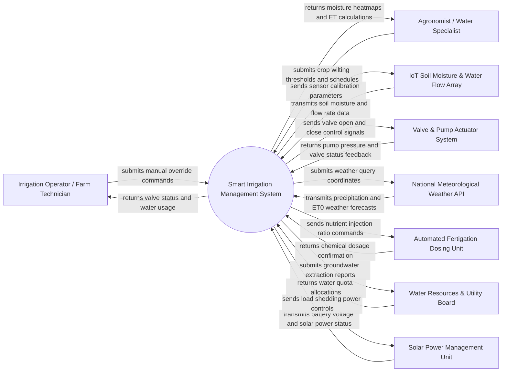

# Context Diagram — Smart Irrigation Management System

## Mermaid Code

## Actor & Interaction Table | Bang Actor & Tuong tac

| # | Actor | Actor Type | Data Sent TO System | Data Received FROM System | Notes |
|---|-------|------------|---------------------|---------------------------|-------|
| 1 | Irrigation Operator / Farm Technician | Primary | Manual override commands, emergency shutoff signals, valve maintenance logs | Live valve status, flow rate meters, pipe pressure alerts, water consumption | Field technician executing manual overrides and maintaining hydraulic hardware |
| 2 | Agronomist / Water Specialist | Primary | Target soil moisture percentages, crop wilting coefficients, irrigation calendars | Moisture spatial heatmaps, evapotranspiration (ET0) metrics, water efficiency reports | Expert user defining plant water requirements and scheduling algorithms |
| 3 | IoT Soil Moisture & Water Flow Array | Supporting System | Volumetric water content (VWC), soil temperature, water line flow rate readings | Telemetry polling intervals, sensor zero-point calibration commands | Wireless sensor nodes (LoRaWAN/Zigbee) buried across field zones |
| 4 | Valve & Pump Actuator System | Supporting System | Pump motor RPM, line pressure (PSI), solenoid valve open/close confirmation feedback | Digital pulse signals for valve open/close, pump start/stop relays | Electric solenoid valves, variable-frequency drive (VFD) water pumps |
| 5 | National Meteorological Weather API | Supporting System | 7-day rainfall forecasts, solar radiation, humidity, ambient temperature, wind speed | Geo-location query parameters, forecast refresh requests | External weather service providing real-time precipitation and climate data |
| 6 | Automated Fertigation Dosing Unit | Supporting System | Chemical tank levels, fertilizer injection flow rate, electrical conductivity (EC), pH readings | Fertigation pulse ratio commands, nutrient mix start/stop triggers | Automated dosing manifold injecting liquid NPK fertilizers into irrigation lines |
| 7 | Water Resources & Utility Board | Regulatory System | Groundwater extraction quotas, seasonal water restriction notices | Daily/monthly water consumption reports, aquifer draw-down metrics | Government environmental agency monitoring regional water conservation compliance |
| 8 | Solar Power Management Unit | Supporting System | Battery state of charge (SoC), solar panel output wattage, bus voltage | Load-shedding commands, non-essential pump shutdown triggers | Off-grid solar photovoltaic power system supplying electricity to valves and pumps |

## System Boundary Description | Mo ta Pham vi He thong

The **Smart Irrigation Management System** is an automated precision agriculture platform engineered to optimize field water distribution, calculate crop evapotranspiration, control solenoid valves, and prevent water waste. The system boundary encompasses real-time soil moisture telemetry processing, closed-loop irrigation scheduling algorithms, automated fertigation chemical dosing, pipe leak detection, and off-grid solar power management. Outside the system boundary are physical pipe plumbing installation, raw electric motor manufacturing, third-party weather satellite operation, and physical aquifer hydrogeology. The system communicates with field hardware over LoRaWAN and Modbus RTU protocols, while integrating with external cloud APIs for weather data and regulatory reporting.
