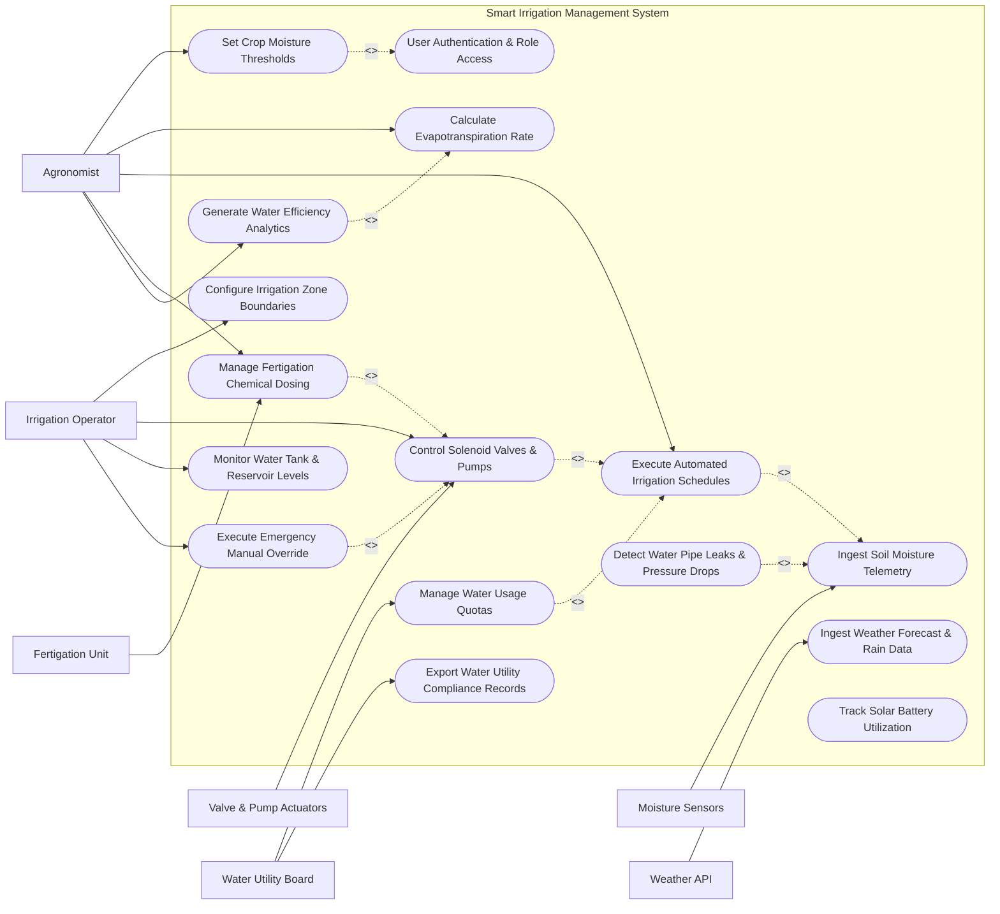

# Use Case Diagram — Smart Irrigation Management System

## Mermaid Code

## Actor Table | Bang Actor

| # | Actor | Actor Type | Role Description | Related Use Cases |
|---|-------|------------|------------------|-------------------|
| 1 | Irrigation Operator | Primary | Configures field zones, operates solenoid valves, monitors water tanks, and executes manual overrides during emergencies | UC01, UC02, UC08, UC11, UC12 |
| 2 | Agronomist | Primary | Sets target soil moisture limits, defines ET calculation parameters, programs fertigation ratios, and analyzes water efficiency | UC02, UC03, UC05, UC07, UC09, UC15 |
| 3 | Moisture Sensors | Secondary | Transmits real-time soil volumetric water content and temperature telemetry over wireless LoRaWAN links | UC04, UC10 |
| 4 | Valve & Pump Actuators | Secondary | Executes hardware switching relays to open/close solenoid valves and start/stop hydraulic pumps | UC08 |
| 5 | Weather API | System | Provides 7-day precipitation forecasts, solar radiation metrics, and humidity data to adjust watering volumes | UC06 |
| 6 | Fertigation Unit | Secondary | Controls liquid nutrient injection pumps to blend liquid fertilizer into active irrigation streams | UC09 |
| 7 | Water Utility Board | System | Monitors groundwater draw-down rates, enforces regional extraction limits, and receives compliance logs | UC14, UC16 |

## Use Case Table | Bang Use Case

| # | UC ID | Use Case Name | Primary Actor | Secondary Actor | Description | Priority |
|---|-------|---------------|---------------|-----------------|-------------|----------|
| 1 | UC01 | Configure Irrigation Zone Boundaries | Irrigation Operator | Agronomist | Maps field parcels into distinct hydraulic zones, specifying pipe diameters and emitter types | High |
| 2 | UC02 | User Authentication & Role Access | Irrigation Operator | Agronomist | Secures system access using multi-factor authentication and role-based operational permissions | High |
| 3 | UC03 | Set Crop Moisture Thresholds | Agronomist | None | Defines field capacity, target moisture percentage, and permanent wilting point per crop stage | High |
| 4 | UC04 | Ingest Soil Moisture Telemetry | Moisture Sensors | Irrigation Operator | Ingests continuous volumetric water content (VWC) data from multi-depth soil sensors | High |
| 5 | UC05 | Calculate Evapotranspiration Rate | Agronomist | Weather API | Computes daily Reference Evapotranspiration (ET0) and Crop Evapotranspiration (ETc) using Penman-Monteith equation | High |
| 6 | UC06 | Ingest Weather Forecast & Rain Data | Weather API | Agronomist | Automatically checks incoming rain probability to delay scheduled irrigation cycles when rain is imminent | High |
| 7 | UC07 | Execute Automated Irrigation Schedules | Agronomist | Moisture Sensors | Calculates required water volume (liters) and automatically queues irrigation events when soil moisture falls below threshold | High |
| 8 | UC08 | Control Solenoid Valves & Pumps | Irrigation Operator | Valve & Pump Actuators | Sends digital open/close commands to field solenoid valves and activates water pressure booster pumps | High |
| 9 | UC09 | Manage Fertigation Chemical Dosing | Agronomist | Fertigation Unit | Injects precise ratios of liquid NPK fertilizers into irrigation water lines based on electrical conductivity (EC) | Medium |
| 10 | UC10 | Detect Water Pipe Leaks & Pressure Drops | Moisture Sensors | Irrigation Operator | Compares water flow rate meters against valve status to detect pipe bursts or emitter clogging | High |
| 11 | UC11 | Monitor Water Tank & Reservoir Levels | Irrigation Operator | Valve & Pump Actuators | Tracks water storage tank levels and automatically activates well pumps to prevent reservoir depletion | High |
| 12 | UC12 | Execute Emergency Manual Override | Irrigation Operator | Valve & Pump Actuators | Allows operators to manually open/close valves via mobile app or physical hardware bypass, overriding automated schedules | High |
| 13 | UC13 | Track Solar Battery Utilization | Irrigation Operator | None | Monitors off-grid solar panel power generation, battery charge levels, and manages pump energy loads | Medium |
| 14 | UC14 | Manage Water Usage Quotas | Water Utility Board | Agronomist | Enforces maximum daily groundwater extraction caps to comply with regional water conservation laws | High |
| 15 | UC15 | Generate Water Efficiency Analytics | Agronomist | None | Compiles spatial water application maps, crop yield per drop metrics, and water savings reports | Medium |
| 16 | UC16 | Export Water Utility Compliance Records | Water Utility Board | Irrigation Operator | Formats monthly groundwater extraction logs into official government regulatory audit files | Medium |

## Use Case Specification | Dac ta Use Case

---

### UC04 — Ingest Soil Moisture Telemetry

| Field | Detail |
|-------|--------|
| **UC ID** | UC04 |
| **Use Case Name** | Ingest Soil Moisture Telemetry |
| **Actor(s)** | Primary: Moisture Sensors / Secondary: Irrigation Operator |
| **Description** | Continuously receives wireless telemetry packets from multi-depth soil sensors, converts raw sensor capacitance into Volumetric Water Content (VWC %), and updates zone moisture dashboards. |
| **Precondition** | 1. Soil moisture sensors are installed, calibrated, and registered in UC01.   2. Wireless LoRaWAN gateway is online and receiving sensor packets. |
| **Main Flow** | 1. Field soil sensors wake up on a pre-programmed 15-minute interval.   2. Sensors measure raw soil dielectric permittivity at 15cm, 30cm, and 60cm depths.   3. Wireless LoRaWAN node transmits encrypted telemetry payload containing VWC %, soil temperature, and battery voltage.   4. System receives payload, decrypts packet, and applies soil calibration curves (sand/clay/loam adjustment).   5. System calculates average root-zone moisture percentage for target zone.   6. System updates live spatial moisture heatmap and stores reading in time-series database. |
| **Alternative Flow** | **AF1** — Deep Moisture Priority Calculation: For deep-rooted crops (e.g., fruit trees), System calculates weighted average giving 60% importance to 60cm depth sensor.   **AF2** — High-Frequency Sampling Mode: During active irrigation execution (UC08), System commands sensors to increase polling rate from 15 minutes to 2 minutes for real-time saturation tracking. |
| **Exception Flow** | **EX1** — Low Battery Warning: Sensor node transmits battery voltage <3.2V. System logs "Sensor Battery Low Warning" and alerts technician to replace lithium battery.   **EX2** — Sensor Communication Dropout: If no telemetry is received for 3 consecutive intervals (45 mins), System flags zone as "Telemetry Offline" and pauses automated schedule triggers for that zone. |
| **Postcondition** | Root-zone soil moisture level is calculated, updated on dashboard, and evaluated against irrigation trigger thresholds (UC07). |
| **Business Rule** | **BR1**: Volumetric water content readings must be calibrated according to specific soil texture classifications (sand, silt, clay).   **BR2**: Offline sensor zones must default to weather-based ET estimation until hardware connection is restored. |

---

### UC07 — Execute Automated Irrigation Schedules

| Field | Detail |
|-------|--------|
| **UC ID** | UC07 |
| **Use Case Name** | Execute Automated Irrigation Schedules |
| **Actor(s)** | Primary: Agronomist / Secondary: Moisture Sensors |
| **Description** | Calculates precise water volume deficit for field zones, verifies weather forecasts, and automatically queues irrigation events when soil moisture drops below pre-set threshold limits. |
| **Precondition** | 1. Soil moisture telemetry is active (UC04).   2. Moisture thresholds (Management Allowable Depletion - MAD) are configured (UC03). |
| **Main Flow** | 1. System evaluates zone soil moisture against Management Allowable Depletion (MAD) threshold (e.g., VWC <22%).   2. System detects moisture deficit in Zone 3 requiring 15,000 liters of water to restore field capacity.   3. System checks 24-hour weather forecast API (UC06) for rain probability.   4. If rain probability is <30%, System calculates required irrigation run-time based on zone emitter flow rate (e.g., 45 minutes at 330 L/min).   5. System checks main reservoir water tank level (UC11) and solar power availability (UC13).   6. System schedules and dispatches valve control signals (UC08) for Zone 3. |
| **Alternative Flow** | **AF1** — Rain Delay Cancellation: At step 3, weather forecast indicates >70% probability of >10mm rainfall within 6 hours. System delays irrigation schedule by 12 hours and logs "Rain Delay Triggered".   **AF2** — Night Irrigation Preference: System is configured to irrigate during off-peak night hours to minimize evaporation losses. System holds scheduled event until 22:00 window. |
| **Exception Flow** | **EX1** — Low Reservoir Interlock: If main water reservoir is below 15% capacity, System halts automated schedule execution, triggers "Water Source Depleted" alarm, and notifies operator.   **EX2** — Daily Water Quota Exceeded: If executing schedule would exceed daily groundwater extraction cap (UC14), System caps run-time to remaining quota limit and logs compliance alert. |
| **Postcondition** | Irrigation execution command is sent to valve actuators, run-time is logged, and water volume consumption is deducted from daily quota. |
| **Business Rule** | **BR1**: Irrigation scheduling must prioritize night/early morning hours (22:00 - 06:00) to reduce wind drift and evaporative losses by up to 30%.   **BR2**: Simultaneous valve operations must not exceed hydraulic pump capacity limits. |

---

### UC08 — Control Solenoid Valves & Pumps

| Field | Detail |
|-------|--------|
| **UC ID** | UC08 |
| **Use Case Name** | Control Solenoid Valves & Pumps |
| **Actor(s)** | Primary: Irrigation Operator / Secondary: Valve & Pump Actuators |
| **Description** | Transmits digital relay signals to open/close 24V AC/DC solenoid valves and start/stop hydraulic pressure booster pumps according to scheduled or manual commands. |
| **Precondition** | 1. Automated schedule trigger (UC07) or Manual override command (UC12) is initiated.   2. Hardware relay controllers are online and connected via Modbus/RS485 or LoRaWAN. |
| **Main Flow** | 1. System sends "Start Pump" command to main booster pump variable frequency drive (VFD).   2. VFD ramps up pump motor to target operating pressure (40 PSI).   3. System sends "Open Valve" signal to solenoid valve actuator for Zone 3.   4. Valve actuator opens and returns digital status confirmation "Zone 3 Open".   5. System monitors flow meter to confirm active water movement (e.g., 330 liters/minute).   6. Upon completion of timer duration (45 mins), System sends "Close Valve" signal, confirms closure, and ramps down pump motor. |
| **Alternative Flow** | **AF1** — Sequential Zone Rotation: System opens Valve 4 two minutes before closing Valve 3 to prevent hydraulic water hammer pressure spikes in supply pipes.   **AF2** — Variable Flow Rate Adjustment: System detects reduced soil absorption rate, signals VFD pump to reduce pressure by 15%, slowing drip emitter output. |
| **Exception Flow** | **EX1** — Valve Actuator Failure: Valve fails to return "Open Confirmation" signal within 10 seconds of command. System immediately shuts off booster pump, triggers "Valve Hardware Failure" alert, and flags Zone 3.   **EX2** — No-Flow Dry Run Alert: Pump starts but flow meter registers zero water movement for 30 seconds (priming loss or dry well). System trips pump emergency interlock to prevent pump motor burn-out. |
| **Postcondition** | Hydraulic valves and pumps complete irrigation cycle safely, actual water volume is metered, and execution log is saved. |
| **Business Rule** | **BR1**: Solenoid valves must incorporate a 30-second staggered overlap sequence during multi-zone switching to prevent water hammer damage.   **BR2**: Hydraulic pumps must trip safety shutoff within 15 seconds of detecting zero flow (dry run prevention). |

---

### UC09 — Manage Fertigation Chemical Dosing

| Field | Detail |
|-------|--------|
| **UC ID** | UC09 |
| **Use Case Name** | Manage Fertigation Chemical Dosing |
| **Actor(s)** | Primary: Agronomist / Secondary: Fertigation Unit |
| **Description** | Controls automated chemical dosing pumps to inject liquid NPK fertilizers and acid conditioners into the active irrigation water stream based on Electrical Conductivity (EC) and pH targets. |
| **Precondition** | 1. Irrigation valve for target zone is actively open and flowing (UC08).   2. Liquid fertilizer tanks contain adequate chemical volume. |
| **Main Flow** | 1. System checks agronomist fertigation prescription for Zone 3 (e.g., Target EC = 2.2 mS/cm, Target pH = 6.0).   2. System activates Venturi injector pumps to pulse liquid NPK fertilizer into main water line.   3. Downstream EC and pH sensors continuously sample the fertigated water stream.   4. System modulates dosing pump pulse frequency using PID control loops to maintain target EC and pH levels.   5. System completes prescribed chemical dosage volume (e.g., 5.0 liters NPK concentrate).   6. System flushes irrigation lines with clean water for 5 minutes post-fertigation to clear chemical residue from drip emitters. |
| **Alternative Flow** | **AF1** — Organic Acid pH Adjustment: System detects alkaline water source (pH >7.8), activates secondary acid dosing pump to inject citric acid until pH reaches target 6.2.   **AF2** — Proportional Volume Dosing: System adjusts dosing pump speed dynamically in response to fluctuating water main flow rates to maintain constant chemical ratio. |
| **Exception Flow** | **EX1** — EC Hyper-Salinity Spike: Downstream EC sensor detects dangerous salinity spike (>3.5 mS/cm). System instantly trips fertigation dosing pump, opens fresh water bypass valve, and alerts agronomist.   **EX2** — Chemical Tank Empty: Tank level sensor registers empty fertilizer reservoir. System halts dosing, logs "Nutrient Tank Depleted", and continues clean water irrigation cycle. |
| **Postcondition** | Liquid fertilizer is accurately injected, line flush cycle is completed, and applied chemical volumes are recorded in crop nutrient logs. |
| **Business Rule** | **BR1**: Fertigation cycles must always end with a minimum 5-minute fresh water flush to prevent fertilizer crystallization in drip emitters.   **BR2**: Maximum allowable chemical injection rate must be hard-capped in system firmware to prevent crop root chemical burn. |

---

### UC10 — Detect Water Pipe Leaks & Pressure Drops

| Field | Detail |
|-------|--------|
| **UC ID** | UC10 |
| **Use Case Name** | Detect Water Pipe Leaks & Pressure Drops |
| **Actor(s)** | Primary: Moisture Sensors / Secondary: Irrigation Operator |
| **Description** | Analyzes differential pressure readings and flow rate meter anomalies to detect main line pipe bursts, lateral line leaks, or clogged drip emitters, triggering automated isolation valves. |
| **Precondition** | 1. Water flow meters and inline pressure sensors are installed on supply mains.   2. Baseline flow rates for active zones are established. |
| **Main Flow** | 1. System monitors main line flow rate meter during active irrigation of Zone 3.   2. System compares live flow rate (e.g., 520 L/min) against baseline expected flow rate for Zone 3 (330 L/min).   3. System detects +57% flow surge accompanied by a sudden pressure drop from 40 PSI to 18 PSI.   4. System identifies major pipe rupture anomaly on Zone 3 supply line.   5. System immediately closes main supply valve, shuts down booster pump, and isolates Zone 3.   6. System sends high-priority "PIPE BURST ALERT — ZONE 3 ISOLATED" SMS to Irrigation Operator with GPS break coordinates. |
| **Alternative Flow** | **AF1** — Minor Lateral Leak Detection: Flow rate shows subtle +8% elevation over 3 consecutive cycles. System flags "Possible Lateral Pipe Micro-Leak" for routine maintenance inspection.   **AF2** — Clogged Emitter Detection: Flow rate drops by 25% below baseline while line pressure rises. System alerts operator of "Emitter Clogging Anomaly". |
| **Exception Flow** | **EX1** — False Positive Pressure Transients: Water hammer creates instantaneous 1-second pressure drop. System uses 5-second moving average filter to ignore transient spikes and prevent false trips.   **EX2** — Flow Sensor Fault: Flow meter returns negative or erratic values. System logs "Flow Sensor Fault" and switches to secondary pressure sensor differential logic. |
| **Postcondition** | Ruptured pipe section is automatically isolated, water loss is prevented, and maintenance alert ticket is dispatched to field crew. |
| **Business Rule** | **BR1**: Flow rate anomalies exceeding +30% above baseline must trigger automated line isolation within 10 seconds.   **BR2**: Pipe leak detection algorithms must ignore transient pressure fluctuations during the first 15 seconds of valve opening. |
